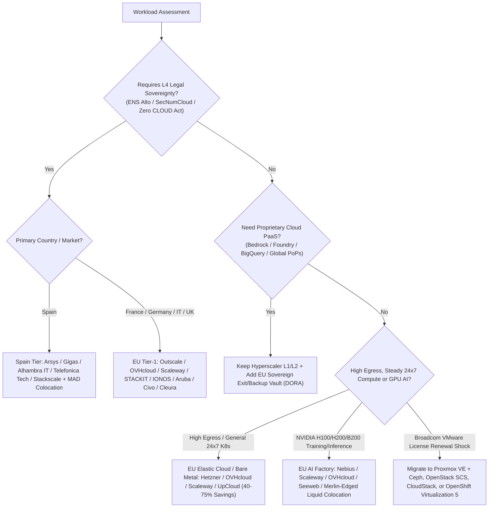

# European Sovereign Cloud and Private Data Centers

!!! tip "Nubenetes V2 Elite Portal"
    You are browsing the AI-Curated V2 Elite Edition. Looking for the exhaustive list of references? Check out the [**V1 Historical Archive**](/v1/eu-sovereign-cloud/).

!!! info "Architectural Context"
    Detailed reference for European Sovereign Cloud and Private Data Centers in the context of European Sovereign Cloud & Private DCs.

!!! abstract "Deep-Dive Topic Pages"
    [Spain Sovereign Cloud & Private DCs](eu-cloud-spain.md) · [France & Germany Cloud Champions](eu-cloud-france-germany.md) · [Italy, UK, Nordics & Benelux](eu-cloud-italy-uk-nordics.md) · [IaC Automation & Maturity vs Hyperscalers](eu-cloud-iac-maturity.md) · [Hypervisors, IaaS, K8s & Sovereign AI](eu-cloud-workloads-stack.md) · [RPO, RTO, SLAs, DRP & Replication](eu-cloud-resilience-sla.md) · [Public Cloud Comparisons](public-cloud-solutions.md)

## Executive Architecture: European Sovereign Cloud vs US Hyperscalers (2026)

1. [The 4 Levels of Cloud Sovereignty](#the-4-levels-of-cloud-sovereignty)
2. [EU Regulatory and Compliance Justification Matrix](#eu-regulatory-and-compliance-justification-matrix)
3. [Pre-Sales Architecture Decision Flow](#pre-sales-architecture-decision-flow)
4. [EUR Cost and TCO Benchmarks vs Hyperscalers](#eur-cost-and-tco-benchmarks-vs-hyperscalers)
5. [When Does Each Cloud Tier Win (Pre-Sales Playbook)](#when-does-each-cloud-tier-win-pre-sales-playbook)

### The 4 Levels of Cloud Sovereignty

!!! warning "Pre-Sales Distinction: European Region != European Sovereignty"
    Deploying in **AWS Madrid (`eu-south-2`)**, **Azure `Spain Central`**, or **GCP Madrid (`europe-southwest1`)** satisfies **Level 1 (Data Residency)**, but US-headquartered hyperscalers remain legally subject to **US extraterritorial statutes (US CLOUD Act / FISA 702)**. Pre-sales architects MUST classify every workload into one of four maturity levels before recommending a provider:

| Level | Sovereignty Tier | Technical and Legal Guarantees | Example Providers and Architectures |
| :---: | :--- | :--- | :--- |
| **L1** | **Data Residency Only** | Data physically stored inside EU/Spain borders; US parent retains control plane and legal compulsion exposure. | Standard AWS (`eu-south-2`), Azure (`Spain Central`), GCP (`europe-southwest1`) |
| **L2** | **Operational Sovereignty** | Data + control-plane staff isolated inside the EU; local audit logs; customer-approvable support access (BYOK). | **AWS European Sovereign Cloud (Brandenburg)**, Google Sovereign Controls, Telefonica + Google Data Boundary |
| **L3** | **Cryptographic Sovereignty (HYOK)** | Hardware HSM keys held outside cloud provider perimeter (**Hold Your Own Key** / Confidential Computing); provider cannot decrypt payloads. | **S3NS** (Thales + GCP), **Bleu** (Capgemini/Orange Azure), **Arsys / IONOS KMS + HSM**, private HSM + Kubernetes |
| **L4** | **Full Legal and Jurisdictional Sovereignty** | **100% EU-headquartered, EU-owned legal entity**, EU operations, EU physical DCs; zero non-EU parent exposure + national security clearance. | **Spain:** Arsys, Gigas, Alhambra IT, Stackscale · **FR:** Outscale (SecNumCloud 3.2), OVHcloud, Scaleway, Cloud Temple · **DE:** STACKIT, IONOS, Hetzner · **IT:** Aruba (ACN QC3), Seeweb · **CH/SE:** Exoscale, Cleura, Elastx |

### EU Regulatory and Compliance Justification Matrix

| Regulation / Standard | Deadline and Scope | Mandatory Technical Requirements | Impact on Cloud Selection (Pre-Sales Justification) |
| :--- | :--- | :--- | :--- |
| **GDPR + Schrems II** | Active (All EU personal data) | Lawful transfer mechanism; Supplementary Measures; sub-processor transparency. | Eliminates cross-border legal friction when using L4 EU-owned providers in Spain/FR/DE. |
| **DORA (EU 2022/2554)** | Enforced since **Jan 17, 2025** (Banking, Insurance, Critical ICT) | Full ICT Third-Party register; **Articles 28–30 mandatory tested Exit Plans**; **Concentration Risk** avoidance; pen-testing (TLPT). | Justifies **multi-provider architecture** (e.g., primary on Hyperscaler or Spanish DC + tested warm DR/exit on EU Sovereign Cloud using OpenTofu/Velero). |
| **NIS2 Directive** | Enforced (Energy, Health, Telco, Digital Infra, MSPs) | Supply-chain risk governance, 24h incident reporting, verified backup segmentation, zero unpatched exposure. | Mandates immutable offsite backups and verified regional MSP certifications (**ENS Medio/Alto**, **ISO 27001**, **BSI C5**). |
| **EU Data Act (EU 2023/2854)** | Switching cap now; **Zero switching fees on Jan 12, 2027** (Art. 29) | Open APIs for functional portability; free migration egress on cloud exit. **Note:** ongoing daily internet egress stays billable! | Use **zero-egress EU clouds** (OVHcloud, Scaleway free tiers, Hetzner 20 TB, Stackscale, Alhambra IT) when daily outbound traffic drives hyperscaler bill shock. |
| **EU AI Act** | Phased 2025–2027 (High-risk AI, foundation models) | Data lineage, model card documentation, sovereign training/inference auditability, privacy-preserving RAG. | Favors **Nebius, Scaleway, OVHcloud, Seeweb, Civo UK, Telefonica/MareNostrum 5**, or private on-prem GPU clusters for sensitive corporate weights/RAG. |
| **ENS Alto (Spain)** | Mandatory for Spanish Public Sector and supply chain | 75+ strict CCN-CERT controls (Confidentiality, Integrity, Traceability, Authenticity, Availability) audited locally. | **Arsys, Gigas, Alhambra IT, Telefonica Tech** win Spanish public tenders immediately over generic global hosting. |
| **SecNumCloud 3.2 (France)** | ANSSI highest EU sovereign standard | Strict non-EU ownership shareholding cap (<24% aggregated non-EU) + French operational isolation. | **3DS Outscale** (full scope), **OVHcloud Bare Metal / Hosted Private Cloud**, **Cloud Temple**; Bleu and S3NS targeting 3.2 Parity. |
| **BSI C5 Type 2 (Germany)** | German Federal Cloud baseline | Continuous annual audited security controls across compute, storage, IAM, and physical facilities. | **IONOS Cloud, STACKIT, Open Telekom Cloud, PlusServer** (plus AWS ESC). |
| **ACN QC3 / AI3 (Italy)** | Mandatory for Italian Public Administration & critical AI | Italian National Cybersecurity Agency cloud & AI workload qualification levels. | **Aruba Cloud** (QC3 + AI3), **Polo Strategico Nazionale (PSN)**, **Seeweb**. |

### Pre-Sales Architecture Decision Flow

### EUR Cost and TCO Benchmarks vs Hyperscalers

*Indicative 2026 monthly production run-rate comparisons (EUR/month, list on-demand/committed baselines without opaque enterprise NDA discounts):*

| Workload Scenario | Reference Spec (24x7 Monthly) | US Hyperscaler Baseline (AWS / Azure / GCP EU) | EU Tier-1 Alternative (OVHcloud / Scaleway / Hetzner / STACKIT) | Spanish Sovereign MSP (Arsys / Gigas / Alhambra / Stackscale) | Pre-Sales Savings & Commercial Root Cause |
| :--- | :--- | :--- | :--- | :--- | :--- |
| **1. Production Kubernetes Cluster (Medium SaaS)** | 6x 8 vCPU / 32 GB nodes + 2 TB NVMe block + 2 LBs + **25 TB outbound egress** | **EUR 3,450 – 4,200 / mo** *(~EUR 2,100 egress alone at ~EUR 0.085/GB!)* | **EUR 420 – 1,050 / mo** *(Hetzner Cloud EUR 420; OVH MKS ~EUR 850 zero egress)* | **EUR 1,150 – 1,950 / mo** *(Includes local L3 managed SLA & ENS Alto)* | **55–88% cheaper** — EU providers eliminate hyperscaler egress taxes and control-plane fees. |
| **2. Legacy VMware Consolidation (Post-Broadcom)** | 128 physical cores, 2 TB RAM, 80 TB NVMe SAN (100+ VMs) | **EUR 9,500 – 14,000 / mo** *(VMware on Hyperscaler or IaaS refactor)* | **EUR 3,200 – 5,500 / mo** *(Bare Metal Proxmox VE + Ceph or OpenStack KVM)* | **EUR 4,500 – 7,800 / mo** *(Managed VCSP / Sovereign Private Cloud EUR/month OPEX)* | **45–68% cheaper** — avoids Broadcom VCF core-bundle shock via Proxmox/OpenStack or MSP pooled VCSP licensing. |
| **3. Private Enterprise RAG and vLLM Inference Node** | 1x dedicated 8x NVIDIA H100 (80 GB) node + 10 TB NVMe + 50 TB egress | **EUR 24,000 – 32,000 / mo** *(p5/NDv5 on-demand + data transfer)* | **EUR 11,500 – 16,500 / mo** *(Nebius / Scaleway / OVHcloud H100)* | **EUR 13,000 – 18,500 / mo** *(Liquid-cooled colocation or Seeweb/AI partner lease)* | **45–55% cheaper** with sovereign model-weight residency and zero cross-region prompt leakage. |
| **4. 100 TB Sovereign Backup & WORM Vault** | 100 TB S3 Object Storage with Object Lock (immutability) + 3x full DR restores/yr | **EUR 2,400 – 3,100 / mo** + **EUR 2,500+ per restore test** | **EUR 600 – 900 / mo** *(OVH / Scaleway / Hetzner S3 Object Storage)* | **EUR 950 – 1,500 / mo** *(Arsys / Alhambra / Gigas ENS Alto S3)* | **60–75% cheaper** and makes **DORA quarterly restore tests** financially viable. |

### When Does Each Cloud Tier Win (Pre-Sales Playbook)

| Customer Scenario | Winning Choice | Why It Wins | Pre-Sales Red Flag to Surface Early |
| :--- | :--- | :--- | :--- |
| **Spanish Ministry, Town Hall, Hospital, or Public Contractor** | **Arsys, Gigas, Alhambra IT, or Telefonica Tech VDC** | Turnkey **ENS Alto**, Spanish contract/billing, 24x7 Spanish L3 engineering, fast public-tender compliance. | Do not pitch raw Hetzner (lacks ENS Alto) unless wrapped inside an ENS Alto certified Spanish MSP layer. |
| **Bank / FinTech / Insurer Under DORA** | **Dual-Cloud (Hyperscaler + L4 EU Secondary, or Telefonica + OVH/Alhambra/STACKIT)** | Satisfies DORA Art. 28–30 **exit plan** & eliminates single-vendor concentration risk. | Beware claiming "2 AZs inside 1 hyperscaler region" satisfies DORA exit — regulators require cross-provider portability. |
| **High-Bandwidth SaaS, Streaming, CDN Origin, or AI Dataset Hub** | **OVHcloud, Scaleway, Hetzner, or Stackscale** | Zero or massively included egress eliminates 50–80% of monthly cloud bills. | Verify inter-region vs internet egress fine print (some providers meter inter-DC private vRack/trunking differently). |
| **Pure GitOps / Kubernetes Platform Team (Terraform + Argo + Talos)** | **Scaleway, OVHcloud, STACKIT, IONOS, Exoscale, or Hetzner** | Mature OpenTofu/CAPI providers (75–85% parity) + Managed K8s or bare metal with Talos Linux. | Confirm OIDC workload identity and BGP LoadBalancer automation before committing to zero-touch pipelines. |
| **Enterprise With Heavy Serverless / Event-Driven / BigQuery Dependency** | **Keep AWS / Azure / GCP** (+ S3 sovereign EU backup vault) | Managed PaaS depth (Lambda, DynamoDB, BigQuery, Foundry/Bedrock) saves 3–6 FTE platform engineers. | Never underestimate the refactoring cost of proprietary managed DBs/queues during a rushed "lift-and-exit" pitch. |

## Cloud Benchmarks

### Pricing Analysis

#### Public Cloud

  - **(2026)** [cloud-mercato.com: Public Cloud Reference 🌟](https://pcr.cloud-mercato.com)  [COMMUNITY-TOOL] — An analytical comparative service assessing the VM performance, network throughput, and real-time operational costs of global hyperscalers. It helps platform architects make data-driven infrastructure decisions. Live grounding confirms its status as a vital neutral reference for multi-cloud benchmark analysis.
## Data Sovereignty

### Regulatory Ecosystems

#### Gaia-x Core

  - **(2026)** [Gaia-X.eu](https://gaia-x.eu) [ADVANCED LEVEL]  [COMMUNITY-TOOL] [SOVEREIGN-EU] — Official portal for Gaia-X, a European initiative seeking to establish unified requirements for an open, secure, and federated data architecture. Curated as a data sovereignty system; live grounding reflects its transition from theoretical architectural documents to real-world deployment of Gaia-X Compliance Engines.
## EU Regulatory Frameworks GDPR DORA NIS2 EU Data Act

  - **(2026)** [Regulation (EU) 2022/2554: Digital Operational Resilience Act (DORA)](https://eur-lex.europa.eu/eli/reg/2022/2554/oj) 🌟🌟🌟 [EMERGING] [SOVEREIGN-EU] — EU financial sector regulation enforcing strict ICT third-party risk management, concentration-risk assessments, mandatory tested exit strategies (Articles 28–30), and incident reporting for cloud providers.
  - **(2026)** [Regulation (EU) 2023/2854: The EU Data Act](https://eur-lex.europa.eu/eli/reg/2023/2854/oj) 🌟🌟🌟 [EMERGING] [SOVEREIGN-EU] — Binding European regulation mandating cloud interoperability, open switching APIs, capped switching charges during transition, and complete elimination of cloud switching/migration egress fees by January 12, 2027 (Article 29).
## France and Germany Cloud Champions

### French Sovereign Cloud Providers Secnumcloud And AI Factories

  - **(2026)** [Bleu Trusted Cloud (Capgemini and Orange)](https://www.bleucloud.fr/en) 🌟🌟🌟 [EMERGING] [SOVEREIGN-EU] — Independent French company operating sovereign Azure-stack and Microsoft 365 environments within France to address SecNumCloud 3.2 criteria for public administrations.
  - **(2026)** [S3NS Trusted Cloud (Thales and Google)](https://www.s3ns.io/en) 🌟🌟🌟 [EMERGING] — French trusted-cloud joint venture coupling Thales sovereign operational control and encryption custody with Google Cloud infrastructure.
### German Sovereign Cloud Providers BSI C5 And High-efficiency Bare Metal

  - **(2026)** [AWS European Sovereign Cloud (Brandenburg Baseline)](https://aws.amazon.com/compliance/europe-digital-sovereignty) 🌟🌟🌟 [EMERGING] [SOVEREIGN-EU] — Standalone German sovereign cloud region built by AWS to isolate operational control planes inside the EU while retaining full AWS API compatibility — evaluated against German-owned providers under CLOUD Act considerations.
## Pan-european Sovereign Cloud Initiatives And Standards

  - **(2026)** [CISPE: Cloud Infrastructure Services Providers in Europe](https://cispe.cloud) 🌟🌟🌟 [EMERGING] — Trade association of European cloud infrastructure providers driving fair software licensing principles, GDPR Data Protection Code of Conduct compliance, and anti-lock-in cloud portability standards.
  - **(2026)** [European Alternatives](https://european-alternatives.eu) 🌟🌟🌟 [EMERGING] — Curated directory cataloging EU-owned, GDPR-compliant alternatives to non-European cloud hosting, SaaS, object storage, and managed Kubernetes platforms.
  - **(2026)** [EuroStack: European Digital Sovereignty Blueprint](https://eurostack.eu) 🌟🌟🌟 [EMERGING] [SOVEREIGN-EU] — Cross-industry European sovereignty initiative mapping strategic dependencies across chips, sovereign cloud IaaS/PaaS, AI models, and open-source software alternatives.
  - **(2026)** [Sovereign Cloud Stack (SCS)](https://scs.community) 🌟🌟🌟 [EMERGING] [HYPERVISOR] [SOVEREIGN-EU] — Open-source European reference stack (OpenStack, Kubernetes, Ceph, IaC standards) backed by OSBA and adopted by German and European sovereign providers such as PlusServer, STACKIT partners, and Cleura to prevent vendor lock-in.
## Spain Sovereign Cloud and Private Dcs

### Spanish National Compliance And Supercomputing

  - **(2026)** [CCN-CERT Esquema Nacional de Seguridad (ENS)](https://ens.ccn.cni.es/en) 🌟🌟🌟 [EMERGING] — Authoritative Spanish cybersecurity standard (Basico, Medio, Alto) required for government agencies, healthcare, banking suppliers, and regulated digital services in Spain.

---
💡 **Explore Related:** [Spain Sovereign Cloud & Private DCs](./eu-cloud-spain.md) | [France & Germany Cloud Champions](./eu-cloud-france-germany.md) | [Italy, UK, Nordics & Benelux](./eu-cloud-italy-uk-nordics.md)

🔗 **See Also:** [Ansible](./ansible.md) | [Container Managers](./container-managers.md)

