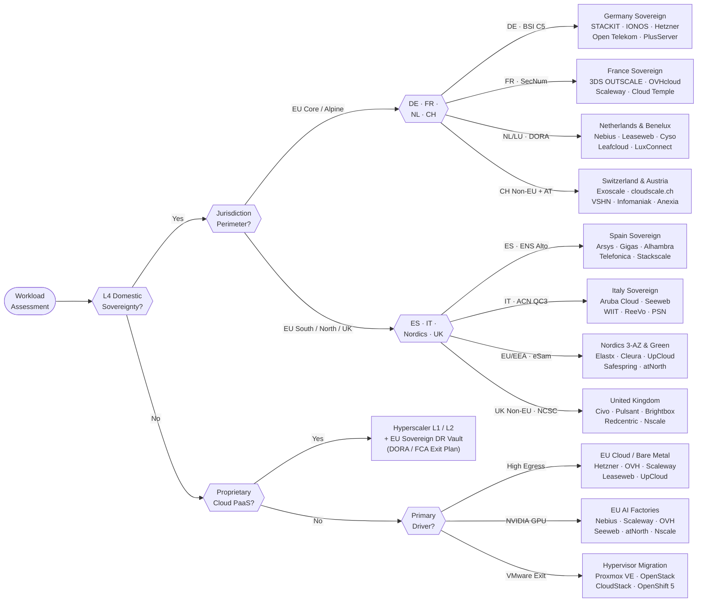

# European Sovereign Cloud and Private Data Centers

!!! tip "Nubenetes V2 Elite Portal"
    You are browsing the AI-Curated V2 Elite Edition. Looking for the exhaustive list of references? Check out the [**V1 Historical Archive**](/v1/eu-sovereign-cloud/).

!!! info "Architectural Context"
    Detailed reference for European Sovereign Cloud and Private Data Centers in the context of European Sovereign Cloud & Private DCs.

!!! abstract "Deep-Dive Topic Pages"
    [Germany Sovereign Cloud & Private DCs](eu-cloud-germany.md) · [France Sovereign Cloud & Private DCs](eu-cloud-france.md) · [Spain Sovereign Cloud & Private DCs](eu-cloud-spain.md) · [Italy Sovereign Cloud & Private DCs](eu-cloud-italy.md) · [Netherlands & Benelux Cloud & DCs](eu-cloud-benelux.md) · [Switzerland & Austria (Alpine Sovereign)](eu-cloud-switzerland-dach.md) · [Nordics Green Cloud & AI Factories](eu-cloud-nordics.md) · [United Kingdom Sovereign Cloud & DCs](eu-cloud-uk.md) · [IaC Automation & Maturity vs Hyperscalers](eu-cloud-iac-maturity.md) · [Hypervisors, IaaS, K8s & Sovereign AI](eu-cloud-workloads-stack.md) · [RPO, RTO, SLAs, DRP & Replication](eu-cloud-resilience-sla.md) · [Neoclouds & GPU AI Clouds](neoclouds.md) · [European Neoclouds & AI Factories](neoclouds-europe.md) · [Public Cloud Comparisons](public-cloud-solutions.md)

## Executive Architecture: European Sovereign Cloud vs US Hyperscalers (2026)

1. [European Country and Regional Pre-Sales Hubs](#european-country-and-regional-pre-sales-hubs)
2. [The 4 Levels of Cloud Sovereignty](#the-4-levels-of-cloud-sovereignty)
3. [EU and Associated European Jurisdictional Boundary (EU/EEA vs Switzerland and UK)](#eu-and-associated-european-jurisdictional-boundary-eueea-vs-switzerland-and-uk)
4. [EU Regulatory and Compliance Justification Matrix](#eu-regulatory-and-compliance-justification-matrix)
5. [Pre-Sales Architecture Decision Flow](#pre-sales-architecture-decision-flow)
6. [EUR Cost and TCO Benchmarks vs Hyperscalers](#eur-cost-and-tco-benchmarks-vs-hyperscalers)
7. [When Does Each Cloud Tier Win (Pre-Sales Playbook)](#when-does-each-cloud-tier-win-pre-sales-playbook)

### European Country and Regional Pre-Sales Hubs

Nubenetes V2 provides dedicated field guides across both the **EU / EEA Legal Perimeter** (`Spain`, `Germany`, `France`, `Italy`, `Benelux`, `Nordics`, `Austria`) and **Associated Non-EU European Sovereign Jurisdictions** (`Switzerland` and `United Kingdom`), with clickable links to every official provider, IXP, and regulator:

  <a class="eu-hub-link" href="/eu-cloud-spain/">
    <article class="eu-hub-card">
      <header>
        🇪🇸
        Spain
        EU · ENS Alto
      </header>
      
Arsys · Gigas · Alhambra IT · Telefonica Tech · Stackscale · ESpanix

      <footer>Explore guide →</footer>
    </article>
  </a>
  <a class="eu-hub-link" href="/eu-cloud-germany/">
    <article class="eu-hub-card">
      <header>
        🇩🇪
        Germany
        EU · BSI C5
      </header>
      
STACKIT · IONOS · Hetzner · Open Telekom · PlusServer · DE-CIX

      <footer>Explore guide →</footer>
    </article>
  </a>
  <a class="eu-hub-link" href="/eu-cloud-france/">
    <article class="eu-hub-card">
      <header>
        🇫🇷
        France
        EU · SecNum 3.2
      </header>
      
OVHcloud · Scaleway · 3DS OUTSCALE · Cloud Temple · Clever Cloud · Marseille

      <footer>Explore guide →</footer>
    </article>
  </a>
  <a class="eu-hub-link" href="/eu-cloud-italy/">
    <article class="eu-hub-card">
      <header>
        🇮🇹
        Italy
        EU · ACN QC3
      </header>
      
Aruba Cloud · Seeweb · WIIT · ReeVo · PSN · MIX Milan

      <footer>Explore guide →</footer>
    </article>
  </a>
  <a class="eu-hub-link" href="/eu-cloud-benelux/">
    <article class="eu-hub-card">
      <header>
        🇳🇱
        Netherlands &amp; Benelux
        EU · AMS-IX · DORA
      </header>
      
Nebius AI · Leaseweb · Cyso · Leafcloud · LuxConnect · Proximus NXT

      <footer>Explore guide →</footer>
    </article>
  </a>
  <a class="eu-hub-link" href="/eu-cloud-nordics/">
    <article class="eu-hub-card">
      <header>
        🇸🇪
        Nordics
        EU/EEA · 3-AZ Green
      </header>
      
Elastx · Cleura · UpCloud · Safespring · Bahnhof · atNorth · Green Mountain

      <footer>Explore guide →</footer>
    </article>
  </a>
  <a class="eu-hub-link" href="/eu-cloud-switzerland-dach/">
    <article class="eu-hub-card">
      <header>
        🇨🇭
        Switzerland &amp; Austria
        CH Non-EU + AT EU
      </header>
      
Exoscale · cloudscale.ch · VSHN APPUiO · Infomaniak · Swisscom · Anexia

      <footer>Explore guide →</footer>
    </article>
  </a>
  <a class="eu-hub-link" href="/eu-cloud-uk/">
    <article class="eu-hub-card">
      <header>
        🇬🇧
        United Kingdom
        Non-EU · NCSC · G-Cloud
      </header>
      
Civo Sovereign · Pulsant · Brightbox · Redcentric · Nscale · Crown Hosting

      <footer>Explore guide →</footer>
    </article>
  </a>

  <a class="eu-hub-link" href="/eu-cloud-iac-maturity/">
    <article class="eu-hub-card">
      <header>
        🏗️
        IaC Automation &amp; Maturity
        OpenTofu · CAPI
      </header>
      
Coverage scorecard vs hyperscalers (100% baseline) and OpenStack/vCD/Proxmox portability

      <footer>Open scorecard →</footer>
    </article>
  </a>
  <a class="eu-hub-link" href="/eu-cloud-workloads-stack/">
    <article class="eu-hub-card">
      <header>
        ⚙️
        Hypervisors, K8s &amp; Sovereign AI
        Post-Broadcom
      </header>
      
Proxmox VE · OpenStack · OpenShift 5 · European NVIDIA H200/B200 AI factories

      <footer>Open stack guide →</footer>
    </article>
  </a>
  <a class="eu-hub-link" href="/eu-cloud-resilience-sla/">
    <article class="eu-hub-card">
      <header>
        🛡️
        RPO, RTO, SLAs &amp; DRP
        DORA Exit
      </header>
      
3-AZ reality check, Veeam/Zerto/PBS/CNPG/Velero and 3-2-1-1-0 ransomware vaults

      <footer>Open resilience guide →</footer>
    </article>
  </a>

| Country / Architecture Hub | Jurisdiction, Regime &amp; Anchor IXP | Top Sovereign Providers &amp; Private DC Ecosystem (Clickable Official Links) | Pre-Sales Deep-Dive |
| :--- | :--- | :--- | :--- |
| **Germany** *(EU)* | [**BSI C5 Type 2**](https://www.bsi.bund.de/EN/Themen/Unternehmen-und-Organisationen/Informationen-und-Empfehlungen/Empfehlungen-nach-Angriffszielen/Cloud-Computing/Kriterienkatalog-C5/kriterienkatalog-c5_node.html), KRITIS, [**TISAX**](https://enx.com/en-US/TISAX) · [**DE-CIX Frankfurt**](https://www.de-cix.net/en) | [**STACKIT**](https://stackit.com/en), [**IONOS**](https://cloud.ionos.com), [**Hetzner**](https://www.hetzner.com/cloud), [**Open Telekom Cloud**](https://www.open-telekom-cloud.com/en), [**PlusServer**](https://www.plusserver.com/en), [**secunet**](https://www.secunet.cloud/en)/[**MetaKube**](https://documentation.syseleven.de), [**noris**](https://www.noris.de/en), [**gridscale**](https://gridscale.io/en), [**Cloud&amp;Heat**](https://www.cloudandheat.com), [**Delos**](https://www.deloscloud.de), [**maincubes**](https://www.maincubes.com/en), [**JUPITER**](https://www.fz-juelich.de/en/jsc/systems/supercomputers/jupiter) | [Germany Sovereign Cloud](/eu-cloud-germany/) |
| **France** *(EU)* | [**ANSSI SecNumCloud 3.2**](https://cyber.gouv.fr/en/secnumcloud-for-cloud-service-providers), [**HDS**](https://esante.gouv.fr/produits-services/cybersecurite/hds) · [**France-IX**](https://www.franceix.net/en) &amp; [**Marseille MRS**](https://www.digitalrealty.com/data-centers/emea/marseille) | [**OVHcloud**](https://www.ovhcloud.com/en-ie), [**Scaleway**](https://www.scaleway.com/en), [**3DS OUTSCALE**](https://en.outscale.com), [**Cloud Temple**](https://www.cloud-temple.com/en), [**Clever Cloud**](https://www.clever.cloud), [**Ikoula**](https://www.ikoula.com/en), [**Bleu**](https://www.bleucloud.fr/en), [**S3NS**](https://www.s3ns.io/en), [**Mistral AI**](https://mistral.ai), [**DATA4**](https://www.data4group.com/en), [**Jean Zay**](https://www.genci.fr/en) | [France Sovereign Cloud](/eu-cloud-france/) |
| **Spain** *(EU)* | [**ENS Alto (RD 311/2022)**](https://ens.ccn.cni.es/en) · [**ESpanix**](https://www.espanix.net/en) | [**Arsys**](https://www.arsys.es/cloud), [**Gigas**](https://gigas.com/en), [**Alhambra IT**](https://alhambrait.com/en), [**Telefonica Tech**](https://telefonicatech.com/en), [**Stackscale**](https://www.stackscale.com), [**Acens**](https://www.acens.com), [**cdmon**](https://www.cdmon.com/en), [**Dinahosting**](https://www.dinahosting.com), [**Merlin-Edged**](https://www.merlinproperties.com/en/data-centers), [**Nabiax**](https://nabiax.com), [**MareNostrum 5**](https://www.bsc.es/marenostrum/marenostrum-5) | [Spain Sovereign Cloud](/eu-cloud-spain/) |
| **Italy** *(EU)* | [**ACN QC3 / AI3**](https://www.acn.gov.it/portale/en/home) · [**MIX Milan**](https://www.mix-it.net/en) | [**Aruba Cloud**](https://www.arubacloud.com), [**Seeweb**](https://www.seeweb.it/en), [**WIIT**](https://www.wiit.cloud/en), [**ReeVo**](https://www.reevo.it/en), [**TIM Enterprise**](https://www.timenterprise.it), [**PSN**](https://www.polostrategiconazionale.it), [**Aruba IT3/IT4**](https://www.datacenter.it), [**Equinix Milan**](https://www.equinix.com/data-centers/europe-colocation/italy-colocation/milan-data-centers), [**CINECA Leonardo**](https://www.eurohpc-ju.europa.eu/supercomputers/our-supercomputers_en) | [Italy Sovereign Cloud](/eu-cloud-italy/) |
| **Netherlands &amp; Benelux** *(EU)* | [**BIO**](https://www.bio-overheid.nl), [**NEN 7510**](https://www.nen.nl/en/certificatie-en-keurmerken-nen-7510), [**CSSF**](https://www.cssf.lu/en) · [**AMS-IX**](https://www.ams-ix.net/ams) | [**Nebius**](https://nebius.com), [**Leaseweb**](https://www.leaseweb.com), [**Cyso Cloud**](https://cyso.com), [**Leafcloud**](https://leafcloud.com), [**TransIP**](https://www.transip.eu), [**Proximus NXT**](https://www.proximusnxt.be/en), [**LuxConnect**](https://www.luxconnect.lu), [**Gcore**](https://gcore.com), [**NorthC**](https://www.northcdatacenters.com/en) | [Netherlands &amp; Benelux](/eu-cloud-benelux/) |
| **Nordics (SE / FI / NO / IS)** *(EU + EEA)* | [**Digg**](https://www.digg.se/en) / `eSam` Schrems II · [**Netnod**](https://www.netnod.se) | [**Elastx**](https://elastx.se/en), [**Cleura**](https://cleura.com), [**UpCloud**](https://upcloud.com/docs), [**GleSYS**](https://glesys.com), [**Safespring**](https://www.safespring.com), [**Bahnhof**](https://bahnhof.se), [**evroc**](https://evroc.com), [**Green Mountain**](https://greenmountain.no), [**atNorth**](https://www.atnorth.com), [**Verne**](https://www.verne.co), [**Bulk**](https://bulkinfrastructure.com), [**LUMI**](https://lumi-supercomputer.eu) | [Nordics Green Cloud](/eu-cloud-nordics/) |
| **Switzerland &amp; Austria** *(CH Non-EU + AT EU)* | [**FINMA**](https://www.finma.ch/en), [**Swiss FADP (`revDSG`)**](https://www.fedlex.admin.ch/eli/cc/2022/491/en) · [**SwissIX**](https://www.swissix.ch) / [**VIX**](https://www.vix.at/en) | [**Exoscale**](https://www.exoscale.com), [**cloudscale.ch**](https://www.cloudscale.ch/en), [**Infomaniak**](https://www.infomaniak.com/en/hosting/public-cloud), [**Swisscom**](https://www.swisscom.ch/en/business/enterprise.html), [**VSHN**](https://www.vshn.ch/en)/[**APPUiO**](https://www.appuio.ch), [**Anexia**](https://anexia.com/en), [**Green Datacenter**](https://www.green.ch/en), [**CSCS Alps**](https://www.cscs.ch/computers/alps) | [Switzerland &amp; Austria](/eu-cloud-switzerland-dach/) |
| **United Kingdom** *(Non-EU · Adequacy)* | [**NCSC 14 Principles**](https://www.ncsc.gov.uk/collection/cloud), [**G-Cloud**](https://www.gov.uk/guidance/g-cloud-buyers-guide), [**UK GDPR**](https://ico.org.uk/for-organisations/uk-gdpr-guidance-and-resources), [**FCA**](https://www.fca.org.uk/firms/operational-resilience) · [**LINX**](https://www.linx.net) | [**Civo**](https://www.civo.com), [**Pulsant**](https://www.pulsant.com), [**Brightbox**](https://www.brightbox.com), [**Redcentric**](https://www.redcentricplc.com), [**Nscale**](https://www.nscale.com), [**ANS Group**](https://www.ans.co.uk), [**Crown Hosting**](https://www.crownhostingdc.co.uk), [**Telehouse**](https://www.telehouse.net), [**Equinix UK**](https://www.equinix.com/data-centers/europe-colocation/united-kingdom-colocation/london-data-centers) | [United Kingdom Sovereign Cloud](/eu-cloud-uk/) |
| **Cross-Cutting Engineering** | Multi-Provider IaC, Post-Broadcom Virtualization, DORA RPO/RTO | [**OpenTofu**](https://opentofu.org), [**Cluster API**](https://cluster-api.sigs.k8s.io), [**Crossplane**](https://www.crossplane.io), [**Proxmox VE**](https://www.proxmox.com/en/products/proxmox-virtual-environment/overview), [**OpenStack**](https://www.openstack.org), [**OpenShift Virtualization**](https://www.redhat.com/en/technologies/cloud-computing/openshift/virtualization), [**Veeam**](https://www.veeam.com), [**Zerto**](https://www.zerto.com), [**CloudNativePG**](https://cloudnative-pg.io), [**Velero**](https://velero.io) | [IaC Maturity](/eu-cloud-iac-maturity/) · [Stacks &amp; AI](/eu-cloud-workloads-stack/) · [RPO/RTO &amp; DRP](/eu-cloud-resilience-sla/) |

### The 4 Levels of Cloud Sovereignty

!!! warning "Pre-Sales Distinction: European Region != European Legal Sovereignty"
    Deploying in **AWS (`Frankfurt` / `Paris` / `Madrid`)**, **Azure (`West Europe` / `France Central` / `Spain Central`)**, or **GCP (`Frankfurt` / `Milan` / `Madrid`)** satisfies **Level 1 (Data Residency)**, but US-headquartered hyperscalers remain legally subject to **US extraterritorial statutes (US CLOUD Act / FISA 702)**. Pre-sales architects MUST classify every workload into one of four maturity levels before recommending a provider:

| Level | Sovereignty Tier | Technical and Legal Guarantees | Example Providers and Architectures (Clickable) |
| :---: | :--- | :--- | :--- |
| **L1** | **Data Residency Only** | Data physically stored inside European borders; US parent retains control plane and legal compulsion exposure. | Standard AWS (`eu-central-1`, `eu-west-3`, `eu-south-2`), Microsoft Azure (`West Europe`, `Spain Central`), Google Cloud (`europe-west3`, `europe-west8`) |
| **L2** | **Operational Sovereignty** | Data + control-plane staff isolated inside the EU; local audit logs; customer-approvable support access (BYOK). | [**AWS European Sovereign Cloud (Brandenburg)**](https://aws.amazon.com/compliance/europe-digital-sovereignty), Google Sovereign Controls, [**Telefonica Tech**](https://telefonicatech.com/en) + Google Data Boundary |
| **L3** | **Cryptographic Sovereignty (HYOK)** | Hardware HSM keys held outside cloud provider perimeter (**Hold Your Own Key** / Confidential Computing); provider cannot decrypt payloads. | [**S3NS**](https://www.s3ns.io/en) (Thales + GCP), [**Bleu**](https://www.bleucloud.fr/en) (Capgemini/Orange Azure), [**Arsys**](https://www.arsys.es/cloud) / [**IONOS**](https://cloud.ionos.com) KMS + HSM, [**Delos Cloud**](https://www.deloscloud.de) |
| **L4 (EU/EEA)** | **Full EU / EEA Jurisdictional Sovereignty** | **100% EU/EEA-headquartered &amp; owned legal entity**, EU operations, EU physical DCs; zero non-EU parent exposure + national clearance. | **DE:** [**STACKIT**](https://stackit.com/en), [**IONOS**](https://cloud.ionos.com), [**Hetzner**](https://www.hetzner.com/cloud), [**Open Telekom**](https://www.open-telekom-cloud.com/en), [**PlusServer**](https://www.plusserver.com/en) · **FR:** [**3DS OUTSCALE**](https://en.outscale.com), [**OVHcloud**](https://www.ovhcloud.com/en-ie), [**Scaleway**](https://www.scaleway.com/en), [**Cloud Temple**](https://www.cloud-temple.com/en) · **ES:** [**Arsys**](https://www.arsys.es/cloud), [**Gigas**](https://gigas.com/en), [**Alhambra IT**](https://alhambrait.com/en), [**Stackscale**](https://www.stackscale.com) · **IT:** [**Aruba**](https://www.arubacloud.com), [**Seeweb**](https://www.seeweb.it/en), [**WIIT**](https://www.wiit.cloud/en) · **NL/LU:** [**Nebius**](https://nebius.com), [**Cyso**](https://cyso.com), [**Leaseweb**](https://www.leaseweb.com), [**LuxConnect**](https://www.luxconnect.lu) · **AT/Nordics:** [**Anexia**](https://anexia.com/en), [**Elastx**](https://elastx.se/en), [**Cleura**](https://cleura.com), [**UpCloud**](https://upcloud.com/docs) |
| **L4 (CH / UK)** | **National Non-EU European Sovereignty** | **100% Swiss or British domestic ownership &amp; residency** under [**EU Adequacy**](https://commission.europa.eu/law/law-topic/data-protection/international-dimension-data-protection/adequacy-decisions_en); satisfies **Swiss FINMA** or **UK NCSC / G-Cloud**, *not* EU-27-only state tenders. | **CH:** [**cloudscale.ch**](https://www.cloudscale.ch/en), [**Infomaniak**](https://www.infomaniak.com/en/hosting/public-cloud), [**Exoscale**](https://www.exoscale.com), [**Swisscom**](https://www.swisscom.ch/en/business/enterprise.html), [**VSHN**](https://www.vshn.ch/en) · **UK:** [**Civo UK Sovereign**](https://www.civo.com), [**Pulsant**](https://www.pulsant.com), [**Redcentric**](https://www.redcentricplc.com), [**Brightbox**](https://www.brightbox.com), [**Nscale**](https://www.nscale.com), [**Crown Hosting**](https://www.crownhostingdc.co.uk) |

### EU and Associated European Jurisdictional Boundary (EU/EEA vs Switzerland and UK)

!!! info "Critical Pre-Sales Rule: 'European Continent (EMEA)' != 'European Union (EU-27 / EEA)'"
    Multinational EMEA topologies routinely span Frankfurt, London, Amsterdam, Paris, Madrid, Milan, Stockholm, and Zurich (`FLAP-D+`). However, solution architects MUST distinguish **three distinct legal perimeters** inside Europe before responding to regulated RFPs:

    1. **EU-27 + EEA Legal Perimeter (`ES`, `DE`, `FR`, `IT`, `NL`, `BE`, `LU`, `AT`, `SE`, `FI` + EEA `NO`, `IS`):** Free intra-EEA personal data flow under **EU GDPR** and direct eligibility for strict EU sovereignty mandates ([**ANSSI SecNumCloud 3.2**](https://cyber.gouv.fr/en/secnumcloud-for-cloud-service-providers), [**Spain ENS Alto**](https://ens.ccn.cni.es/en), [**Italy ACN QC3**](https://www.acn.gov.it/portale/en/home), [**German BSI C5**](https://www.bsi.bund.de/EN/Themen/Unternehmen-und-Organisationen/Informationen-und-Empfehlungen/Empfehlungen-nach-Angriffszielen/Cloud-Computing/Kriterienkatalog-C5/kriterienkatalog-c5_node.html), [**DORA**](https://eur-lex.europa.eu/eli/reg/2022/2554/oj), [**EU Data Act**](https://eur-lex.europa.eu/eli/reg/2023/2854/oj)).
    2. **Switzerland (`CH` — Non-EU / Non-EEA Neutral Perimeter):** Personal data transfers from the EU rely on the [**European Commission Adequacy Decision**](https://commission.europa.eu/law/law-topic/data-protection/international-dimension-data-protection/adequacy-decisions_en). Governed by [**FINMA**](https://www.finma.ch/en) and [**Swiss FADP (`revDSG`)**](https://www.fedlex.admin.ch/eli/cc/2022/491/en) with **zero US CLOUD Act exposure** — gold-standard for Swiss banking, wealth management, and pharma, though ineligible where a public tender strictly mandates EU Member State territory (pair Zurich with Vienna/Frankfurt via [**Exoscale**](https://www.exoscale.com)).
    3. **United Kingdom (`UK` — Post-Brexit Third Country):** Included in this hub because British enterprises face the exact same US hyperscaler lock-in, egress, and CLOUD Act challenges under [**UK NCSC**](https://www.ncsc.gov.uk/collection/cloud), [**G-Cloud**](https://www.gov.uk/guidance/g-cloud-buyers-guide), **NHS HSCN**, and [**FCA Operational Resilience**](https://www.fca.org.uk/firms/operational-resilience). **Caveat:** Hosting EU citizen or public-sector workloads in London relies on conditional [**EU–UK Adequacy**](https://commission.europa.eu/law/law-topic/data-protection/international-dimension-data-protection/adequacy-decisions_en), **disqualifies** EU-only tenders (`SecNumCloud`/`ENS`), and sits under the UK *Investigatory Powers Act 2016 (`IPA`)* and bilateral *US–UK Data Access Agreement*. Use UK sovereign clouds for **UK-regulated workloads**, and EU/EEA sovereign clouds for **EU-regulated workloads**.

### EU Regulatory and Compliance Justification Matrix

| Regulation / Standard | Deadline and Scope | Mandatory Technical Requirements | Impact on Cloud Selection (Clickable Providers) |
| :--- | :--- | :--- | :--- |
| [**GDPR**](https://gdpr.eu) + **Schrems II** | Active (All EU/EEA personal data) | Lawful transfer mechanism; Supplementary Measures; sub-processor transparency. | Eliminates cross-border legal friction when using L4 EU-owned providers across [DE](/eu-cloud-germany/), [FR](/eu-cloud-france/), [ES](/eu-cloud-spain/), [IT](/eu-cloud-italy/), [NL](/eu-cloud-benelux/), and [Nordics](/eu-cloud-nordics/). |
| [**DORA (EU 2022/2554)**](https://eur-lex.europa.eu/eli/reg/2022/2554/oj) | Enforced since **Jan 17, 2025** (Banking, Insurance, Critical ICT) | Full ICT Third-Party register; **Articles 28–30 mandatory tested Exit Plans**; **Concentration Risk** avoidance; pen-testing (TLPT). | Justifies **multi-provider architecture** (primary on Hyperscaler or National Tier IV DC + tested warm DR/exit on EU Sovereign Cloud via [**OpenTofu**](https://opentofu.org) + [**Velero**](https://velero.io)). |
| [**NIS2 Directive**](https://digital-strategy.ec.europa.eu/en/policies/nis2-directive) | Enforced (Energy, Health, Telco, Digital Infra, MSPs) | Supply-chain risk governance, 24h incident reporting, verified backup segmentation, zero unpatched exposure. | Mandates immutable offsite backups and verified regional MSP certifications ([**ENS Alto**](https://ens.ccn.cni.es/en), **ISO 27001**, [**BSI C5**](https://www.bsi.bund.de/EN/Themen/Unternehmen-und-Organisationen/Informationen-und-Empfehlungen/Empfehlungen-nach-Angriffszielen/Cloud-Computing/Kriterienkatalog-C5/kriterienkatalog-c5_node.html)). |
| [**EU Data Act (EU 2023/2854)**](https://eur-lex.europa.eu/eli/reg/2023/2854/oj) | Switching cap now; **Zero switching fees on Jan 12, 2027** (Art. 29) | Open APIs for functional portability; free migration egress on cloud exit. **Note:** ongoing daily internet egress stays billable! | Use **zero-egress EU clouds** ([**OVHcloud**](https://www.ovhcloud.com/en-ie), [**Scaleway**](https://www.scaleway.com/en), [**Hetzner**](https://www.hetzner.com/cloud) 20 TB, [**Stackscale**](https://www.stackscale.com), [**Alhambra IT**](https://alhambrait.com/en)) when daily outbound traffic drives bill shock. |
| [**EU AI Act**](https://digital-strategy.ec.europa.eu/en/policies/regulatory-framework-ai) | Phased 2025–2027 (High-risk AI, foundation models) | Data lineage, model card documentation, sovereign training/inference auditability, privacy-preserving RAG. | Favors [**Nebius**](https://nebius.com), [**Scaleway**](https://www.scaleway.com/en), [**OVHcloud**](https://www.ovhcloud.com/en-ie), [**Seeweb**](https://www.seeweb.it/en), [**Telefonica Tech**](https://telefonicatech.com/en)/[**MareNostrum 5**](https://www.bsc.es/marenostrum/marenostrum-5), or [**Nscale**](https://www.nscale.com)/[**Civo**](https://www.civo.com) (UK). |
| [**ENS Alto (Spain)**](https://ens.ccn.cni.es/en) | Mandatory for Spanish Public Sector and supply chain | 75+ strict CCN-CERT controls (Confidentiality, Integrity, Traceability, Authenticity, Availability) audited locally. | [**Arsys**](https://www.arsys.es/cloud), [**Gigas**](https://gigas.com/en), [**Alhambra IT**](https://alhambrait.com/en), and [**Telefonica Tech**](https://telefonicatech.com/en) win Spanish public tenders over generic hosting. |
| [**SecNumCloud 3.2 (France)**](https://cyber.gouv.fr/en/secnumcloud-for-cloud-service-providers) | ANSSI highest EU sovereign standard | Strict non-EU ownership shareholding cap (&lt;24% aggregated non-EU) + French operational isolation. | [**3DS OUTSCALE**](https://en.outscale.com) (full scope), [**OVHcloud**](https://www.ovhcloud.com/en-ie) Bare Metal/HPC, [**Cloud Temple**](https://www.cloud-temple.com/en); [**Bleu**](https://www.bleucloud.fr/en) &amp; [**S3NS**](https://www.s3ns.io/en) targeting 3.2. |
| [**BSI C5 Type 2 (Germany)**](https://www.bsi.bund.de/EN/Themen/Unternehmen-und-Organisationen/Informationen-und-Empfehlungen/Empfehlungen-nach-Angriffszielen/Cloud-Computing/Kriterienkatalog-C5/kriterienkatalog-c5_node.html) | German Federal Cloud baseline | Continuous annual audited security controls across compute, storage, IAM, and physical facilities. | [**IONOS Cloud**](https://cloud.ionos.com), [**STACKIT**](https://stackit.com/en), [**Open Telekom Cloud**](https://www.open-telekom-cloud.com/en), [**PlusServer**](https://www.plusserver.com/en), [**secunet**](https://www.secunet.cloud/en), [**noris**](https://www.noris.de/en) (+ [**AWS ESC**](https://aws.amazon.com/compliance/europe-digital-sovereignty)). |
| [**ACN QC3 / AI3 (Italy)**](https://www.acn.gov.it/portale/en/home) | Mandatory for Italian Public Administration &amp; critical AI | Italian National Cybersecurity Agency cloud &amp; AI workload qualification levels. | [**Aruba Cloud**](https://www.arubacloud.com) (QC3 + AI3), [**Polo Strategico Nazionale (PSN)**](https://www.polostrategiconazionale.it), [**Seeweb**](https://www.seeweb.it/en), [**WIIT**](https://www.wiit.cloud/en). |
| [**FINMA**](https://www.finma.ch/en) / [**revDSG (Switzerland)**](https://www.fedlex.admin.ch/eli/cc/2022/491/en) | Swiss banking outsourcing &amp; revised Federal Data Protection Act | Swiss audit rights, strict third-country transfer prohibitions, operational continuity &amp; exit verification. | [**Exoscale**](https://www.exoscale.com), [**cloudscale.ch**](https://www.cloudscale.ch/en), [**Infomaniak**](https://www.infomaniak.com/en/hosting/public-cloud), [**Swisscom**](https://www.swisscom.ch/en/business/enterprise.html), [**VSHN**](https://www.vshn.ch/en)/[**APPUiO**](https://www.appuio.ch). |
| [**UK NCSC**](https://www.ncsc.gov.uk/collection/cloud) / [**FCA-PRA**](https://www.fca.org.uk/firms/operational-resilience) | UK public sector ([**G-Cloud**](https://www.gov.uk/guidance/g-cloud-buyers-guide)) &amp; financial operational resilience | 14 NCSC Cloud Security Principles, [**UK GDPR**](https://ico.org.uk/for-organisations/uk-gdpr-guidance-and-resources) residency, tested impact-tolerance exits. | [**Civo UK Sovereign**](https://www.civo.com), [**Pulsant**](https://www.pulsant.com), [**Brightbox**](https://www.brightbox.com), [**Redcentric**](https://www.redcentricplc.com), [**Nscale**](https://www.nscale.com), [**ANS**](https://www.ans.co.uk), [**Crown Hosting**](https://www.crownhostingdc.co.uk). |

### Pre-Sales Architecture Decision Flow

### EUR Cost and TCO Benchmarks vs Hyperscalers

*Indicative 2026 monthly production run-rate comparisons (EUR/month, list on-demand/committed baselines without opaque enterprise NDA discounts):*

| Workload Scenario | Reference Spec (24x7 Monthly) | US Hyperscaler Baseline (AWS / Azure / GCP EU) | EU Tier-1 Alternative ([OVHcloud](https://www.ovhcloud.com/en-ie) / [Scaleway](https://www.scaleway.com/en) / [Hetzner](https://www.hetzner.com/cloud) / [STACKIT](https://stackit.com/en)) | National Sovereign MSP ([Arsys](https://www.arsys.es/cloud) · [STACKIT](https://stackit.com/en) · [Cloud Temple](https://www.cloud-temple.com/en) · [Aruba](https://www.arubacloud.com) · [WIIT](https://www.wiit.cloud/en) · [Exoscale](https://www.exoscale.com)) | Pre-Sales Savings &amp; Commercial Root Cause |
| :--- | :--- | :--- | :--- | :--- | :--- |
| **1. Production Kubernetes Cluster (Medium SaaS)** | 6x 8 vCPU / 32 GB nodes + 2 TB NVMe block + 2 LBs + **25 TB outbound egress** | **EUR 3,450 – 4,200 / mo** *(~EUR 2,100 egress alone at ~EUR 0.085/GB!)* | **EUR 420 – 1,050 / mo** *([Hetzner](https://www.hetzner.com/cloud) EUR 420; [OVH MKS](https://www.ovhcloud.com/en-ie/public-cloud/kubernetes) ~EUR 850 zero egress)* | **EUR 1,150 – 2,150 / mo** *(Includes local L3 managed SLA &amp; ENS/BSI/ACN/FINMA compliance)* | **55–88% cheaper** — EU providers eliminate hyperscaler egress taxes and control-plane fees. |
| **2. Legacy VMware Consolidation (Post-Broadcom)** | 128 physical cores, 2 TB RAM, 80 TB NVMe SAN (100+ VMs) | **EUR 9,500 – 14,000 / mo** *(VMware on Hyperscaler or IaaS refactor)* | **EUR 3,200 – 5,500 / mo** *(Bare Metal [Proxmox VE](https://www.proxmox.com/en/products/proxmox-virtual-environment/overview) + Ceph or [OpenStack](https://www.openstack.org) KVM)* | **EUR 4,500 – 7,800 / mo** *(Managed VCSP / Sovereign Private Cloud EUR/CHF OPEX)* | **45–68% cheaper** — avoids Broadcom VCF core-bundle shock via Proxmox/OpenStack or MSP pooled VCSP licensing. |
| **3. Private Enterprise RAG and vLLM Inference Node** | 1x dedicated 8x NVIDIA H100 (80 GB) node + 10 TB NVMe + 50 TB egress | **EUR 24,000 – 32,000 / mo** *(p5/NDv5 on-demand + data transfer)* | **EUR 11,500 – 16,500 / mo** *([Nebius](https://nebius.com) / [Scaleway](https://www.scaleway.com/en) / [OVHcloud](https://www.ovhcloud.com/en-ie) H100)* | **EUR 13,000 – 18,500 / mo** *(Sovereign GPU lease via [Seeweb](https://www.seeweb.it/en) / [Scaleway](https://www.scaleway.com/en) / [Merlin-Edged](https://www.merlinproperties.com/en/data-centers) / [Nscale](https://www.nscale.com))* | **45–55% cheaper** with sovereign model-weight residency and zero cross-region prompt leakage. |
| **4. 100 TB Sovereign Backup &amp; WORM Vault** | 100 TB S3 Object Storage with Object Lock (immutability) + 3x full DR restores/yr | **EUR 2,400 – 3,100 / mo** + **EUR 2,500+ per restore test** | **EUR 600 – 900 / mo** *([OVH](https://www.ovhcloud.com/en-ie) / [Scaleway](https://www.scaleway.com/en) / [Hetzner](https://www.hetzner.com/cloud) / [Exoscale](https://www.exoscale.com) SOS S3)* | **EUR 950 – 1,500 / mo** *(Certified national S3 Object Lock via [Arsys](https://www.arsys.es/cloud) / [IONOS](https://cloud.ionos.com) / [Aruba](https://www.arubacloud.com) / [WIIT](https://www.wiit.cloud/en))* | **60–75% cheaper** and makes **DORA quarterly restore tests** financially viable. |

### When Does Each Cloud Tier Win (Pre-Sales Playbook)

| Customer Scenario | Winning Choice (Clickable Official Platforms) | Why It Wins | Pre-Sales Red Flag to Surface Early |
| :--- | :--- | :--- | :--- |
| **Regulated National Public Sector, Health, or Defense** | **DE:** [**STACKIT**](https://stackit.com/en) / [**Open Telekom**](https://www.open-telekom-cloud.com/en) / [**Delos**](https://www.deloscloud.de) · **FR:** [**3DS OUTSCALE**](https://en.outscale.com) / [**Cloud Temple**](https://www.cloud-temple.com/en) · **ES:** [**Arsys**](https://www.arsys.es/cloud) / [**Gigas**](https://gigas.com/en) / [**Alhambra**](https://alhambrait.com/en) / [**Telefonica**](https://telefonicatech.com/en) · **IT:** [**PSN**](https://www.polostrategiconazionale.it) / [**Aruba**](https://www.arubacloud.com) · **CH:** [**cloudscale.ch**](https://www.cloudscale.ch/en) / [**Swisscom**](https://www.swisscom.ch/en/business/enterprise.html) · **UK:** [**Redcentric**](https://www.redcentricplc.com) / [**Civo**](https://www.civo.com) / [**Crown Hosting**](https://www.crownhostingdc.co.uk) | Turnkey national security clearance (`BSI C5`, `SecNumCloud 3.2`, `ENS Alto`, `ACN QC3`, `FINMA`, `G-Cloud`), local contract/billing, zero foreign control chain. | Never pitch uncertified commodity VPS hosts (or non-EU UK zones for EU-27 tenders) unless matched to the buyer's exact statutory perimeter. |
| **Bank / FinTech / Insurer Under DORA or FCA-PRA** | **Dual-Cloud Multi-Country:** Hyperscaler + L4 EU Secondary, or Sovereign Pairs ([**STACKIT**](https://stackit.com/en)+[**Arsys**](https://www.arsys.es/cloud), [**OVHcloud**](https://www.ovhcloud.com/en-ie)+[**Cyso**](https://cyso.com), [**Exoscale**](https://www.exoscale.com) CH+AT, [**Pulsant**](https://www.pulsant.com)+[**Civo**](https://www.civo.com) UK) | Satisfies [DORA](https://eur-lex.europa.eu/eli/reg/2022/2554/oj) Art. 28–30 **tested exit plan** &amp; eliminates single-vendor concentration risk across independent power grids. | Beware claiming "2 AZs inside 1 hyperscaler region" satisfies DORA exit — regulators require cross-provider portability. |
| **High-Bandwidth SaaS, Streaming, CDN Origin, or AI Dataset Hub** | [**OVHcloud**](https://www.ovhcloud.com/en-ie), [**Scaleway**](https://www.scaleway.com/en), [**Hetzner**](https://www.hetzner.com/cloud), [**Leaseweb**](https://www.leaseweb.com), [**Stackscale**](https://www.stackscale.com), or [**UpCloud**](https://upcloud.com/docs) | Zero or massively included egress eliminates 50–80% of monthly cloud bills across Europe. | Verify inter-region vs internet egress fine print (some providers meter inter-DC private trunking differently). |
| **Pure GitOps / Kubernetes Platform Team (OpenTofu + Argo + Talos)** | [**Scaleway**](https://www.scaleway.com/en), [**OVHcloud**](https://www.ovhcloud.com/en-ie), [**STACKIT**](https://stackit.com/en), [**IONOS**](https://cloud.ionos.com), [**Exoscale**](https://www.exoscale.com), [**Cleura**](https://cleura.com), [**Elastx**](https://elastx.se/en), [**Civo**](https://www.civo.com), or [**Hetzner**](https://www.hetzner.com/cloud) | Mature [**OpenTofu**](https://opentofu.org)/[**CAPI**](https://cluster-api.sigs.k8s.io)/[**Crossplane**](https://www.crossplane.io) providers (75–85% parity) + Managed K8s or bare metal with [**Talos Linux**](https://www.talos.dev). | Confirm OIDC workload identity and BGP LoadBalancer automation before committing to zero-touch pipelines. |
| **Enterprise With Heavy Serverless / Event-Driven / BigQuery Dependency** | **Keep AWS / Azure / GCP** (+ S3 sovereign EU backup vault on [**OVHcloud**](https://www.ovhcloud.com/en-ie) / [**Arsys**](https://www.arsys.es/cloud) / [**IONOS**](https://cloud.ionos.com)) | Managed PaaS depth (Lambda, DynamoDB, BigQuery, Foundry/Bedrock) saves 3–6 FTE platform engineers. | Never underestimate the refactoring cost of proprietary managed DBs/queues during a rushed "lift-and-exit" pitch. |

!!! tip "Looking for GPU-First AI Neoclouds and Global Sovereign AI Factories?"
    Explore Nubenetes V2's dedicated **[Neoclouds &amp; GPU AI Clouds](/neoclouds/)** pillar and **[European Neoclouds &amp; Country AI Factories](/neoclouds-europe/)** field guide for global InfiniBand H200/GB200 NVL72 comparisons, **Neocloud vs Sovereign Cloud (`CLOUD Act`)** overlap analysis, and pan-continental AI infrastructure across Europe, North America, APAC, MENA, LatAm, and Africa.

## Cloud Benchmarks

### Pricing Analysis

#### Public Cloud

  - **(2026)** [cloud-mercato.com: Public Cloud Reference 🌟](https://pcr.cloud-mercato.com)  [COMMUNITY-TOOL] — An analytical comparative service assessing the VM performance, network throughput, and real-time operational costs of global hyperscalers. It helps platform architects make data-driven infrastructure decisions. Live grounding confirms its status as a vital neutral reference for multi-cloud benchmark analysis.
## Data Sovereignty

### Regulatory Ecosystems

#### Gaia-x Core

  - **(2026)** [Gaia-X.eu](https://gaia-x.eu) [ADVANCED LEVEL]  [COMMUNITY-TOOL] [SOVEREIGN-EU] — Official portal for Gaia-X, a European initiative seeking to establish unified requirements for an open, secure, and federated data architecture. Curated as a data sovereignty system; live grounding reflects its transition from theoretical architectural documents to real-world deployment of Gaia-X Compliance Engines.
## EU Regulatory Frameworks GDPR DORA NIS2 EU Data Act

  - **(2026)** [EU Artificial Intelligence Act Regulatory Framework](https://digital-strategy.ec.europa.eu/en/policies/regulatory-framework-ai) 🌟🌟🌟 [EMERGING] — Binding European regulatory framework defining risk tiers, model transparency, training-data governance, and sovereign auditability for foundation models and enterprise AI workloads.
  - **(2026)** [EU NIS2 Directive Official Policy Portal](https://digital-strategy.ec.europa.eu/en/policies/nis2-directive) 🌟🌟🌟 [EMERGING] — Official European Commission cybersecurity framework governing supply-chain security, 24-hour incident reporting, and encrypted backup resilience across critical infrastructure and cloud MSPs.
  - **(2026)** [European Commission Data Protection Adequacy Decisions](https://commission.europa.eu/law/law-topic/data-protection/international-dimension-data-protection/adequacy-decisions_en) 🌟🌟🌟 [EMERGING] — Authoritative registry governing personal data transfers between the EU/EEA and non-EU third countries including Switzerland and the post-Brexit United Kingdom.
  - **(2026)** [Regulation (EU) 2022/2554: Digital Operational Resilience Act (DORA)](https://eur-lex.europa.eu/eli/reg/2022/2554/oj) 🌟🌟🌟 [EMERGING] [SOVEREIGN-EU] — EU financial sector regulation enforcing strict ICT third-party risk management, concentration-risk assessments, mandatory tested exit strategies (Articles 28–30), and incident reporting for cloud providers.
  - **(2026)** [Regulation (EU) 2023/2854: The EU Data Act](https://eur-lex.europa.eu/eli/reg/2023/2854/oj) 🌟🌟🌟 [EMERGING] [SOVEREIGN-EU] — Binding European regulation mandating cloud interoperability, open switching APIs, capped switching charges during transition, and complete elimination of cloud switching/migration egress fees by January 12, 2027 (Article 29).
## France Sovereign Cloud and Private Dcs

### French Sovereign Cloud Providers Secnumcloud And AI Factories

  - **(2026)** [Bleu Trusted Cloud (Capgemini and Orange)](https://www.bleucloud.fr/en) 🌟🌟🌟 [EMERGING] [SOVEREIGN-EU] — Independent French company operating sovereign Azure-stack and Microsoft 365 environments within France to address SecNumCloud 3.2 criteria for public administrations.
  - **(2026)** [S3NS Trusted Cloud (Thales and Google)](https://www.s3ns.io/en) 🌟🌟🌟 [EMERGING] — French trusted-cloud joint venture coupling Thales sovereign operational control and encryption custody with Google Cloud infrastructure.
## Germany Sovereign Cloud and Private Dcs

### German Sovereign Cloud Providers BSI C5 And High-efficiency Bare Metal

  - **(2026)** [AWS European Sovereign Cloud (Brandenburg Baseline)](https://aws.amazon.com/compliance/europe-digital-sovereignty) 🌟🌟🌟 [EMERGING] [SOVEREIGN-EU] — Standalone German sovereign cloud region built by AWS to isolate operational control planes inside the EU while retaining full AWS API compatibility — evaluated against German-owned providers under CLOUD Act considerations.
## Pan-european Sovereign Cloud Initiatives And Standards

  - **(2026)** [CISPE: Cloud Infrastructure Services Providers in Europe](https://cispe.cloud) 🌟🌟🌟 [EMERGING] — Trade association of European cloud infrastructure providers driving fair software licensing principles, GDPR Data Protection Code of Conduct compliance, and anti-lock-in cloud portability standards.
  - **(2026)** [European Alternatives](https://european-alternatives.eu) 🌟🌟🌟 [EMERGING] — Curated directory cataloging EU-owned, GDPR-compliant alternatives to non-European cloud hosting, SaaS, object storage, and managed Kubernetes platforms.
  - **(2026)** [EuroStack: European Digital Sovereignty Blueprint](https://eurostack.eu) 🌟🌟🌟 [EMERGING] [SOVEREIGN-EU] — Cross-industry European sovereignty initiative mapping strategic dependencies across chips, sovereign cloud IaaS/PaaS, AI models, and open-source software alternatives.
  - **(2026)** [Sovereign Cloud Stack (SCS)](https://scs.community) 🌟🌟🌟 [EMERGING] [HYPERVISOR] [SOVEREIGN-EU] — Open-source European reference stack (OpenStack, Kubernetes, Ceph, IaC standards) backed by OSBA and adopted by German and European sovereign providers such as PlusServer, STACKIT partners, and Cleura to prevent vendor lock-in.
## Spain Sovereign Cloud and Private Dcs

### Spanish National Compliance And Supercomputing

  - **(2026)** [CCN-CERT Esquema Nacional de Seguridad (ENS)](https://ens.ccn.cni.es/en) 🌟🌟🌟 [EMERGING] — Authoritative Spanish cybersecurity standard (Basico, Medio, Alto) required for government agencies, healthcare, banking suppliers, and regulated digital services in Spain.

---
💡 **Explore Related:** [Spain Sovereign Cloud & Private DCs](./eu-cloud-spain.md) | [Germany Sovereign Cloud & Private DCs](./eu-cloud-germany.md) | [France Sovereign Cloud & Private DCs](./eu-cloud-france.md)

🔗 **See Also:** [Ansible](./ansible.md) | [Container Managers](./container-managers.md)

