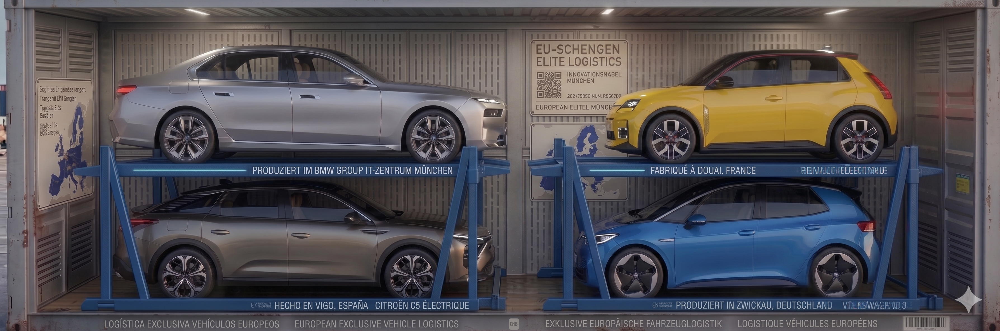

# Nubenetes Elite Portal (V2) | Awesome Kubernetes & Cloud 

!!! tip "Nubenetes V2 Elite Portal: AI-Curated & High-Density"
    You are browsing the AI-Curated V2 Elite Edition of Nubenetes. Looking for the complete historical archive? Explore the [**V1 Historical Archive**](/v1/).

  <a href="https://www.cncf.io/certification/software-conformance" class="hero-showcase-link">
    
    

      CNCF Conformance
      Standardized conformance guarantees seamless workload portability across the Cloud Native landscape.
    

  </a>

  <a href="https://en.wikipedia.org/wiki/Horatio_Nelson_Jackson" class="quote-card-link">
    

      
"I do not believe you can do today's job with yesterday's methods and be in business tomorrow"

      
Horatio Nelson Jackson

    

  </a>

## Explore the Ecosystem

  <a href="/kubernetes/" style="text-decoration: none; color: inherit; display: block;">
    

      
      
Ecosystem Core

      
Explore Kubernetes

    

  </a>
  <a href="/enterprise-ai-platforms/" style="text-decoration: none; color: inherit; display: block;">
    

      
☁️

      
Enterprise AI

      
Foundry · Bedrock · Vertex

    

  </a>
  <a href="/ai-agents-mcp/" style="text-decoration: none; color: inherit; display: block;">
    

      
      
AI & MCP Agents

      
Agentic Ecosystem

    

  </a>
  <a href="/tech-digest/" style="text-decoration: none; color: inherit; display: block;">
    

      
📊

      
Intelligence Digest

      
Top picks · 3/6/12 months

    

  </a>
  <a href="/videos/" style="text-decoration: none; color: inherit; display: block;">
    

      
      
Agentic Video Hub

      
Architect Video Library

    

  </a>
  <a href="/topic-map/" style="text-decoration: none; color: inherit; display: block;">
    

      
🗺️

      
Topic Map

      
All Categories · Directory

    

  </a>
  <a href="/introduction/" style="text-decoration: none; color: inherit; display: block;">
    

      
      
Get Started

      
Introduction Guide

    

  </a>
  <a href="./other-awesome-lists/" style="text-decoration: none; color: inherit; display: block;">
    

      
      
Awesome Lists

      
Curated awesome-* directory

    

  </a>

!!! abstract "The High-Density Vision"
    The V2 Edition is a curated, high-density version of the Nubenetes archive. Using **Agentic AI Orchestration**, the system selects only the most relevant, stable, and impactful resources for the modern Cloud Native ecosystem (2026 and beyond).

??? info "Knowledge Architecture and AI Coverage Status"
    The Nubenetes Elite Portal operates on a dual-layer knowledge architecture:
    1. **Elite Layer (AI-Enriched)**: Resources individually analyzed by our Agentic AI with high-density summaries and hierarchical indexing.
    2. **Standard Layer (Mapped)**: Resources identified as candidates for Elite status but pending deep AI analysis.

    **Current Inventory Coverage:**
    - **V1 Base Inventory**: 20494 total resources analyzed.
    - **V2 Elite Selection**: 16368 candidates identified (79.87% density ratio).
    - **AI Enrichment Coverage**: 16368 / 16368 (100.0%)
    - **GitHub Metadata Coverage**: 1849 / 1849 (100.0%) - *Critical for Maturity Tagging*
    - **Status**: The system is incrementally processing pending resources to complete the knowledge graph.

## Trending Now

🔥 Trending Now — Cloud Native Intelligence Updated Nov 17, 2026

<input type="checkbox" id="trend-expand-now" class="trending-toggle">

  
🔴 CRITICAL 🆕 NEW

  
Spain

  
<a href="https://www.youtube.com/playlist?list=PLLvKIaVqVF78">Nubenetes FinOps for Agentic AI Architectures: Azure TCO, Foundry, AKS & Serverless</a>

  
2026-11-15 · 🌟🌟🌟🌟🌟

  
This flagship curriculum and open-source TCO study gives Spanish enterprises—including P3 Regulated Spain Central deployments—a rigorous FinOps model to compare AKS, serverless, and Foundry agentic AI architectures.

  
🔴 CRITICAL

  
Networking & Service Mesh

  
<a href="https://github.com/kubernetes-sigs/gateway-api">Kubernetes Gateway API</a>

  
2026-11-05 · 3k★

  
Kubernetes Gateway API is the foundational standard replacing legacy Ingress with expressive, role-oriented routing across cloud-native platforms.

  
🔴 CRITICAL

  
AI & Agents

  
<a href="https://www.redhat.com/en/technologies/cloud-computing/openshift/openshift-ai">Red Hat OpenShift AI (RHOAI)</a>

  
2026-11-05 · 🌟🌟🌟🌟🌟

  
Unifies KServe, vLLM, Kubeflow Pipelines, KubeRay, and Kueue natively on Kubernetes to provide a production-ready enterprise hybrid-cloud AI platform.

  
🔴 CRITICAL

  
Python, Java & Developer Ecosystem

  
<a href="https://github.com/metalbear-co/mirrord">metalbear-co/mirrord</a>

  
2026-11-05 · 5.4k★

  
Mirrord transforms cloud-native inner-loop development by letting local processes plug directly into remote Kubernetes namespaces without slow container builds or redeployments.

  
🔴 CRITICAL

  
Azure

  
<a href="https://github.com/kaito-project/kaito">KAITO (Kubernetes AI Toolchain Operator)</a>

  
2026-11-05 · 1k★

  
KAITO is a CNCF Sandbox operator that automates GPU node provisioning and open-weight LLM/SLM inference directly on Kubernetes.

  
🔴 CRITICAL

  
Kubernetes & Orchestration

  
<a href="https://github.com/kubernetes-sigs/kueue">kubernetes-sigs/kueue: Kubernetes-native Job Queueing</a>

  
2026-11-05 · 3.1k★

  
Kueue establishes the Kubernetes-native standard for multi-tenant batch scheduling and AI/ML job queueing to maximize GPU and cluster utilization.

  
🔴 CRITICAL

  
AWS

  
<a href="https://github.com/awslabs/ai-on-eks">AI on EKS (AWS Labs)</a>

  
2026-11-05 · 228★

  
Provides official Terraform and Argo CD blueprints for running production-scale generative AI and machine learning workloads on Amazon EKS.

  
🔴 CRITICAL

  
GCP, OCI & Others

  
<a href="https://github.com/google/adk-python">Google Agent Development Kit (ADK)</a>

  
2026-11-05 · 22.1k★

  
Establishes an open-source, code-first standard for building deterministic multi-agent systems with native Model Context Protocol (MCP) support.

  
🔴 CRITICAL

  
OpenShift / Red Hat

  
<a href="https://www.redhat.com/en/products/ai/openshift-ai">Red Hat OpenShift AI (RHOAI)</a>

  
2026-11-05 · 🌟🌟🌟🌟🌟

  
Serves as Red Hat's flagship enterprise platform for deploying, managing, and scaling distributed AI and MLOps workloads on OpenShift.

  
🔴 CRITICAL

  
MLOps & Data Science

  
<a href="https://www.databricks.com/product/artificial-intelligence">Databricks Mosaic AI</a>

  
2026-11-05 · 🌟🌟🌟🌟🌟

  
Delivers a unified enterprise platform for building, governing, and evaluating production AI agents, RAG pipelines, and fine-tuned models alongside Lakehouse data.

  
🔴 CRITICAL

  
Virtualization & Private Cloud

  
<a href="https://github.com/kubernetes-sigs/kubespray">Kubespray</a>

  
2026-11-05 · 18.8k★

  
Kubespray is the industry-standard Ansible automation framework for deploying production-grade, customizable Kubernetes clusters across private clouds and bare-metal infrastructure.

  
🔴 CRITICAL

  
Infrastructure as Code

  
<a href="https://github.com/opentofu/opentofu">OpenTofu Official GitHub Repository</a>

  
2026-11-02 · 30.7k★

  
Governed by the Linux Foundation, OpenTofu represents a pivotal industry shift toward open-source IaC with major innovations like native state encryption.

  
🔴 CRITICAL

  
Europe

  
<a href="https://github.com/antonbabenko/pre-commit-terraform">antonbabenko/pre-commit-terraform: Git Pre-Commit and CI Hooks for Terraform and OpenTofu</a>

  
2026-11-02 · 3.8k★

  
Provides essential cloud-native IaC automation and security scanning hooks across Terraform and OpenTofu workflows for platform engineering teams.

  
🔴 CRITICAL

  
Data, Messaging & Storage

  
<a href="https://kubernetes.io/blog/2026/08/31/kubernetes-v1-37-storage-version-migration-ga">Kubernetes v1.37: Storage Version Migration Enabled by Default</a>

  
2026-11-01 · 🌟🌟🌟🌟

  
Graduating Storage Version Migration to GA and enabling it by default in Kubernetes v1.37 standardizes Day-2 etcd lifecycle management and safe API schema evolution.

  
🔴 CRITICAL

  
CI/CD & GitOps

  
<a href="https://github.com/fluxcd/flux2">github: Flux Version 2</a>

  
2026-11-01 · 8.5k★

  
Flux v2 is a foundational CNCF GitOps toolkit enabling decoupled, parallel Kubernetes configuration reconciliation at enterprise scale.

  
🔴 CRITICAL

  
Security & Compliance

  
<a href="https://kubernetes.io/blog/2026/08/28/kubernetes-v1-37-pod-certificates-and-cluster-trust-bundles">Kubernetes v1.37: Pod Certificates and Cluster Trust Bundles</a>

  
2026-11-01 · 🌟🌟🌟🌟

  
Kubernetes v1.37 introduces native Pod Certificates and Cluster Trust Bundles, fundamentally decentralizing mTLS and PKI trust distribution within the control plane.

<label for="trend-expand-now" class="trending-showmore">▼ Show 7 more▲ Show less</label>

📈 Rising this Quarter — Sustained Momentum

<input type="checkbox" id="trend-expand-rising" class="trending-toggle">

  
🔴 CRITICAL

  
AI & Agents

  
<a href="https://github.com/vllm-project/vllm">vLLM on Kubernetes</a>

  
2026-11-02 · 96.2k★

  
Standardizes high-throughput, memory-efficient LLM inference on Kubernetes clusters using PagedAttention for cloud-native AI serving.

  
🔴 CRITICAL

  
Networking & Service Mesh

  
<a href="https://github.com/istio/istio">Istio</a>

  
2026-11-01 · 38.5k★

  
Istio remains the flagship CNCF service mesh unifying Envoy sidecar and sidecarless ambient modes for zero-trust mTLS, observability, and traffic control.

  
🔴 CRITICAL

  
Security & Compliance

  
<a href="https://github.com/hashicorp/vault">hashicorp/vault</a>

  
2026-11-01 · 36.5k★

  
HashiCorp Vault remains the enterprise backbone for Zero Trust architectures, providing dynamic credential brokering and secrets management across multi-cloud and Kubernetes workloads.

  
🔴 CRITICAL

  
Containers & Runtime

  
<a href="https://github.com/containerd/containerd">containerd - An open and reliable container runtime</a>

  
2026-10-31 · 21.4k★

  
As the industry-standard CNCF runtime embedded in Kubernetes, containerd forms the core foundation of modern container execution.

  
🔴 CRITICAL

  
CI/CD & GitOps

  
<a href="https://github.com/dagger/dagger">dagger/dagger: Dagger is a portable devkit for CICD</a>

  
2026-11-01 · 16.6k★

  
Dagger transforms CI/CD pipelines from brittle YAML into portable, BuildKit-powered code written in general-purpose languages.

  
🔴 CRITICAL

  
Observability, SRE & Testing

  
<a href="https://github.com/prometheus/prometheus">prometheus</a>

  
2026-10-25 · 66.8k★

  
Prometheus remains the foundational CNCF telemetry engine for cloud-native monitoring, powering sub-second PromQL querying and standardized metric scraping across Kubernetes estates.

  
🔴 CRITICAL

  
Kubernetes & Orchestration

  
<a href="https://github.com/karmada-io/karmada">Karmada</a>

  
2026-11-05 · 5.8k★

  
Karmada provides CNCF-backed multi-cluster workload federation and scheduling, enabling resilient hybrid and multi-cloud Kubernetes architectures.

  
🔴 CRITICAL

  
Data, Messaging & Storage

  
<a href="https://github.com/velero-io/velero">velero</a>

  
2026-10-30 · 10.4k★

  
Velero remains the foundational cloud-native standard for backing up, restoring, and migrating Kubernetes cluster resources and persistent volumes in production.

  
🔴 CRITICAL

  
Azure

  
<a href="https://github.com/microsoft/azurelinux">CBL-Mariner</a>

  
2026-11-05 · 5.4k★

  
Azure Linux serves as the hardened, lightweight container-optimized host OS underpinning secure and minimal-footprint AKS deployments.

  
🔴 CRITICAL

  
DevOps & Culture

  
<a href="https://github.com/devtron-labs/devtron">Devtron</a>

  
2026-10-30 · 5.6k★

  
Unifies Kubernetes AppOps, GitOps, and observability into a single interface, significantly streamlining enterprise cloud native delivery workflows.

  
🟡 HIGH

  
Europe

  
<a href="https://github.com/langfuse/langfuse">Langfuse</a>

  
2026-11-15 · 37.5k★

  
Delivers cloud-native, end-to-end observability, telemetry, and evaluation infrastructure required to run LLM applications and agents in production.

  
🟡 HIGH

  
Asia-Pacific

  
<a href="https://github.com/opensandbox-group/OpenSandbox">OpenSandbox</a>

  
2026-11-15 · 17.3k★

  
OpenSandbox delivers a specialized, MCP-integrated execution environment for AI agents that directly addresses cloud-native isolation and orchestration needs.

<label for="trend-expand-rising" class="trending-showmore">▼ Show 6 more▲ Show less</label>

  <a href="/tech-digest/" class="digest-link-card">📊 Full Tech & Cloud Digest →</a>
  <a href="/industry-digest/" class="digest-link-card">🌍 Industry & Geo Digest →</a>

## The Cloud Native Universe We Track

AI & Advanced Tech

[{: style="width:48px; height:48px; object-fit:contain; margin:6px;" loading="lazy" .channel-logo}](https://www.youtube.com/@GoogleGemini) [{: style="width:48px; height:48px; object-fit:contain; margin:6px;" loading="lazy" .channel-logo}](https://www.youtube.com/@googledeepmind) [{: style="width:48px; height:48px; object-fit:contain; margin:6px;" loading="lazy" .channel-logo}](https://www.youtube.com/@anthropic-ai) [{: style="width:48px; height:48px; object-fit:contain; margin:6px;" loading="lazy" .channel-logo}](https://www.youtube.com/OpenAI) [{: style="width:48px; height:48px; object-fit:contain; margin:6px;" loading="lazy" .channel-logo}](https://www.youtube.com/@aiatmeta) [{: style="width:48px; height:48px; object-fit:contain; margin:6px;" loading="lazy" .channel-logo}](https://www.youtube.com/@Microsoft.Copilot) [{: style="width:48px; height:48px; object-fit:contain; margin:6px;" loading="lazy" .channel-logo}](https://www.youtube.com/@MicrosoftReactor) [{: style="width:48px; height:48px; object-fit:contain; margin:6px;" loading="lazy" .channel-logo}](https://www.youtube.com/@DotCSV) [{: style="width:48px; height:48px; object-fit:contain; margin:6px;" loading="lazy" .channel-logo}](https://www.youtube.com/@gustavo-entrala)

Cloud Providers & Core Infrastructure

[{: style="width:48px; height:48px; object-fit:contain; margin:6px;" loading="lazy" .channel-logo}](https://www.youtube.com/c/amazonwebservices) [{: style="width:48px; height:48px; object-fit:contain; margin:6px;" loading="lazy" .channel-logo}](https://www.youtube.com/c/MicrosoftAzure) [{: style="width:48px; height:48px; object-fit:contain; margin:6px;" loading="lazy" .channel-logo}](https://www.youtube.com/user/googlecloudplatform) [{: style="width:48px; height:48px; object-fit:contain; margin:6px;" loading="lazy" .channel-logo}](https://www.youtube.com/@googlecloudtech) [{: style="width:48px; height:48px; object-fit:contain; margin:6px;" loading="lazy" .channel-logo}](https://www.youtube.com/c/IBMTechnology) [{: style="width:48px; height:48px; object-fit:contain; margin:6px;" loading="lazy" .channel-logo}](https://www.youtube.com/c/OracleCloudInfrastructure) [{: style="width:48px; height:48px; object-fit:contain; margin:6px;" loading="lazy" .channel-logo}](https://www.youtube.com/c/Digitalocean) [{: style="width:48px; height:48px; object-fit:contain; margin:6px;" loading="lazy" .channel-logo}](https://www.youtube.com/cloudflare) [{: style="width:48px; height:48px; object-fit:contain; margin:6px;" loading="lazy" .channel-logo}](https://www.youtube.com/c/Scaleway-Cloud) [{: style="width:48px; height:48px; object-fit:contain; margin:6px;" loading="lazy" .channel-logo}](https://www.youtube.com/c/OpenStackFoundation) [{: style="width:48px; height:48px; object-fit:contain; margin:6px;" loading="lazy" .channel-logo}](https://www.youtube.com/c/AlibabaCloud) [{: style="width:48px; height:48px; object-fit:contain; margin:6px;" loading="lazy" .channel-logo}](https://www.youtube.com/c/linode) [{: style="width:48px; height:48px; object-fit:contain; margin:6px;" loading="lazy" .channel-logo}](https://www.youtube.com/channel/UCB5WMc2FfrxKzfd7XIODoMw) [{: style="width:48px; height:48px; object-fit:contain; margin:6px;" loading="lazy" .channel-logo}](https://www.youtube.com/@kyndryl) [{: style="width:48px; height:48px; object-fit:contain; margin:6px;" loading="lazy" .channel-logo}](https://www.youtube.com/@arsys) [{: style="width:48px; height:48px; object-fit:contain; margin:6px;" loading="lazy" .channel-logo}](https://www.youtube.com/@IONOSUK) [{: style="width:48px; height:48px; object-fit:contain; margin:6px;" loading="lazy" .channel-logo}](https://www.youtube.com/nutanix)

Cloud Native Platforms & Kubernetes

[{: style="width:48px; height:48px; object-fit:contain; margin:6px;" loading="lazy" .channel-logo}](https://www.youtube.com/c/cloudnativefdn) [{: style="width:48px; height:48px; object-fit:contain; margin:6px;" loading="lazy" .channel-logo}](https://www.youtube.com/kubernetescommunity) [{: style="width:48px; height:48px; object-fit:contain; margin:6px;" loading="lazy" .channel-logo}](https://www.youtube.com/c/redhat) [{: style="width:48px; height:48px; object-fit:contain; margin:6px;" loading="lazy" .channel-logo}](https://www.youtube.com/c/OpenShift) [{: style="width:48px; height:48px; object-fit:contain; margin:6px;" loading="lazy" .channel-logo}](https://www.youtube.com/c/Rancher) [{: style="width:48px; height:48px; object-fit:contain; margin:6px;" loading="lazy" .channel-logo}](https://www.youtube.com/c/VMwareTanzu) [{: style="width:48px; height:48px; object-fit:contain; margin:6px;" loading="lazy" .channel-logo}](https://www.youtube.com/channel/UCOvYmppcbOPm1viN6ust3lA) [{: style="width:48px; height:48px; object-fit:contain; margin:6px;" loading="lazy" .channel-logo}](https://www.youtube.com/channel/UCoZxt-YMhGHb20ZkvcCc5KA) [{: style="width:48px; height:48px; object-fit:contain; margin:6px;" loading="lazy" .channel-logo}](https://www.youtube.com/c/keptn) [{: style="width:48px; height:48px; object-fit:contain; margin:6px;" loading="lazy" .channel-logo}](https://www.youtube.com/@NetBoxLabs) [{: style="width:48px; height:48px; object-fit:contain; margin:6px;" loading="lazy" .channel-logo}](https://www.youtube.com/@kubefm) [{: style="width:48px; height:48px; object-fit:contain; margin:6px;" loading="lazy" .channel-logo}](https://www.youtube.com/c/ContainerDays) [{: style="width:48px; height:48px; object-fit:contain; margin:6px;" loading="lazy" .channel-logo}](https://www.youtube.com/c/Tetrate) [{: style="width:48px; height:48px; object-fit:contain; margin:6px;" loading="lazy" .channel-logo}](https://www.youtube.com/vmware) [{: style="width:48px; height:48px; object-fit:contain; margin:6px;" loading="lazy" .channel-logo}](https://www.youtube.com/ProxmoxVE)

DevOps, CI/CD, IaC & GitOps

[{: style="width:48px; height:48px; object-fit:contain; margin:6px;" loading="lazy" .channel-logo}](https://www.youtube.com/c/DockerIo) [{: style="width:48px; height:48px; object-fit:contain; margin:6px;" loading="lazy" .channel-logo}](https://www.youtube.com/c/CloudBeesTV) [{: style="width:48px; height:48px; object-fit:contain; margin:6px;" loading="lazy" .channel-logo}](https://www.youtube.com/c/jenkinscicd) [{: style="width:48px; height:48px; object-fit:contain; margin:6px;" loading="lazy" .channel-logo}](https://www.youtube.com/@jayex-io) [{: style="width:48px; height:48px; object-fit:contain; margin:6px;" loading="lazy" .channel-logo}](https://www.youtube.com/@spinnaker7813) [{: style="width:48px; height:48px; object-fit:contain; margin:6px;" loading="lazy" .channel-logo}](https://www.youtube.com/c/HashiCorp) [{: style="width:48px; height:48px; object-fit:contain; margin:6px;" loading="lazy" .channel-logo}](https://www.youtube.com/c/PulumiTV) [{: style="width:48px; height:48px; object-fit:contain; margin:6px;" loading="lazy" .channel-logo}](https://www.youtube.com/@azure-terraformer) [{: style="width:48px; height:48px; object-fit:contain; margin:6px;" loading="lazy" .channel-logo}](https://www.youtube.com/@NedintheCloud) [{: style="width:48px; height:48px; object-fit:contain; margin:6px;" loading="lazy" .channel-logo}](https://www.youtube.com/c/GitHub) [{: style="width:48px; height:48px; object-fit:contain; margin:6px;" loading="lazy" .channel-logo}](https://www.youtube.com/c/Gitlab) [{: style="width:48px; height:48px; object-fit:contain; margin:6px;" loading="lazy" .channel-logo}](https://www.youtube.com/c/Gitkraken) [{: style="width:48px; height:48px; object-fit:contain; margin:6px;" loading="lazy" .channel-logo}](https://www.youtube.com/c/Atlassian) [{: style="width:48px; height:48px; object-fit:contain; margin:6px;" loading="lazy" .channel-logo}](https://www.youtube.com/c/postman) [{: style="width:48px; height:48px; object-fit:contain; margin:6px;" loading="lazy" .channel-logo}](https://www.youtube.com/c/Smartbear) [{: style="width:48px; height:48px; object-fit:contain; margin:6px;" loading="lazy" .channel-logo}](https://www.youtube.com/c/JFrogInc) [{: style="width:48px; height:48px; object-fit:contain; margin:6px;" loading="lazy" .channel-logo}](https://www.youtube.com/c/Sonatypeinc) [{: style="width:48px; height:48px; object-fit:contain; margin:6px;" loading="lazy" .channel-logo}](https://www.youtube.com/@SonarSource) [{: style="width:48px; height:48px; object-fit:contain; margin:6px;" loading="lazy" .channel-logo}](https://www.youtube.com/c/ContinuousDeliveryFoundation) [{: style="width:48px; height:48px; object-fit:contain; margin:6px;" loading="lazy" .channel-logo}](https://www.youtube.com/c/AzureDevOps) [{: style="width:48px; height:48px; object-fit:contain; margin:6px;" loading="lazy" .channel-logo}](https://www.youtube.com/@DevOpsDirective) [{: style="width:48px; height:48px; object-fit:contain; margin:6px;" loading="lazy" .channel-logo}](https://www.youtube.com/@DevOpsParadox)

Observability, Databases & Cloud Storage

[{: style="width:48px; height:48px; object-fit:contain; margin:6px;" loading="lazy" .channel-logo}](https://www.youtube.com/c/PrometheusIo) [{: style="width:48px; height:48px; object-fit:contain; margin:6px;" loading="lazy" .channel-logo}](https://www.youtube.com/c/Grafana) [{: style="width:48px; height:48px; object-fit:contain; margin:6px;" loading="lazy" .channel-logo}](https://www.youtube.com/c/Istio) [{: style="width:48px; height:48px; object-fit:contain; margin:6px;" loading="lazy" .channel-logo}](https://www.youtube.com/c/Elastic) [{: style="width:48px; height:48px; object-fit:contain; margin:6px;" loading="lazy" .channel-logo}](https://www.youtube.com/c/dynatrace) [{: style="width:48px; height:48px; object-fit:contain; margin:6px;" loading="lazy" .channel-logo}](https://www.youtube.com/c/appdynamics) [{: style="width:48px; height:48px; object-fit:contain; margin:6px;" loading="lazy" .channel-logo}](https://www.youtube.com/c/NewRelicInc) [{: style="width:48px; height:48px; object-fit:contain; margin:6px;" loading="lazy" .channel-logo}](https://www.youtube.com/channel/UC8uN3yhpeBeerGNwDiQbcgw) [{: style="width:48px; height:48px; object-fit:contain; margin:6px;" loading="lazy" .channel-logo}](https://www.youtube.com/c/WeaveWorksInc) [{: style="width:48px; height:48px; object-fit:contain; margin:6px;" loading="lazy" .channel-logo}](https://www.youtube.com/c/CrunchyDataPostgres) [{: style="width:48px; height:48px; object-fit:contain; margin:6px;" loading="lazy" .channel-logo}](https://www.youtube.com/channel/UC5qMsRjObu685rTBq0PJX8w) [{: style="width:48px; height:48px; object-fit:contain; margin:6px;" loading="lazy" .channel-logo}](https://www.youtube.com/c/cockroachdb) [{: style="width:48px; height:48px; object-fit:contain; margin:6px;" loading="lazy" .channel-logo}](https://www.youtube.com/c/MongoDBofficial) [{: style="width:48px; height:48px; object-fit:contain; margin:6px;" loading="lazy" .channel-logo}](https://www.youtube.com/c/Redisinc) [{: style="width:48px; height:48px; object-fit:contain; margin:6px;" loading="lazy" .channel-logo}](https://www.youtube.com/c/Confluent) [{: style="width:48px; height:48px; object-fit:contain; margin:6px;" loading="lazy" .channel-logo}](https://www.youtube.com/channel/UCud7fErZAyMC6lHT_cWZNfA) [{: style="width:48px; height:48px; object-fit:contain; margin:6px;" loading="lazy" .channel-logo}](https://www.youtube.com/channel/UC3ywadaAUQ1FI4YsHZ8wa0g) [{: style="width:48px; height:48px; object-fit:contain; margin:6px;" loading="lazy" .channel-logo}](https://www.youtube.com/channel/UCm63IQg81KP9vXRWSHQpu1w) [{: style="width:48px; height:48px; object-fit:contain; margin:6px;" loading="lazy" .channel-logo}](https://www.youtube.com/channel/UCt7N400Z8gB_3yKq1qrjP2w) [{: style="width:48px; height:48px; object-fit:contain; margin:6px;" loading="lazy" .channel-logo}](https://www.youtube.com/c/Portworx) [{: style="width:48px; height:48px; object-fit:contain; margin:6px;" loading="lazy" .channel-logo}](https://www.youtube.com/@ClickHouseDB) [{: style="width:48px; height:48px; object-fit:contain; margin:6px;" loading="lazy" .channel-logo}](https://www.youtube.com/@Firebase) [{: style="width:48px; height:48px; object-fit:contain; margin:6px;" loading="lazy" .channel-logo}](https://www.youtube.com/c/supabase)

Development, Testing & Collaboration

[{: style="width:48px; height:48px; object-fit:contain; margin:6px;" loading="lazy" .channel-logo}](https://www.youtube.com/c/Code) [{: style="width:48px; height:48px; object-fit:contain; margin:6px;" loading="lazy" .channel-logo}](https://www.youtube.com/@Playwrightdev) [{: style="width:48px; height:48px; object-fit:contain; margin:6px;" loading="lazy" .channel-logo}](https://www.youtube.com/c/GoogleChromeDevelopers) [{: style="width:48px; height:48px; object-fit:contain; margin:6px;" loading="lazy" .channel-logo}](https://www.youtube.com/c/MozillaDeveloper) [{: style="width:48px; height:48px; object-fit:contain; margin:6px;" loading="lazy" .channel-logo}](https://www.youtube.com/c/RedHatDevelopers) [{: style="width:48px; height:48px; object-fit:contain; margin:6px;" loading="lazy" .channel-logo}](https://www.youtube.com/user/SpringSourceDev) [{: style="width:48px; height:48px; object-fit:contain; margin:6px;" loading="lazy" .channel-logo}](https://www.youtube.com/c/Quarkusio) [{: style="width:48px; height:48px; object-fit:contain; margin:6px;" loading="lazy" .channel-logo}](https://www.youtube.com/c/Lightbend-TV) [{: style="width:48px; height:48px; object-fit:contain; margin:6px;" loading="lazy" .channel-logo}](https://www.youtube.com/c/LambdaTest) [{: style="width:48px; height:48px; object-fit:contain; margin:6px;" loading="lazy" .channel-logo}](https://www.youtube.com/c/RocketChatApp) [{: style="width:48px; height:48px; object-fit:contain; margin:6px;" loading="lazy" .channel-logo}](https://www.youtube.com/c/Slackhq) [{: style="width:48px; height:48px; object-fit:contain; margin:6px;" loading="lazy" .channel-logo}](https://www.youtube.com/c/MattermostHQ) [{: style="width:48px; height:48px; object-fit:contain; margin:6px;" loading="lazy" .channel-logo}](https://www.youtube.com/c/microsoft365) [{: style="width:48px; height:48px; object-fit:contain; margin:6px;" loading="lazy" .channel-logo}](https://www.youtube.com/c/OpenProjectCommunity) [{: style="width:48px; height:48px; object-fit:contain; margin:6px;" loading="lazy" .channel-logo}](https://www.youtube.com/Salesforce) [{: style="width:48px; height:48px; object-fit:contain; margin:6px;" loading="lazy" .channel-logo}](https://www.youtube.com/user/SAP)

Tech E-Learning, Influencers & Communities

[{: style="width:48px; height:48px; object-fit:contain; margin:6px;" loading="lazy" .channel-logo}](https://www.youtube.com/c/Cloudacademy) [{: style="width:48px; height:48px; object-fit:contain; margin:6px;" loading="lazy" .channel-logo}](https://www.youtube.com/c/AcloudGuru) [{: style="width:48px; height:48px; object-fit:contain; margin:6px;" loading="lazy" .channel-logo}](https://www.youtube.com/c/Devopsdotcom) [{: style="width:48px; height:48px; object-fit:contain; margin:6px;" loading="lazy" .channel-logo}](https://www.youtube.com/c/XebiaLabs) [{: style="width:48px; height:48px; object-fit:contain; margin:6px;" loading="lazy" .channel-logo}](https://www.youtube.com/c/Devopslibrary) [{: style="width:48px; height:48px; object-fit:contain; margin:6px;" loading="lazy" .channel-logo}](https://www.youtube.com/c/codecademy) [{: style="width:48px; height:48px; object-fit:contain; margin:6px;" loading="lazy" .channel-logo}](https://www.youtube.com/user/coursera) [{: style="width:48px; height:48px; object-fit:contain; margin:6px;" loading="lazy" .channel-logo}](https://www.youtube.com/c/Academind) [{: style="width:48px; height:48px; object-fit:contain; margin:6px;" loading="lazy" .channel-logo}](https://www.youtube.com/c/guru99comm) [{: style="width:48px; height:48px; object-fit:contain; margin:6px;" loading="lazy" .channel-logo}](https://www.youtube.com/c/Intellipaat) [{: style="width:48px; height:48px; object-fit:contain; margin:6px;" loading="lazy" .channel-logo}](https://www.youtube.com/channel/UCv9MUffHWyo2GgLIDLVu0KQ) [{: style="width:48px; height:48px; object-fit:contain; margin:6px;" loading="lazy" .channel-logo}](https://www.youtube.com/c/Thetips4you) [{: style="width:48px; height:48px; object-fit:contain; margin:6px;" loading="lazy" .channel-logo}](https://www.youtube.com/channel/UC57acx8sCmE7uFHfVMvIlNg) [{: style="width:48px; height:48px; object-fit:contain; margin:6px;" loading="lazy" .channel-logo}](https://www.youtube.com/c/NTFAQGuy) [{: style="width:48px; height:48px; object-fit:contain; margin:6px;" loading="lazy" .channel-logo}](https://www.youtube.com/channel/UCorFV-WGnajyfNu4zPI0AAA) [{: style="width:48px; height:48px; object-fit:contain; margin:6px;" loading="lazy" .channel-logo}](https://www.youtube.com/c/AppsCodeInc) [{: style="width:48px; height:48px; object-fit:contain; margin:6px;" loading="lazy" .channel-logo}](https://www.youtube.com/c/DevOpsToolkit) [{: style="width:48px; height:48px; object-fit:contain; margin:6px;" loading="lazy" .channel-logo}](https://www.youtube.com/c/AnsiblePilot) [{: style="width:48px; height:48px; object-fit:contain; margin:6px;" loading="lazy" .channel-logo}](https://www.youtube.com/CodelyTV) [{: style="width:48px; height:48px; object-fit:contain; margin:6px;" loading="lazy" .channel-logo}](https://www.youtube.com/c/PeladoNerd) [{: style="width:48px; height:48px; object-fit:contain; margin:6px;" loading="lazy" .channel-logo}](https://www.youtube.com/c/HolaMundoDev) [{: style="width:48px; height:48px; object-fit:contain; margin:6px;" loading="lazy" .channel-logo}](https://www.youtube.com/c/JavierGarz%C3%A1s) [{: style="width:48px; height:48px; object-fit:contain; margin:6px;" loading="lazy" .channel-logo}](https://www.youtube.com/c/LondonIAC) [{: style="width:48px; height:48px; object-fit:contain; margin:6px;" loading="lazy" .channel-logo}](https://www.youtube.com/c/TechWorldwithNana) [{: style="width:48px; height:48px; object-fit:contain; margin:6px;" loading="lazy" .channel-logo}](https://www.youtube.com/c/Honeypotio) [{: style="width:48px; height:48px; object-fit:contain; margin:6px;" loading="lazy" .channel-logo}](https://www.youtube.com/c/AliSpittelDev) [{: style="width:48px; height:48px; object-fit:contain; margin:6px;" loading="lazy" .channel-logo}](https://www.youtube.com/c/ThomasMaurerCloud) [{: style="width:48px; height:48px; object-fit:contain; margin:6px;" loading="lazy" .channel-logo}](https://www.youtube.com/c/Freecodecamp) [{: style="width:48px; height:48px; object-fit:contain; margin:6px;" loading="lazy" .channel-logo}](https://www.youtube.com/c/TheNewStack) [{: style="width:48px; height:48px; object-fit:contain; margin:6px;" loading="lazy" .channel-logo}](https://www.youtube.com/c/priyankavergadia) [{: style="width:48px; height:48px; object-fit:contain; margin:6px;" loading="lazy" .channel-logo}](https://www.youtube.com/c/TinaHuang1) [{: style="width:48px; height:48px; object-fit:contain; margin:6px;" loading="lazy" .channel-logo}](https://www.youtube.com/channel/UC2Pk9GcHhlVV0R9CQIU6gLw) [{: style="width:48px; height:48px; object-fit:contain; margin:6px;" loading="lazy" .channel-logo}](https://www.youtube.com/c/MadeByGPS) [{: style="width:48px; height:48px; object-fit:contain; margin:6px;" loading="lazy" .channel-logo}](https://www.youtube.com/c/AnaisUrlichs) [{: style="width:48px; height:48px; object-fit:contain; margin:6px;" loading="lazy" .channel-logo}](https://www.youtube.com/c/TheDigitalLifeTech) [{: style="width:48px; height:48px; object-fit:contain; margin:6px;" loading="lazy" .channel-logo}](https://www.youtube.com/@techwithhelen) [{: style="width:48px; height:48px; object-fit:contain; margin:6px;" loading="lazy" .channel-logo}](https://www.youtube.com/@ByteByteGo) [{: style="width:48px; height:48px; object-fit:contain; margin:6px;" loading="lazy" .channel-logo}](https://www.youtube.com/@midulive) [{: style="width:48px; height:48px; object-fit:contain; margin:6px;" loading="lazy" .channel-logo}](https://www.youtube.com/@returngis) [{: style="width:48px; height:48px; object-fit:contain; margin:6px;" loading="lazy" .channel-logo}](https://www.youtube.com/@OlenaKutsenko) [{: style="width:48px; height:48px; object-fit:contain; margin:6px;" loading="lazy" .channel-logo}](https://www.youtube.com/@mouredev) [{: style="width:48px; height:48px; object-fit:contain; margin:6px;" loading="lazy" .channel-logo}](https://www.youtube.com/@CloudNativeMadrid) [{: style="width:48px; height:48px; object-fit:contain; margin:6px;" loading="lazy" .channel-logo}](https://www.youtube.com/@ITOpsTalk) [{: style="width:48px; height:48px; object-fit:contain; margin:6px;" loading="lazy" .channel-logo}](https://www.youtube.com/c/dzone) [{: style="width:48px; height:48px; object-fit:contain; margin:6px;" loading="lazy" .channel-logo}](https://www.youtube.com/@JorgeMonzon%C3%ADsSAP) [{: style="width:48px; height:48px; object-fit:contain; margin:6px;" loading="lazy" .channel-logo}](https://www.youtube.com/@ITTelevisi%C3%B3n_ES)

## Label Heatmap

Every technical label across Nubenetes, sized by how many resources carry it. Click any label to open it on the [Technical Tags](/tags/) page.

<a class="v2-heat-tag v2-heat-1" href="/tags/#3d-generation" title="1 resources">3D-Generation1</a>
<a class="v2-heat-tag v2-heat-1" href="/tags/#4-bit" title="1 resources">4-Bit1</a>
<a class="v2-heat-tag v2-heat-1" href="/tags/#access-control" title="1 resources">Access-Control1</a>
<a class="v2-heat-tag v2-heat-1" href="/tags/#ad-tech" title="2 resources">Ad-Tech2</a>
<a class="v2-heat-tag v2-heat-2" href="/tags/#agent" title="3 resources">Agent3</a>
<a class="v2-heat-tag v2-heat-1" href="/tags/#agent-intrusion" title="1 resources">Agent-Intrusion1</a>
<a class="v2-heat-tag v2-heat-2" href="/tags/#agentic-ai" title="11 resources">Agentic-Ai11</a>
<a class="v2-heat-tag v2-heat-1" href="/tags/#agentic-coding" title="1 resources">Agentic-Coding1</a>
<a class="v2-heat-tag v2-heat-1" href="/tags/#agentic-commerce" title="1 resources">Agentic-Commerce1</a>
<a class="v2-heat-tag v2-heat-1" href="/tags/#agentic-qa" title="1 resources">Agentic-Qa1</a>
<a class="v2-heat-tag v2-heat-1" href="/tags/#agentic-readiness" title="1 resources">Agentic-Readiness1</a>
<a class="v2-heat-tag v2-heat-1" href="/tags/#agentic-rl" title="1 resources">Agentic-Rl1</a>
<a class="v2-heat-tag v2-heat-1" href="/tags/#agentic-systems" title="1 resources">Agentic-Systems1</a>
<a class="v2-heat-tag v2-heat-1" href="/tags/#agentic-workflow" title="1 resources">Agentic-Workflow1</a>
<a class="v2-heat-tag v2-heat-2" href="/tags/#agents" title="5 resources">Agents5</a>
<a class="v2-heat-tag v2-heat-3" href="/tags/#agnostic-content" title="58 resources">Agnostic58</a>
<a class="v2-heat-tag v2-heat-3" href="/tags/#ai" title="45 resources">AI45</a>
<a class="v2-heat-tag v2-heat-1" href="/tags/#ai-adoption" title="2 resources">Ai-Adoption2</a>
<a class="v2-heat-tag v2-heat-1" href="/tags/#ai-agent" title="1 resources">Ai-Agent1</a>
<a class="v2-heat-tag v2-heat-3" href="/tags/#ai-agents" title="57 resources">Ai-Agents57</a>
<a class="v2-heat-tag v2-heat-1" href="/tags/#ai-alignment" title="1 resources">Ai-Alignment1</a>
<a class="v2-heat-tag v2-heat-1" href="/tags/#ai-architecture" title="1 resources">Ai-Architecture1</a>
<a class="v2-heat-tag v2-heat-1" href="/tags/#ai-assisted" title="1 resources">Ai-Assisted1</a>
<a class="v2-heat-tag v2-heat-1" href="/tags/#ai-defense" title="1 resources">Ai-Defense1</a>
<a class="v2-heat-tag v2-heat-1" href="/tags/#ai-devtools" title="1 resources">Ai-Devtools1</a>
<a class="v2-heat-tag v2-heat-2" href="/tags/#ai-driven-defense" title="3 resources">Ai-Driven-Defense3</a>
<a class="v2-heat-tag v2-heat-1" href="/tags/#ai-factories" title="1 resources">Ai-Factories1</a>
<a class="v2-heat-tag v2-heat-2" href="/tags/#ai-factory" title="4 resources">Ai-Factory4</a>
<a class="v2-heat-tag v2-heat-1" href="/tags/#ai-governance" title="1 resources">Ai-Governance1</a>
<a class="v2-heat-tag v2-heat-1" href="/tags/#ai-inference" title="2 resources">Ai-Inference2</a>
<a class="v2-heat-tag v2-heat-2" href="/tags/#ai-infrastructure" title="7 resources">Ai-Infrastructure7</a>
<a class="v2-heat-tag v2-heat-1" href="/tags/#ai-models" title="1 resources">Ai-Models1</a>
<a class="v2-heat-tag v2-heat-1" href="/tags/#ai-native" title="1 resources">Ai-Native1</a>
<a class="v2-heat-tag v2-heat-2" href="/tags/#ai-platform" title="10 resources">Ai-Platform10</a>
<a class="v2-heat-tag v2-heat-1" href="/tags/#ai-policy" title="1 resources">Ai-Policy1</a>
<a class="v2-heat-tag v2-heat-2" href="/tags/#ai-safety" title="6 resources">Ai-Safety6</a>
<a class="v2-heat-tag v2-heat-1" href="/tags/#ai-scientist" title="1 resources">Ai-Scientist1</a>
<a class="v2-heat-tag v2-heat-2" href="/tags/#ai-security" title="3 resources">Ai-Security3</a>
<a class="v2-heat-tag v2-heat-1" href="/tags/#ai-sre" title="1 resources">Ai-Sre1</a>
<a class="v2-heat-tag v2-heat-2" href="/tags/#aiops" title="3 resources">Aiops3</a>
<a class="v2-heat-tag v2-heat-1" href="/tags/#aiperf" title="1 resources">Aiperf1</a>
<a class="v2-heat-tag v2-heat-1" href="/tags/#aks" title="1 resources">Aks1</a>
<a class="v2-heat-tag v2-heat-1" href="/tags/#alerting" title="1 resources">Alerting1</a>
<a class="v2-heat-tag v2-heat-1" href="/tags/#amazon-bedrock" title="2 resources">Amazon-Bedrock2</a>
<a class="v2-heat-tag v2-heat-1" href="/tags/#amazon-polly" title="1 resources">Amazon-Polly1</a>
<a class="v2-heat-tag v2-heat-2" href="/tags/#analytics" title="3 resources">Analytics3</a>
<a class="v2-heat-tag v2-heat-2" href="/tags/#ansible-content" title="3 resources">Ansible3</a>
<a class="v2-heat-tag v2-heat-1" href="/tags/#any-content" title="1 resources">Any1</a>
<a class="v2-heat-tag v2-heat-1" href="/tags/#apache-flink" title="1 resources">Apache-Flink1</a>
<a class="v2-heat-tag v2-heat-1" href="/tags/#apache-spark" title="1 resources">Apache-Spark1</a>
<a class="v2-heat-tag v2-heat-1" href="/tags/#apacheconf-content" title="1 resources">Apacheconf1</a>
<a class="v2-heat-tag v2-heat-1" href="/tags/#api" title="2 resources">Api2</a>
<a class="v2-heat-tag v2-heat-1" href="/tags/#api-composability" title="1 resources">Api-Composability1</a>
<a class="v2-heat-tag v2-heat-1" href="/tags/#api-design" title="2 resources">Api-Design2</a>
<a class="v2-heat-tag v2-heat-1" href="/tags/#api-first" title="1 resources">Api-First1</a>
<a class="v2-heat-tag v2-heat-1" href="/tags/#api-integration" title="1 resources">Api-Integration1</a>
<a class="v2-heat-tag v2-heat-1" href="/tags/#apple-silicon" title="2 resources">Apple-Silicon2</a>
<a class="v2-heat-tag v2-heat-2" href="/tags/#architecture" title="7 resources">Architecture7</a>
<a class="v2-heat-tag v2-heat-1" href="/tags/#architecture-guide" title="1 resources">Architecture-Guide1</a>
<a class="v2-heat-tag v2-heat-1" href="/tags/#ard" title="1 resources">Ard1</a>
<a class="v2-heat-tag v2-heat-1" href="/tags/#arm" title="2 resources">Arm2</a>
<a class="v2-heat-tag v2-heat-1" href="/tags/#asciidoc-content" title="1 resources">Asciidoc1</a>
<a class="v2-heat-tag v2-heat-2" href="/tags/#asr" title="4 resources">Asr4</a>
<a class="v2-heat-tag v2-heat-1" href="/tags/#atlassian" title="1 resources">Atlassian1</a>
<a class="v2-heat-tag v2-heat-1" href="/tags/#auto-coding" title="1 resources">Auto-Coding1</a>
<a class="v2-heat-tag v2-heat-1" href="/tags/#auto-tuning" title="1 resources">Auto-Tuning1</a>
<a class="v2-heat-tag v2-heat-1" href="/tags/#automated-testing" title="1 resources">Automated-Testing1</a>
<a class="v2-heat-tag v2-heat-2" href="/tags/#automation" title="10 resources">Automation10</a>
<a class="v2-heat-tag v2-heat-1" href="/tags/#autonomous-recovery" title="1 resources">Autonomous-Recovery1</a>
<a class="v2-heat-tag v2-heat-1" href="/tags/#autonomous-vehicle" title="1 resources">Autonomous-Vehicle1</a>
<a class="v2-heat-tag v2-heat-2" href="/tags/#autoscaling" title="4 resources">Autoscaling4</a>
<a class="v2-heat-tag v2-heat-2" href="/tags/#awk-content" title="3 resources">Awk3</a>
<a class="v2-heat-tag v2-heat-2" href="/tags/#aws" title="4 resources">Aws4</a>
<a class="v2-heat-tag v2-heat-1" href="/tags/#aws-ec2" title="1 resources">Aws-Ec21</a>
<a class="v2-heat-tag v2-heat-2" href="/tags/#aws-trainium" title="4 resources">Aws-Trainium4</a>
<a class="v2-heat-tag v2-heat-3" href="/tags/#azure" title="26 resources">Azure26</a>
<a class="v2-heat-tag v2-heat-1" href="/tags/#ballerina-content" title="1 resources">Ballerina1</a>
<a class="v2-heat-tag v2-heat-4" href="/tags/#bash-content" title="110 resources">Bash110</a>
<a class="v2-heat-tag v2-heat-1" href="/tags/#bash-python-content" title="1 resources">Bash/Python1</a>
<a class="v2-heat-tag v2-heat-1" href="/tags/#bash-yaml-content" title="1 resources">Bash/Yaml1</a>
<a class="v2-heat-tag v2-heat-1" href="/tags/#batch" title="1 resources">Batch1</a>
<a class="v2-heat-tag v2-heat-1" href="/tags/#batch-processing" title="1 resources">Batch-Processing1</a>
<a class="v2-heat-tag v2-heat-1" href="/tags/#batch-scheduler" title="1 resources">Batch-Scheduler1</a>
<a class="v2-heat-tag v2-heat-2" href="/tags/#benchmark" title="5 resources">Benchmark5</a>
<a class="v2-heat-tag v2-heat-1" href="/tags/#benchmark-optimization" title="1 resources">Benchmark-Optimization1</a>
<a class="v2-heat-tag v2-heat-2" href="/tags/#benchmarking" title="4 resources">Benchmarking4</a>
<a class="v2-heat-tag v2-heat-1" href="/tags/#bgp" title="1 resources">Bgp1</a>
<a class="v2-heat-tag v2-heat-3" href="/tags/#bicep-content" title="17 resources">Bicep17</a>
<a class="v2-heat-tag v2-heat-1" href="/tags/#bioinformatics" title="1 resources">Bioinformatics1</a>
<a class="v2-heat-tag v2-heat-1" href="/tags/#bionemo" title="2 resources">Bionemo2</a>
<a class="v2-heat-tag v2-heat-1" href="/tags/#biotech" title="1 resources">Biotech1</a>
<a class="v2-heat-tag v2-heat-1" href="/tags/#blackwell" title="2 resources">Blackwell2</a>
<a class="v2-heat-tag v2-heat-1" href="/tags/#bluefield" title="1 resources">Bluefield1</a>
<a class="v2-heat-tag v2-heat-1" href="/tags/#bluefield-4" title="1 resources">Bluefield-41</a>
<a class="v2-heat-tag v2-heat-1" href="/tags/#bot-management" title="1 resources">Bot-Management1</a>
<a class="v2-heat-tag v2-heat-1" href="/tags/#breach" title="1 resources">Breach1</a>
<a class="v2-heat-tag v2-heat-1" href="/tags/#browser-agents" title="1 resources">Browser-Agents1</a>
<a class="v2-heat-tag v2-heat-1" href="/tags/#browser-storage" title="1 resources">Browser-Storage1</a>
<a class="v2-heat-tag v2-heat-3" href="/tags/#c-content" title="29 resources">C29</a>
<a class="v2-heat-tag v2-heat-3" href="/tags/#c-sharp-content" title="27 resources">C#27</a>
<a class="v2-heat-tag v2-heat-1" href="/tags/#c-plus-plus-go-python-content" title="1 resources">C++ / Go / Python1</a>
<a class="v2-heat-tag v2-heat-1" href="/tags/#c-plus-plus-go-content" title="1 resources">C++ / Go1</a>
<a class="v2-heat-tag v2-heat-3" href="/tags/#c-plus-plus-content" title="22 resources">C++22</a>
<a class="v2-heat-tag v2-heat-1" href="/tags/#c-bash-content" title="1 resources">C/Bash1</a>
<a class="v2-heat-tag v2-heat-1" href="/tags/#c-c-plus-plus-content" title="1 resources">C/C++1</a>
<a class="v2-heat-tag v2-heat-1" href="/tags/#caching" title="1 resources">Caching1</a>
<a class="v2-heat-tag v2-heat-1" href="/tags/#capi" title="1 resources">Capi1</a>
<a class="v2-heat-tag v2-heat-4" href="/tags/#case-study" title="175 resources">Case Study175</a>
<a class="v2-heat-tag v2-heat-2" href="/tags/#case-study-2" title="4 resources">Case-Study4</a>
<a class="v2-heat-tag v2-heat-1" href="/tags/#cassandra" title="1 resources">Cassandra1</a>
<a class="v2-heat-tag v2-heat-1" href="/tags/#causal-inference" title="1 resources">Causal-Inference1</a>
<a class="v2-heat-tag v2-heat-1" href="/tags/#cgroups" title="1 resources">Cgroups1</a>
<a class="v2-heat-tag v2-heat-1" href="/tags/#cgroupv2" title="1 resources">Cgroupv21</a>
<a class="v2-heat-tag v2-heat-1" href="/tags/#chain-of-thought" title="1 resources">Chain-Of-Thought1</a>
<a class="v2-heat-tag v2-heat-1" href="/tags/#chatbot" title="1 resources">Chatbot1</a>
<a class="v2-heat-tag v2-heat-1" href="/tags/#chatgpt-enterprise" title="1 resources">Chatgpt-Enterprise1</a>
<a class="v2-heat-tag v2-heat-1" href="/tags/#chatgpt-work" title="1 resources">Chatgpt-Work1</a>
<a class="v2-heat-tag v2-heat-1" href="/tags/#chinese-content" title="1 resources">Chinese1</a>
<a class="v2-heat-tag v2-heat-1" href="/tags/#chip-design" title="1 resources">Chip-Design1</a>
<a class="v2-heat-tag v2-heat-2" href="/tags/#ci-cd" title="5 resources">Ci-Cd5</a>
<a class="v2-heat-tag v2-heat-2" href="/tags/#cicd" title="5 resources">Cicd5</a>
<a class="v2-heat-tag v2-heat-1" href="/tags/#claude" title="1 resources">Claude1</a>
<a class="v2-heat-tag v2-heat-1" href="/tags/#cli" title="1 resources">Cli1</a>
<a class="v2-heat-tag v2-heat-1" href="/tags/#clojure-content" title="1 resources">Clojure1</a>
<a class="v2-heat-tag v2-heat-3" href="/tags/#cloud-ai" title="47 resources">CLOUD-AI47</a>
<a class="v2-heat-tag v2-heat-1" href="/tags/#cloud-platform" title="1 resources">Cloud-Platform1</a>
<a class="v2-heat-tag v2-heat-1" href="/tags/#cloudflare" title="2 resources">Cloudflare2</a>
<a class="v2-heat-tag v2-heat-1" href="/tags/#cluster-management" title="1 resources">Cluster-Management1</a>
<a class="v2-heat-tag v2-heat-2" href="/tags/#code-generation" title="3 resources">Code-Generation3</a>
<a class="v2-heat-tag v2-heat-1" href="/tags/#codex" title="2 resources">Codex2</a>
<a class="v2-heat-tag v2-heat-1" href="/tags/#coding-assistant" title="1 resources">Coding-Assistant1</a>
<a class="v2-heat-tag v2-heat-1" href="/tags/#coding-assistants" title="1 resources">Coding-Assistants1</a>
<a class="v2-heat-tag v2-heat-1" href="/tags/#colbert" title="2 resources">Colbert2</a>
<a class="v2-heat-tag v2-heat-1" href="/tags/#community-reference" title="1 resources">Community-Reference1</a>
<a class="v2-heat-tag v2-heat-6" href="/tags/#community-tool" title="8391 resources">Community-Tool8391</a>
<a class="v2-heat-tag v2-heat-1" href="/tags/#compiler" title="1 resources">Compiler1</a>
<a class="v2-heat-tag v2-heat-1" href="/tags/#compiler-optimization" title="1 resources">Compiler-Optimization1</a>
<a class="v2-heat-tag v2-heat-1" href="/tags/#compiler-theory" title="1 resources">Compiler-Theory1</a>
<a class="v2-heat-tag v2-heat-1" href="/tags/#compilers" title="1 resources">Compilers1</a>
<a class="v2-heat-tag v2-heat-2" href="/tags/#compliance" title="3 resources">Compliance3</a>
<a class="v2-heat-tag v2-heat-1" href="/tags/#computational-biology" title="1 resources">Computational-Biology1</a>
<a class="v2-heat-tag v2-heat-2" href="/tags/#computer-use" title="3 resources">Computer-Use3</a>
<a class="v2-heat-tag v2-heat-2" href="/tags/#computer-vision" title="5 resources">Computer-Vision5</a>
<a class="v2-heat-tag v2-heat-2" href="/tags/#conceptual-content" title="13 resources">Conceptual13</a>
<a class="v2-heat-tag v2-heat-1" href="/tags/#confidential-computing" title="1 resources">Confidential-Computing1</a>
<a class="v2-heat-tag v2-heat-1" href="/tags/#conformance" title="2 resources">Conformance2</a>
<a class="v2-heat-tag v2-heat-1" href="/tags/#containers" title="2 resources">Containers2</a>
<a class="v2-heat-tag v2-heat-1" href="/tags/#conversational-ai" title="1 resources">Conversational-Ai1</a>
<a class="v2-heat-tag v2-heat-1" href="/tags/#cooling" title="1 resources">Cooling1</a>
<a class="v2-heat-tag v2-heat-1" href="/tags/#core-ml" title="1 resources">Core-Ml1</a>
<a class="v2-heat-tag v2-heat-2" href="/tags/#cost-optimization" title="4 resources">Cost-Optimization4</a>
<a class="v2-heat-tag v2-heat-1" href="/tags/#cost-reduction" title="1 resources">Cost-Reduction1</a>
<a class="v2-heat-tag v2-heat-1" href="/tags/#cpu" title="1 resources">Cpu1</a>
<a class="v2-heat-tag v2-heat-1" href="/tags/#cryptography" title="1 resources">Cryptography1</a>
<a class="v2-heat-tag v2-heat-1" href="/tags/#csi" title="1 resources">Csi1</a>
<a class="v2-heat-tag v2-heat-2" href="/tags/#cuda" title="12 resources">Cuda12</a>
<a class="v2-heat-tag v2-heat-1" href="/tags/#cuphoton" title="1 resources">Cuphoton1</a>
<a class="v2-heat-tag v2-heat-1" href="/tags/#customer-support" title="1 resources">Customer-Support1</a>
<a class="v2-heat-tag v2-heat-2" href="/tags/#cybersecurity" title="8 resources">Cybersecurity8</a>
<a class="v2-heat-tag v2-heat-1" href="/tags/#dart-content" title="1 resources">Dart1</a>
<a class="v2-heat-tag v2-heat-1" href="/tags/#dashboard" title="1 resources">Dashboard1</a>
<a class="v2-heat-tag v2-heat-1" href="/tags/#data-analytics" title="1 resources">Data-Analytics1</a>
<a class="v2-heat-tag v2-heat-2" href="/tags/#data-center" title="4 resources">Data-Center4</a>
<a class="v2-heat-tag v2-heat-1" href="/tags/#data-collection" title="1 resources">Data-Collection1</a>
<a class="v2-heat-tag v2-heat-2" href="/tags/#data-engineering" title="6 resources">Data-Engineering6</a>
<a class="v2-heat-tag v2-heat-1" href="/tags/#data-governance" title="1 resources">Data-Governance1</a>
<a class="v2-heat-tag v2-heat-1" href="/tags/#data-leakage" title="1 resources">Data-Leakage1</a>
<a class="v2-heat-tag v2-heat-1" href="/tags/#data-pipeline" title="2 resources">Data-Pipeline2</a>
<a class="v2-heat-tag v2-heat-1" href="/tags/#data-privacy" title="1 resources">Data-Privacy1</a>
<a class="v2-heat-tag v2-heat-1" href="/tags/#data-sovereignty" title="1 resources">Data-Sovereignty1</a>
<a class="v2-heat-tag v2-heat-1" href="/tags/#data-store" title="1 resources">Data-Store1</a>
<a class="v2-heat-tag v2-heat-1" href="/tags/#data-strategy" title="1 resources">Data-Strategy1</a>
<a class="v2-heat-tag v2-heat-1" href="/tags/#database" title="1 resources">Database1</a>
<a class="v2-heat-tag v2-heat-1" href="/tags/#databases" title="1 resources">Databases1</a>
<a class="v2-heat-tag v2-heat-1" href="/tags/#day-2-ops" title="1 resources">Day-2-Ops1</a>
<a class="v2-heat-tag v2-heat-1" href="/tags/#daybreak" title="1 resources">Daybreak1</a>
<a class="v2-heat-tag v2-heat-5" href="/tags/#de-facto-standard" title="1348 resources">De Facto Standard1348</a>
<a class="v2-heat-tag v2-heat-1" href="/tags/#decisions-api" title="1 resources">Decisions-Api1</a>
<a class="v2-heat-tag v2-heat-1" href="/tags/#defense" title="2 resources">Defense2</a>
<a class="v2-heat-tag v2-heat-1" href="/tags/#deployment" title="1 resources">Deployment1</a>
<a class="v2-heat-tag v2-heat-1" href="/tags/#deprecations" title="1 resources">Deprecations1</a>
<a class="v2-heat-tag v2-heat-1" href="/tags/#deterministic-execution" title="1 resources">Deterministic-Execution1</a>
<a class="v2-heat-tag v2-heat-1" href="/tags/#dev-dx" title="1 resources">Dev-Dx1</a>
<a class="v2-heat-tag v2-heat-1" href="/tags/#developer-experience" title="1 resources">Developer-Experience1</a>
<a class="v2-heat-tag v2-heat-1" href="/tags/#developer-tools" title="1 resources">Developer-Tools1</a>
<a class="v2-heat-tag v2-heat-1" href="/tags/#devops" title="2 resources">Devops2</a>
<a class="v2-heat-tag v2-heat-1" href="/tags/#devsecops" title="2 resources">Devsecops2</a>
<a class="v2-heat-tag v2-heat-1" href="/tags/#dgx-spark" title="2 resources">Dgx-Spark2</a>
<a class="v2-heat-tag v2-heat-1" href="/tags/#diagnostics" title="1 resources">Diagnostics1</a>
<a class="v2-heat-tag v2-heat-1" href="/tags/#diffusers" title="1 resources">Diffusers1</a>
<a class="v2-heat-tag v2-heat-1" href="/tags/#diffusion" title="2 resources">Diffusion2</a>
<a class="v2-heat-tag v2-heat-1" href="/tags/#diffusion-models" title="2 resources">Diffusion-Models2</a>
<a class="v2-heat-tag v2-heat-1" href="/tags/#digital-biology" title="2 resources">Digital-Biology2</a>
<a class="v2-heat-tag v2-heat-2" href="/tags/#digital-twin" title="5 resources">Digital-Twin5</a>
<a class="v2-heat-tag v2-heat-1" href="/tags/#disaggregation" title="1 resources">Disaggregation1</a>
<a class="v2-heat-tag v2-heat-1" href="/tags/#distillation" title="1 resources">Distillation1</a>
<a class="v2-heat-tag v2-heat-1" href="/tags/#distributed-computing" title="1 resources">Distributed-Computing1</a>
<a class="v2-heat-tag v2-heat-1" href="/tags/#distributed-inference" title="1 resources">Distributed-Inference1</a>
<a class="v2-heat-tag v2-heat-1" href="/tags/#distributed-systems" title="1 resources">Distributed-Systems1</a>
<a class="v2-heat-tag v2-heat-2" href="/tags/#distributed-training" title="3 resources">Distributed-Training3</a>
<a class="v2-heat-tag v2-heat-1" href="/tags/#dlp" title="1 resources">Dlp1</a>
<a class="v2-heat-tag v2-heat-1" href="/tags/#dlss" title="1 resources">Dlss1</a>
<a class="v2-heat-tag v2-heat-1" href="/tags/#dlss5" title="1 resources">Dlss51</a>
<a class="v2-heat-tag v2-heat-1" href="/tags/#doca" title="1 resources">Doca1</a>
<a class="v2-heat-tag v2-heat-1" href="/tags/#docker" title="2 resources">Docker2</a>
<a class="v2-heat-tag v2-heat-1" href="/tags/#docker-content" title="1 resources">Docker1</a>
<a class="v2-heat-tag v2-heat-1" href="/tags/#docker-shell-content" title="1 resources">Docker/Shell1</a>
<a class="v2-heat-tag v2-heat-3" href="/tags/#dockerfile-content" title="20 resources">Dockerfile20</a>
<a class="v2-heat-tag v2-heat-1" href="/tags/#dockerfile-shell-content" title="1 resources">Dockerfile/Shell1</a>
<a class="v2-heat-tag v2-heat-1" href="/tags/#document-ai" title="2 resources">Document-Ai2</a>
<a class="v2-heat-tag v2-heat-1" href="/tags/#documentation" title="2 resources">Documentation2</a>
<a class="v2-heat-tag v2-heat-1" href="/tags/#domain-specific-ai" title="1 resources">Domain-Specific-Ai1</a>
<a class="v2-heat-tag v2-heat-1" href="/tags/#dpu" title="2 resources">Dpu2</a>
<a class="v2-heat-tag v2-heat-2" href="/tags/#dra" title="3 resources">Dra3</a>
<a class="v2-heat-tag v2-heat-1" href="/tags/#dsx-maxlps" title="1 resources">Dsx-Maxlps1</a>
<a class="v2-heat-tag v2-heat-1" href="/tags/#dynamodb" title="1 resources">Dynamodb1</a>
<a class="v2-heat-tag v2-heat-1" href="/tags/#e-commerce" title="1 resources">E-Commerce1</a>
<a class="v2-heat-tag v2-heat-3" href="/tags/#ebpf" title="73 resources">EBPF73</a>
<a class="v2-heat-tag v2-heat-1" href="/tags/#ecommerce" title="1 resources">Ecommerce1</a>
<a class="v2-heat-tag v2-heat-1" href="/tags/#ecosystem" title="1 resources">Ecosystem1</a>
<a class="v2-heat-tag v2-heat-1" href="/tags/#ecs" title="1 resources">Ecs1</a>
<a class="v2-heat-tag v2-heat-1" href="/tags/#edge" title="2 resources">Edge2</a>
<a class="v2-heat-tag v2-heat-2" href="/tags/#edge-ai" title="9 resources">Edge-Ai9</a>
<a class="v2-heat-tag v2-heat-1" href="/tags/#edge-compute" title="1 resources">Edge-Compute1</a>
<a class="v2-heat-tag v2-heat-2" href="/tags/#edge-computing" title="4 resources">Edge-Computing4</a>
<a class="v2-heat-tag v2-heat-1" href="/tags/#elixir-content" title="1 resources">Elixir1</a>
<a class="v2-heat-tag v2-heat-2" href="/tags/#embeddings" title="4 resources">Embeddings4</a>
<a class="v2-heat-tag v2-heat-1" href="/tags/#embodied-ai" title="1 resources">Embodied-Ai1</a>
<a class="v2-heat-tag v2-heat-5" href="/tags/#emerging" title="804 resources">Emerging804</a>
<a class="v2-heat-tag v2-heat-1" href="/tags/#emerging-architecture" title="1 resources">Emerging-Architecture1</a>
<a class="v2-heat-tag v2-heat-1" href="/tags/#encoder" title="1 resources">Encoder1</a>
<a class="v2-heat-tag v2-heat-1" href="/tags/#energy-efficiency" title="2 resources">Energy-Efficiency2</a>
<a class="v2-heat-tag v2-heat-1" href="/tags/#engineering-blog" title="1 resources">Engineering-Blog1</a>
<a class="v2-heat-tag v2-heat-1" href="/tags/#engineering-practices" title="1 resources">Engineering-Practices1</a>
<a class="v2-heat-tag v2-heat-1" href="/tags/#enterprise-adoption" title="1 resources">Enterprise-Adoption1</a>
<a class="v2-heat-tag v2-heat-2" href="/tags/#enterprise-ai" title="4 resources">Enterprise-Ai4</a>
<a class="v2-heat-tag v2-heat-1" href="/tags/#enterprise-architecture" title="1 resources">Enterprise-Architecture1</a>
<a class="v2-heat-tag v2-heat-1" href="/tags/#enterprise-context" title="1 resources">Enterprise-Context1</a>
<a class="v2-heat-tag v2-heat-1" href="/tags/#enterprise-integration" title="1 resources">Enterprise-Integration1</a>
<a class="v2-heat-tag v2-heat-5" href="/tags/#enterprise-stable" title="1502 resources">Enterprise-Stable1502</a>
<a class="v2-heat-tag v2-heat-1" href="/tags/#environments" title="1 resources">Environments1</a>
<a class="v2-heat-tag v2-heat-1" href="/tags/#erlang-content" title="1 resources">Erlang1</a>
<a class="v2-heat-tag v2-heat-2" href="/tags/#etcd" title="3 resources">Etcd3</a>
<a class="v2-heat-tag v2-heat-1" href="/tags/#ethernet" title="1 resources">Ethernet1</a>
<a class="v2-heat-tag v2-heat-1" href="/tags/#eu-ai-act" title="1 resources">Eu-Ai-Act1</a>
<a class="v2-heat-tag v2-heat-1" href="/tags/#evals" title="2 resources">Evals2</a>
<a class="v2-heat-tag v2-heat-2" href="/tags/#evaluation" title="10 resources">Evaluation10</a>
<a class="v2-heat-tag v2-heat-1" href="/tags/#evaluations" title="1 resources">Evaluations1</a>
<a class="v2-heat-tag v2-heat-1" href="/tags/#event-driven" title="1 resources">Event-Driven1</a>
<a class="v2-heat-tag v2-heat-1" href="/tags/#experimentation" title="1 resources">Experimentation1</a>
<a class="v2-heat-tag v2-heat-1" href="/tags/#fair-use" title="1 resources">Fair-Use1</a>
<a class="v2-heat-tag v2-heat-1" href="/tags/#finance" title="2 resources">Finance2</a>
<a class="v2-heat-tag v2-heat-2" href="/tags/#fine-tuning" title="5 resources">Fine-Tuning5</a>
<a class="v2-heat-tag v2-heat-1" href="/tags/#finetuning" title="1 resources">Finetuning1</a>
<a class="v2-heat-tag v2-heat-2" href="/tags/#finops" title="10 resources">Finops10</a>
<a class="v2-heat-tag v2-heat-1" href="/tags/#fintech" title="2 resources">Fintech2</a>
<a class="v2-heat-tag v2-heat-1" href="/tags/#fleet-management" title="1 resources">Fleet-Management1</a>
<a class="v2-heat-tag v2-heat-1" href="/tags/#flink" title="1 resources">Flink1</a>
<a class="v2-heat-tag v2-heat-1" href="/tags/#flux" title="1 resources">Flux1</a>
<a class="v2-heat-tag v2-heat-1" href="/tags/#flux-content" title="1 resources">Flux1</a>
<a class="v2-heat-tag v2-heat-2" href="/tags/#foundation-models" title="5 resources">Foundation-Models5</a>
<a class="v2-heat-tag v2-heat-1" href="/tags/#foundry" title="1 resources">Foundry1</a>
<a class="v2-heat-tag v2-heat-1" href="/tags/#frameworks" title="1 resources">Frameworks1</a>
<a class="v2-heat-tag v2-heat-2" href="/tags/#french-content" title="3 resources">French3</a>
<a class="v2-heat-tag v2-heat-1" href="/tags/#frontend" title="1 resources">Frontend1</a>
<a class="v2-heat-tag v2-heat-1" href="/tags/#frontier-model" title="1 resources">Frontier-Model1</a>
<a class="v2-heat-tag v2-heat-1" href="/tags/#future-of-work" title="1 resources">Future-Of-Work1</a>
<a class="v2-heat-tag v2-heat-1" href="/tags/#gateway-api" title="1 resources">Gateway-Api1</a>
<a class="v2-heat-tag v2-heat-1" href="/tags/#gcp" title="1 resources">Gcp1</a>
<a class="v2-heat-tag v2-heat-1" href="/tags/#gen-ai" title="1 resources">Gen-Ai1</a>
<a class="v2-heat-tag v2-heat-2" href="/tags/#genai" title="5 resources">Genai5</a>
<a class="v2-heat-tag v2-heat-2" href="/tags/#generative-ai" title="3 resources">Generative-Ai3</a>
<a class="v2-heat-tag v2-heat-1" href="/tags/#generative-ui" title="1 resources">Generative-Ui1</a>
<a class="v2-heat-tag v2-heat-1" href="/tags/#geospatial" title="1 resources">Geospatial1</a>
<a class="v2-heat-tag v2-heat-1" href="/tags/#german-content" title="1 resources">German1</a>
<a class="v2-heat-tag v2-heat-2" href="/tags/#git" title="4 resources">Git4</a>
<a class="v2-heat-tag v2-heat-1" href="/tags/#github-actions" title="2 resources">Github-Actions2</a>
<a class="v2-heat-tag v2-heat-2" href="/tags/#gitops" title="3 resources">GITOPS3</a>
<a class="v2-heat-tag v2-heat-1" href="/tags/#go-javascript-content" title="2 resources">Go / Javascript2</a>
<a class="v2-heat-tag v2-heat-1" href="/tags/#go-yaml-content" title="2 resources">Go / Yaml2</a>
<a class="v2-heat-tag v2-heat-5" href="/tags/#go-content" title="1040 resources">Go1040</a>
<a class="v2-heat-tag v2-heat-1" href="/tags/#go-bash-content" title="1 resources">Go/Bash1</a>
<a class="v2-heat-tag v2-heat-1" href="/tags/#go-markdown-content" title="1 resources">Go/Markdown1</a>
<a class="v2-heat-tag v2-heat-1" href="/tags/#go-rego-content" title="1 resources">Go/Rego1</a>
<a class="v2-heat-tag v2-heat-1" href="/tags/#go-typescript-content" title="1 resources">Go/Typescript1</a>
<a class="v2-heat-tag v2-heat-2" href="/tags/#go-yaml-content-2" title="3 resources">Go/Yaml3</a>
<a class="v2-heat-tag v2-heat-2" href="/tags/#governance" title="4 resources">Governance4</a>
<a class="v2-heat-tag v2-heat-2" href="/tags/#gpt-6" title="7 resources">Gpt-67</a>
<a class="v2-heat-tag v2-heat-1" href="/tags/#gpt-live" title="1 resources">Gpt-Live1</a>
<a class="v2-heat-tag v2-heat-1" href="/tags/#gpt-rosalind" title="1 resources">Gpt-Rosalind1</a>
<a class="v2-heat-tag v2-heat-4" href="/tags/#gpu" title="198 resources">GPU198</a>
<a class="v2-heat-tag v2-heat-2" href="/tags/#gpu-acceleration" title="4 resources">Gpu-Acceleration4</a>
<a class="v2-heat-tag v2-heat-1" href="/tags/#gpu-io" title="1 resources">Gpu-Io1</a>
<a class="v2-heat-tag v2-heat-1" href="/tags/#gpu-management" title="1 resources">Gpu-Management1</a>
<a class="v2-heat-tag v2-heat-1" href="/tags/#gpu-operator" title="1 resources">Gpu-Operator1</a>
<a class="v2-heat-tag v2-heat-2" href="/tags/#gpu-optimization" title="3 resources">Gpu-Optimization3</a>
<a class="v2-heat-tag v2-heat-2" href="/tags/#gpu-orchestration" title="3 resources">Gpu-Orchestration3</a>
<a class="v2-heat-tag v2-heat-1" href="/tags/#gpu-programming" title="1 resources">Gpu-Programming1</a>
<a class="v2-heat-tag v2-heat-1" href="/tags/#gpu-provisioning" title="1 resources">Gpu-Provisioning1</a>
<a class="v2-heat-tag v2-heat-1" href="/tags/#gpu-scheduling" title="1 resources">Gpu-Scheduling1</a>
<a class="v2-heat-tag v2-heat-1" href="/tags/#gpu-sharing" title="1 resources">Gpu-Sharing1</a>
<a class="v2-heat-tag v2-heat-1" href="/tags/#gpudirect-storage" title="1 resources">Gpudirect-Storage1</a>
<a class="v2-heat-tag v2-heat-1" href="/tags/#gradio" title="2 resources">Gradio2</a>
<a class="v2-heat-tag v2-heat-3" href="/tags/#groovy-content" title="59 resources">Groovy59</a>
<a class="v2-heat-tag v2-heat-1" href="/tags/#groovy-hcl-content" title="1 resources">Groovy/Hcl1</a>
<a class="v2-heat-tag v2-heat-1" href="/tags/#groovy-yaml-content" title="1 resources">Groovy/Yaml1</a>
<a class="v2-heat-tag v2-heat-1" href="/tags/#grpo" title="1 resources">Grpo1</a>
<a class="v2-heat-tag v2-heat-5" href="/tags/#guide" title="1134 resources">Guide1134</a>
<a class="v2-heat-tag v2-heat-1" href="/tags/#hardening" title="1 resources">Hardening1</a>
<a class="v2-heat-tag v2-heat-2" href="/tags/#hardware" title="8 resources">Hardware8</a>
<a class="v2-heat-tag v2-heat-2" href="/tags/#hardware-acceleration" title="6 resources">Hardware-Acceleration6</a>
<a class="v2-heat-tag v2-heat-2" href="/tags/#haskell-content" title="4 resources">Haskell4</a>
<a class="v2-heat-tag v2-heat-4" href="/tags/#hcl-content" title="221 resources">Hcl221</a>
<a class="v2-heat-tag v2-heat-1" href="/tags/#hcl-packer-content" title="1 resources">Hcl/Packer1</a>
<a class="v2-heat-tag v2-heat-2" href="/tags/#hcl-yaml-content" title="4 resources">Hcl/Yaml4</a>
<a class="v2-heat-tag v2-heat-2" href="/tags/#headlamp" title="4 resources">Headlamp4</a>
<a class="v2-heat-tag v2-heat-2" href="/tags/#healthcare" title="3 resources">Healthcare3</a>
<a class="v2-heat-tag v2-heat-1" href="/tags/#helm-content" title="1 resources">Helm1</a>
<a class="v2-heat-tag v2-heat-2" href="/tags/#hpc" title="4 resources">Hpc4</a>
<a class="v2-heat-tag v2-heat-3" href="/tags/#html-content" title="36 resources">Html36</a>
<a class="v2-heat-tag v2-heat-1" href="/tags/#huggingface" title="1 resources">Huggingface1</a>
<a class="v2-heat-tag v2-heat-1" href="/tags/#hybrid-models" title="1 resources">Hybrid-Models1</a>
<a class="v2-heat-tag v2-heat-1" href="/tags/#hybrid-search" title="1 resources">Hybrid-Search1</a>
<a class="v2-heat-tag v2-heat-1" href="/tags/#hyper-scale" title="1 resources">Hyper-Scale1</a>
<a class="v2-heat-tag v2-heat-3" href="/tags/#iac" title="43 resources">IAC43</a>
<a class="v2-heat-tag v2-heat-1" href="/tags/#iam" title="1 resources">Iam1</a>
<a class="v2-heat-tag v2-heat-1" href="/tags/#image-generation" title="1 resources">Image-Generation1</a>
<a class="v2-heat-tag v2-heat-1" href="/tags/#image-pdf-content" title="1 resources">Image/Pdf1</a>
<a class="v2-heat-tag v2-heat-1" href="/tags/#in-browser-inference" title="1 resources">In-Browser-Inference1</a>
<a class="v2-heat-tag v2-heat-1" href="/tags/#incident" title="1 resources">Incident1</a>
<a class="v2-heat-tag v2-heat-1" href="/tags/#incident-management" title="1 resources">Incident-Management1</a>
<a class="v2-heat-tag v2-heat-3" href="/tags/#inference" title="20 resources">Inference20</a>
<a class="v2-heat-tag v2-heat-2" href="/tags/#inference-optimization" title="3 resources">Inference-Optimization3</a>
<a class="v2-heat-tag v2-heat-2" href="/tags/#infrastructure" title="3 resources">Infrastructure3</a>
<a class="v2-heat-tag v2-heat-1" href="/tags/#infrastructure-as-code" title="1 resources">Infrastructure-As-Code1</a>
<a class="v2-heat-tag v2-heat-1" href="/tags/#ingress" title="2 resources">Ingress2</a>
<a class="v2-heat-tag v2-heat-1" href="/tags/#ini-content" title="1 resources">Ini1</a>
<a class="v2-heat-tag v2-heat-1" href="/tags/#ini-yaml-content" title="1 resources">Ini/Yaml1</a>
<a class="v2-heat-tag v2-heat-1" href="/tags/#integration" title="1 resources">Integration1</a>
<a class="v2-heat-tag v2-heat-1" href="/tags/#intelligence-age" title="1 resources">Intelligence-Age1</a>
<a class="v2-heat-tag v2-heat-1" href="/tags/#irt" title="1 resources">Irt1</a>
<a class="v2-heat-tag v2-heat-1" href="/tags/#isaac-sim" title="1 resources">Isaac-Sim1</a>
<a class="v2-heat-tag v2-heat-1" href="/tags/#isolation" title="1 resources">Isolation1</a>
<a class="v2-heat-tag v2-heat-1" href="/tags/#itsm" title="1 resources">Itsm1</a>
<a class="v2-heat-tag v2-heat-1" href="/tags/#java" title="1 resources">Java1</a>
<a class="v2-heat-tag v2-heat-1" href="/tags/#java-english-content" title="1 resources">Java / English1</a>
<a class="v2-heat-tag v2-heat-1" href="/tags/#java-go-node-js-content" title="1 resources">Java / Go / Node.Js1</a>
<a class="v2-heat-tag v2-heat-1" href="/tags/#java-yaml-content" title="2 resources">Java / Yaml2</a>
<a class="v2-heat-tag v2-heat-4" href="/tags/#java-content" title="446 resources">Java446</a>
<a class="v2-heat-tag v2-heat-1" href="/tags/#java-c-plus-plus-content" title="1 resources">Java/C++1</a>
<a class="v2-heat-tag v2-heat-1" href="/tags/#javascript" title="1 resources">Javascript1</a>
<a class="v2-heat-tag v2-heat-4" href="/tags/#javascript-content" title="133 resources">Javascript133</a>
<a class="v2-heat-tag v2-heat-1" href="/tags/#javascript-shell-content" title="1 resources">Javascript/Shell1</a>
<a class="v2-heat-tag v2-heat-1" href="/tags/#javascript-typescript-content" title="2 resources">Javascript/Typescript2</a>
<a class="v2-heat-tag v2-heat-1" href="/tags/#jax" title="1 resources">Jax1</a>
<a class="v2-heat-tag v2-heat-1" href="/tags/#jetson" title="1 resources">Jetson1</a>
<a class="v2-heat-tag v2-heat-1" href="/tags/#json" title="1 resources">Json1</a>
<a class="v2-heat-tag v2-heat-3" href="/tags/#json-content" title="22 resources">Json22</a>
<a class="v2-heat-tag v2-heat-2" href="/tags/#jsonnet-content" title="5 resources">Jsonnet5</a>
<a class="v2-heat-tag v2-heat-1" href="/tags/#kafka" title="1 resources">Kafka1</a>
<a class="v2-heat-tag v2-heat-1" href="/tags/#kdd-cup" title="1 resources">Kdd-Cup1</a>
<a class="v2-heat-tag v2-heat-1" href="/tags/#kernel-optimization" title="1 resources">Kernel-Optimization1</a>
<a class="v2-heat-tag v2-heat-1" href="/tags/#kernel-tuning" title="1 resources">Kernel-Tuning1</a>
<a class="v2-heat-tag v2-heat-1" href="/tags/#kernels" title="1 resources">Kernels1</a>
<a class="v2-heat-tag v2-heat-1" href="/tags/#key-management" title="1 resources">Key-Management1</a>
<a class="v2-heat-tag v2-heat-1" href="/tags/#knative" title="1 resources">Knative1</a>
<a class="v2-heat-tag v2-heat-1" href="/tags/#knowledge-base" title="1 resources">Knowledge-Base1</a>
<a class="v2-heat-tag v2-heat-2" href="/tags/#knowledge-graph" title="3 resources">Knowledge-Graph3</a>
<a class="v2-heat-tag v2-heat-2" href="/tags/#kotlin-content" title="4 resources">Kotlin4</a>
<a class="v2-heat-tag v2-heat-2" href="/tags/#kql-content" title="5 resources">Kql5</a>
<a class="v2-heat-tag v2-heat-1" href="/tags/#kubeflow" title="1 resources">Kubeflow1</a>
<a class="v2-heat-tag v2-heat-3" href="/tags/#kubernetes" title="31 resources">Kubernetes31</a>
<a class="v2-heat-tag v2-heat-1" href="/tags/#kubernetes-dashboard" title="1 resources">Kubernetes-Dashboard1</a>
<a class="v2-heat-tag v2-heat-1" href="/tags/#kubernetes-security" title="1 resources">Kubernetes-Security1</a>
<a class="v2-heat-tag v2-heat-1" href="/tags/#kueue" title="1 resources">Kueue1</a>
<a class="v2-heat-tag v2-heat-1" href="/tags/#lambda" title="1 resources">Lambda1</a>
<a class="v2-heat-tag v2-heat-1" href="/tags/#late-interaction" title="1 resources">Late-Interaction1</a>
<a class="v2-heat-tag v2-heat-1" href="/tags/#latency" title="1 resources">Latency1</a>
<a class="v2-heat-tag v2-heat-1" href="/tags/#lateral-movement" title="1 resources">Lateral-Movement1</a>
<a class="v2-heat-tag v2-heat-1" href="/tags/#leaderboard" title="1 resources">Leaderboard1</a>
<a class="v2-heat-tag v2-heat-1" href="/tags/#lean" title="1 resources">Lean1</a>
<a class="v2-heat-tag v2-heat-5" href="/tags/#legacy" title="655 resources">Legacy655</a>
<a class="v2-heat-tag v2-heat-1" href="/tags/#legal" title="2 resources">Legal2</a>
<a class="v2-heat-tag v2-heat-1" href="/tags/#legal-tech" title="2 resources">Legal-Tech2</a>
<a class="v2-heat-tag v2-heat-1" href="/tags/#lfm" title="1 resources">Lfm1</a>
<a class="v2-heat-tag v2-heat-1" href="/tags/#lifecycle-management" title="1 resources">Lifecycle-Management1</a>
<a class="v2-heat-tag v2-heat-1" href="/tags/#linear-programming" title="1 resources">Linear-Programming1</a>
<a class="v2-heat-tag v2-heat-1" href="/tags/#linux" title="2 resources">Linux2</a>
<a class="v2-heat-tag v2-heat-1" href="/tags/#live-streaming" title="1 resources">Live-Streaming1</a>
<a class="v2-heat-tag v2-heat-1" href="/tags/#llama-cpp" title="1 resources">Llama-Cpp1</a>
<a class="v2-heat-tag v2-heat-4" href="/tags/#llm" title="193 resources">LLM193</a>
<a class="v2-heat-tag v2-heat-1" href="/tags/#llm-agents" title="2 resources">Llm-Agents2</a>
<a class="v2-heat-tag v2-heat-1" href="/tags/#llm-benchmarks" title="1 resources">Llm-Benchmarks1</a>
<a class="v2-heat-tag v2-heat-1" href="/tags/#llm-compression" title="1 resources">Llm-Compression1</a>
<a class="v2-heat-tag v2-heat-1" href="/tags/#llm-inference" title="2 resources">Llm-Inference2</a>
<a class="v2-heat-tag v2-heat-1" href="/tags/#llm-integration" title="1 resources">Llm-Integration1</a>
<a class="v2-heat-tag v2-heat-2" href="/tags/#llm-ops" title="3 resources">Llm-Ops3</a>
<a class="v2-heat-tag v2-heat-1" href="/tags/#llm-optimization" title="2 resources">Llm-Optimization2</a>
<a class="v2-heat-tag v2-heat-1" href="/tags/#llm-orchestration" title="1 resources">Llm-Orchestration1</a>
<a class="v2-heat-tag v2-heat-1" href="/tags/#llm-routing" title="2 resources">Llm-Routing2</a>
<a class="v2-heat-tag v2-heat-1" href="/tags/#llm-serving" title="1 resources">Llm-Serving1</a>
<a class="v2-heat-tag v2-heat-1" href="/tags/#llm-training" title="1 resources">Llm-Training1</a>
<a class="v2-heat-tag v2-heat-2" href="/tags/#llmops" title="6 resources">Llmops6</a>
<a class="v2-heat-tag v2-heat-1" href="/tags/#local-ai" title="2 resources">Local-Ai2</a>
<a class="v2-heat-tag v2-heat-1" href="/tags/#local-llm" title="1 resources">Local-Llm1</a>
<a class="v2-heat-tag v2-heat-1" href="/tags/#long-context" title="1 resources">Long-Context1</a>
<a class="v2-heat-tag v2-heat-2" href="/tags/#lora" title="3 resources">Lora3</a>
<a class="v2-heat-tag v2-heat-1" href="/tags/#lua-content" title="2 resources">Lua2</a>
<a class="v2-heat-tag v2-heat-2" href="/tags/#machine-learning" title="4 resources">Machine-Learning4</a>
<a class="v2-heat-tag v2-heat-1" href="/tags/#maintainership" title="1 resources">Maintainership1</a>
<a class="v2-heat-tag v2-heat-1" href="/tags/#makefile-content" title="1 resources">Makefile1</a>
<a class="v2-heat-tag v2-heat-1" href="/tags/#malware-analysis" title="1 resources">Malware-Analysis1</a>
<a class="v2-heat-tag v2-heat-1" href="/tags/#mamba" title="1 resources">Mamba1</a>
<a class="v2-heat-tag v2-heat-1" href="/tags/#manufacturing" title="1 resources">Manufacturing1</a>
<a class="v2-heat-tag v2-heat-4" href="/tags/#markdown-content" title="333 resources">Markdown333</a>
<a class="v2-heat-tag v2-heat-1" href="/tags/#markdown-images-content" title="1 resources">Markdown/Images1</a>
<a class="v2-heat-tag v2-heat-1" href="/tags/#markdown-shell-content" title="1 resources">Markdown/Shell1</a>
<a class="v2-heat-tag v2-heat-1" href="/tags/#mathematical-reasoning" title="1 resources">Mathematical-Reasoning1</a>
<a class="v2-heat-tag v2-heat-4" href="/tags/#mcp" title="277 resources">MCP277</a>
<a class="v2-heat-tag v2-heat-1" href="/tags/#mcp-ready" title="1 resources">Mcp-Ready1</a>
<a class="v2-heat-tag v2-heat-1" href="/tags/#mdr" title="1 resources">Mdr1</a>
<a class="v2-heat-tag v2-heat-1" href="/tags/#medical-imaging" title="1 resources">Medical-Imaging1</a>
<a class="v2-heat-tag v2-heat-1" href="/tags/#megatron" title="1 resources">Megatron1</a>
<a class="v2-heat-tag v2-heat-1" href="/tags/#memory-architecture" title="1 resources">Memory-Architecture1</a>
<a class="v2-heat-tag v2-heat-2" href="/tags/#memory-management" title="4 resources">Memory-Management4</a>
<a class="v2-heat-tag v2-heat-1" href="/tags/#memory-safety" title="1 resources">Memory-Safety1</a>
<a class="v2-heat-tag v2-heat-1" href="/tags/#merge-queue" title="1 resources">Merge-Queue1</a>
<a class="v2-heat-tag v2-heat-2" href="/tags/#metrics" title="3 resources">Metrics3</a>
<a class="v2-heat-tag v2-heat-2" href="/tags/#microservices" title="3 resources">Microservices3</a>
<a class="v2-heat-tag v2-heat-1" href="/tags/#migration" title="1 resources">Migration1</a>
<a class="v2-heat-tag v2-heat-1" href="/tags/#mitre" title="1 resources">Mitre1</a>
<a class="v2-heat-tag v2-heat-4" href="/tags/#mlops" title="92 resources">MLOPS92</a>
<a class="v2-heat-tag v2-heat-1" href="/tags/#mlperf" title="1 resources">Mlperf1</a>
<a class="v2-heat-tag v2-heat-1" href="/tags/#mlx" title="1 resources">Mlx1</a>
<a class="v2-heat-tag v2-heat-1" href="/tags/#mobility" title="1 resources">Mobility1</a>
<a class="v2-heat-tag v2-heat-1" href="/tags/#model-garden" title="1 resources">Model-Garden1</a>
<a class="v2-heat-tag v2-heat-1" href="/tags/#model-optimization" title="1 resources">Model-Optimization1</a>
<a class="v2-heat-tag v2-heat-1" href="/tags/#model-orchestration" title="1 resources">Model-Orchestration1</a>
<a class="v2-heat-tag v2-heat-1" href="/tags/#model-routing" title="1 resources">Model-Routing1</a>
<a class="v2-heat-tag v2-heat-1" href="/tags/#model-spec" title="1 resources">Model-Spec1</a>
<a class="v2-heat-tag v2-heat-1" href="/tags/#model-training" title="1 resources">Model-Training1</a>
<a class="v2-heat-tag v2-heat-1" href="/tags/#modular-ai" title="1 resources">Modular-Ai1</a>
<a class="v2-heat-tag v2-heat-2" href="/tags/#moe" title="12 resources">Moe12</a>
<a class="v2-heat-tag v2-heat-1" href="/tags/#monitoring" title="2 resources">Monitoring2</a>
<a class="v2-heat-tag v2-heat-1" href="/tags/#mps" title="1 resources">Mps1</a>
<a class="v2-heat-tag v2-heat-1" href="/tags/#multi-content" title="2 resources">Multi2</a>
<a class="v2-heat-tag v2-heat-1" href="/tags/#multi-agent" title="1 resources">Multi-Agent1</a>
<a class="v2-heat-tag v2-heat-1" href="/tags/#multi-agent-systems" title="1 resources">Multi-Agent-Systems1</a>
<a class="v2-heat-tag v2-heat-2" href="/tags/#multi-cloud" title="3 resources">Multi-Cloud3</a>
<a class="v2-heat-tag v2-heat-1" href="/tags/#multi-gpu" title="1 resources">Multi-Gpu1</a>
<a class="v2-heat-tag v2-heat-1" href="/tags/#multi-tenancy" title="2 resources">Multi-Tenancy2</a>
<a class="v2-heat-tag v2-heat-1" href="/tags/#multi-tenant" title="1 resources">Multi-Tenant1</a>
<a class="v2-heat-tag v2-heat-2" href="/tags/#multimodal" title="10 resources">Multimodal10</a>
<a class="v2-heat-tag v2-heat-1" href="/tags/#natural-language-processing" title="1 resources">Natural-Language-Processing1</a>
<a class="v2-heat-tag v2-heat-1" href="/tags/#nemo" title="1 resources">Nemo1</a>
<a class="v2-heat-tag v2-heat-1" href="/tags/#nemoclaw" title="1 resources">Nemoclaw1</a>
<a class="v2-heat-tag v2-heat-2" href="/tags/#nemotron" title="3 resources">Nemotron3</a>
<a class="v2-heat-tag v2-heat-1" href="/tags/#netscaler" title="1 resources">Netscaler1</a>
<a class="v2-heat-tag v2-heat-1" href="/tags/#network-security" title="1 resources">Network-Security1</a>
<a class="v2-heat-tag v2-heat-2" href="/tags/#networking" title="14 resources">Networking14</a>
<a class="v2-heat-tag v2-heat-1" href="/tags/#neural-rendering" title="2 resources">Neural-Rendering2</a>
<a class="v2-heat-tag v2-heat-1" href="/tags/#nginx-conf-content" title="1 resources">Nginx Conf1</a>
<a class="v2-heat-tag v2-heat-1" href="/tags/#nim" title="1 resources">Nim1</a>
<a class="v2-heat-tag v2-heat-1" href="/tags/#nix-content" title="2 resources">Nix2</a>
<a class="v2-heat-tag v2-heat-1" href="/tags/#nlp" title="2 resources">Nlp2</a>
<a class="v2-heat-tag v2-heat-1" href="/tags/#node-management" title="1 resources">Node-Management1</a>
<a class="v2-heat-tag v2-heat-2" href="/tags/#node-js-content" title="3 resources">Node.Js3</a>
<a class="v2-heat-tag v2-heat-1" href="/tags/#nodewright" title="1 resources">Nodewright1</a>
<a class="v2-heat-tag v2-heat-1" href="/tags/#norwegian-content" title="1 resources">Norwegian1</a>
<a class="v2-heat-tag v2-heat-1" href="/tags/#numa" title="1 resources">Numa1</a>
<a class="v2-heat-tag v2-heat-1" href="/tags/#nunchaku" title="1 resources">Nunchaku1</a>
<a class="v2-heat-tag v2-heat-1" href="/tags/#nvcre" title="1 resources">Nvcre1</a>
<a class="v2-heat-tag v2-heat-1" href="/tags/#nvidia" title="2 resources">Nvidia2</a>
<a class="v2-heat-tag v2-heat-1" href="/tags/#nvidia-ace" title="2 resources">Nvidia-Ace2</a>
<a class="v2-heat-tag v2-heat-1" href="/tags/#nvidia-cosmos" title="1 resources">Nvidia-Cosmos1</a>
<a class="v2-heat-tag v2-heat-1" href="/tags/#nvidia-minerva" title="1 resources">Nvidia-Minerva1</a>
<a class="v2-heat-tag v2-heat-1" href="/tags/#nvidia-nemo" title="2 resources">Nvidia-Nemo2</a>
<a class="v2-heat-tag v2-heat-1" href="/tags/#nvlink" title="2 resources">Nvlink2</a>
<a class="v2-heat-tag v2-heat-1" href="/tags/#object-storage" title="2 resources">Object-Storage2</a>
<a class="v2-heat-tag v2-heat-1" href="/tags/#objective-c-content" title="1 resources">Objective-C1</a>
<a class="v2-heat-tag v2-heat-2" href="/tags/#observability" title="9 resources">Observability9</a>
<a class="v2-heat-tag v2-heat-1" href="/tags/#ocaml-content" title="1 resources">Ocaml1</a>
<a class="v2-heat-tag v2-heat-1" href="/tags/#ocp" title="1 resources">Ocp1</a>
<a class="v2-heat-tag v2-heat-2" href="/tags/#ocr" title="3 resources">Ocr3</a>
<a class="v2-heat-tag v2-heat-1" href="/tags/#ollama" title="1 resources">Ollama1</a>
<a class="v2-heat-tag v2-heat-1" href="/tags/#omnimodal" title="1 resources">Omnimodal1</a>
<a class="v2-heat-tag v2-heat-1" href="/tags/#omniverse" title="1 resources">Omniverse1</a>
<a class="v2-heat-tag v2-heat-1" href="/tags/#on-device" title="1 resources">On-Device1</a>
<a class="v2-heat-tag v2-heat-1" href="/tags/#on-device-ai" title="1 resources">On-Device-Ai1</a>
<a class="v2-heat-tag v2-heat-1" href="/tags/#on-premise" title="2 resources">On-Premise2</a>
<a class="v2-heat-tag v2-heat-2" href="/tags/#open-science" title="3 resources">Open-Science3</a>
<a class="v2-heat-tag v2-heat-2" href="/tags/#open-source" title="5 resources">Open-Source5</a>
<a class="v2-heat-tag v2-heat-2" href="/tags/#open-weights" title="5 resources">Open-Weights5</a>
<a class="v2-heat-tag v2-heat-1" href="/tags/#openai" title="1 resources">Openai1</a>
<a class="v2-heat-tag v2-heat-1" href="/tags/#openenv" title="1 resources">Openenv1</a>
<a class="v2-heat-tag v2-heat-1" href="/tags/#openshell" title="1 resources">Openshell1</a>
<a class="v2-heat-tag v2-heat-2" href="/tags/#openusd" title="3 resources">Openusd3</a>
<a class="v2-heat-tag v2-heat-1" href="/tags/#operational-excellence" title="1 resources">Operational-Excellence1</a>
<a class="v2-heat-tag v2-heat-2" href="/tags/#optimization" title="5 resources">Optimization5</a>
<a class="v2-heat-tag v2-heat-1" href="/tags/#oracle" title="1 resources">Oracle1</a>
<a class="v2-heat-tag v2-heat-2" href="/tags/#orchestration" title="3 resources">Orchestration3</a>
<a class="v2-heat-tag v2-heat-1" href="/tags/#organizational-design" title="1 resources">Organizational-Design1</a>
<a class="v2-heat-tag v2-heat-1" href="/tags/#os-lifecycle" title="1 resources">Os-Lifecycle1</a>
<a class="v2-heat-tag v2-heat-1" href="/tags/#palantir" title="1 resources">Palantir1</a>
<a class="v2-heat-tag v2-heat-1" href="/tags/#partnership" title="1 resources">Partnership1</a>
<a class="v2-heat-tag v2-heat-2" href="/tags/#pdf-content" title="10 resources">Pdf10</a>
<a class="v2-heat-tag v2-heat-1" href="/tags/#peft" title="1 resources">Peft1</a>
<a class="v2-heat-tag v2-heat-2" href="/tags/#performance" title="8 resources">Performance8</a>
<a class="v2-heat-tag v2-heat-2" href="/tags/#performance-optimization" title="5 resources">Performance-Optimization5</a>
<a class="v2-heat-tag v2-heat-1" href="/tags/#performance-profiling" title="1 resources">Performance-Profiling1</a>
<a class="v2-heat-tag v2-heat-1" href="/tags/#performance-tuning" title="1 resources">Performance-Tuning1</a>
<a class="v2-heat-tag v2-heat-1" href="/tags/#perl-content" title="2 resources">Perl2</a>
<a class="v2-heat-tag v2-heat-1" href="/tags/#pgvector" title="1 resources">Pgvector1</a>
<a class="v2-heat-tag v2-heat-1" href="/tags/#php" title="1 resources">Php1</a>
<a class="v2-heat-tag v2-heat-2" href="/tags/#php-content" title="4 resources">Php4</a>
<a class="v2-heat-tag v2-heat-1" href="/tags/#pki" title="1 resources">Pki1</a>
<a class="v2-heat-tag v2-heat-2" href="/tags/#platform-engineering" title="4 resources">Platform-Engineering4</a>
<a class="v2-heat-tag v2-heat-1" href="/tags/#plugins" title="1 resources">Plugins1</a>
<a class="v2-heat-tag v2-heat-1" href="/tags/#policy" title="1 resources">Policy1</a>
<a class="v2-heat-tag v2-heat-1" href="/tags/#post-quantum" title="1 resources">Post-Quantum1</a>
<a class="v2-heat-tag v2-heat-1" href="/tags/#post-training" title="1 resources">Post-Training1</a>
<a class="v2-heat-tag v2-heat-1" href="/tags/#postgresql" title="1 resources">Postgresql1</a>
<a class="v2-heat-tag v2-heat-1" href="/tags/#power-efficiency" title="1 resources">Power-Efficiency1</a>
<a class="v2-heat-tag v2-heat-1" href="/tags/#power-management" title="1 resources">Power-Management1</a>
<a class="v2-heat-tag v2-heat-1" href="/tags/#powershell-sql-content" title="1 resources">Powershell / Sql1</a>
<a class="v2-heat-tag v2-heat-3" href="/tags/#powershell-content" title="66 resources">Powershell66</a>
<a class="v2-heat-tag v2-heat-1" href="/tags/#powershell-bash-content" title="1 resources">Powershell/Bash1</a>
<a class="v2-heat-tag v2-heat-2" href="/tags/#powershell-cli-content" title="3 resources">Powershell/Cli3</a>
<a class="v2-heat-tag v2-heat-1" href="/tags/#privacy" title="1 resources">Privacy1</a>
<a class="v2-heat-tag v2-heat-2" href="/tags/#profiling" title="4 resources">Profiling4</a>
<a class="v2-heat-tag v2-heat-1" href="/tags/#prometheus" title="1 resources">Prometheus1</a>
<a class="v2-heat-tag v2-heat-1" href="/tags/#prompt-engineering" title="1 resources">Prompt-Engineering1</a>
<a class="v2-heat-tag v2-heat-2" href="/tags/#promql-content" title="3 resources">Promql3</a>
<a class="v2-heat-tag v2-heat-1" href="/tags/#proprietary-content" title="1 resources">Proprietary1</a>
<a class="v2-heat-tag v2-heat-1" href="/tags/#proprietary-saas" title="1 resources">Proprietary-Saas1</a>
<a class="v2-heat-tag v2-heat-1" href="/tags/#protobuf-content" title="1 resources">Protobuf1</a>
<a class="v2-heat-tag v2-heat-1" href="/tags/#proxy" title="1 resources">Proxy1</a>
<a class="v2-heat-tag v2-heat-1" href="/tags/#pvc" title="1 resources">Pvc1</a>
<a class="v2-heat-tag v2-heat-2" href="/tags/#python" title="5 resources">Python5</a>
<a class="v2-heat-tag v2-heat-1" href="/tags/#python-c-plus-plus-content" title="1 resources">Python / C++1</a>
<a class="v2-heat-tag v2-heat-1" href="/tags/#python-go-content" title="1 resources">Python / Go1</a>
<a class="v2-heat-tag v2-heat-4" href="/tags/#python-content" title="380 resources">Python380</a>
<a class="v2-heat-tag v2-heat-1" href="/tags/#python-ansible-content" title="1 resources">Python/Ansible1</a>
<a class="v2-heat-tag v2-heat-1" href="/tags/#python-go-content-2" title="1 resources">Python/Go1</a>
<a class="v2-heat-tag v2-heat-1" href="/tags/#python-shell-content" title="2 resources">Python/Shell2</a>
<a class="v2-heat-tag v2-heat-1" href="/tags/#python-terraform-content" title="1 resources">Python/Terraform1</a>
<a class="v2-heat-tag v2-heat-2" href="/tags/#python-yaml-content" title="3 resources">Python/Yaml3</a>
<a class="v2-heat-tag v2-heat-2" href="/tags/#pytorch" title="7 resources">Pytorch7</a>
<a class="v2-heat-tag v2-heat-1" href="/tags/#qos" title="1 resources">Qos1</a>
<a class="v2-heat-tag v2-heat-1" href="/tags/#quantitative-finance" title="1 resources">Quantitative-Finance1</a>
<a class="v2-heat-tag v2-heat-1" href="/tags/#quantitative-research" title="1 resources">Quantitative-Research1</a>
<a class="v2-heat-tag v2-heat-2" href="/tags/#quantization" title="3 resources">Quantization3</a>
<a class="v2-heat-tag v2-heat-1" href="/tags/#quorum" title="1 resources">Quorum1</a>
<a class="v2-heat-tag v2-heat-1" href="/tags/#r-content" title="1 resources">R1</a>
<a class="v2-heat-tag v2-heat-2" href="/tags/#rag" title="4 resources">Rag4</a>
<a class="v2-heat-tag v2-heat-1" href="/tags/#ray" title="1 resources">Ray1</a>
<a class="v2-heat-tag v2-heat-1" href="/tags/#rbac" title="1 resources">Rbac1</a>
<a class="v2-heat-tag v2-heat-1" href="/tags/#rdma" title="1 resources">Rdma1</a>
<a class="v2-heat-tag v2-heat-1" href="/tags/#real-time" title="1 resources">Real-Time1</a>
<a class="v2-heat-tag v2-heat-1" href="/tags/#reasoning" title="1 resources">Reasoning1</a>
<a class="v2-heat-tag v2-heat-1" href="/tags/#recommendation" title="1 resources">Recommendation1</a>
<a class="v2-heat-tag v2-heat-2" href="/tags/#recommendation-systems" title="3 resources">Recommendation-Systems3</a>
<a class="v2-heat-tag v2-heat-1" href="/tags/#recommender-systems" title="1 resources">Recommender-Systems1</a>
<a class="v2-heat-tag v2-heat-1" href="/tags/#red-teaming" title="2 resources">Red-Teaming2</a>
<a class="v2-heat-tag v2-heat-1" href="/tags/#regex-content" title="1 resources">Regex1</a>
<a class="v2-heat-tag v2-heat-2" href="/tags/#rego-content" title="8 resources">Rego8</a>
<a class="v2-heat-tag v2-heat-2" href="/tags/#reinforcement-learning" title="4 resources">Reinforcement-Learning4</a>
<a class="v2-heat-tag v2-heat-2" href="/tags/#release" title="3 resources">Release3</a>
<a class="v2-heat-tag v2-heat-1" href="/tags/#release-engineering" title="1 resources">Release-Engineering1</a>
<a class="v2-heat-tag v2-heat-1" href="/tags/#remote-sensing" title="1 resources">Remote-Sensing1</a>
<a class="v2-heat-tag v2-heat-1" href="/tags/#reproducibility" title="2 resources">Reproducibility2</a>
<a class="v2-heat-tag v2-heat-2" href="/tags/#research" title="3 resources">Research3</a>
<a class="v2-heat-tag v2-heat-1" href="/tags/#resilience" title="2 resources">Resilience2</a>
<a class="v2-heat-tag v2-heat-1" href="/tags/#resiliency" title="1 resources">Resiliency1</a>
<a class="v2-heat-tag v2-heat-2" href="/tags/#resource-management" title="5 resources">Resource-Management5</a>
<a class="v2-heat-tag v2-heat-2" href="/tags/#retail" title="3 resources">Retail3</a>
<a class="v2-heat-tag v2-heat-1" href="/tags/#retrieval" title="1 resources">Retrieval1</a>
<a class="v2-heat-tag v2-heat-1" href="/tags/#rl" title="2 resources">Rl2</a>
<a class="v2-heat-tag v2-heat-1" href="/tags/#rlhf" title="1 resources">Rlhf1</a>
<a class="v2-heat-tag v2-heat-1" href="/tags/#robot-content" title="1 resources">Robot1</a>
<a class="v2-heat-tag v2-heat-2" href="/tags/#robotics" title="13 resources">Robotics13</a>
<a class="v2-heat-tag v2-heat-1" href="/tags/#roi" title="1 resources">Roi1</a>
<a class="v2-heat-tag v2-heat-1" href="/tags/#rootless" title="1 resources">Rootless1</a>
<a class="v2-heat-tag v2-heat-1" href="/tags/#ros2" title="1 resources">Ros21</a>
<a class="v2-heat-tag v2-heat-1" href="/tags/#rpa" title="1 resources">Rpa1</a>
<a class="v2-heat-tag v2-heat-1" href="/tags/#rtx" title="2 resources">Rtx2</a>
<a class="v2-heat-tag v2-heat-3" href="/tags/#ruby-content" title="20 resources">Ruby20</a>
<a class="v2-heat-tag v2-heat-1" href="/tags/#runtime" title="1 resources">Runtime1</a>
<a class="v2-heat-tag v2-heat-1" href="/tags/#runtime-protection" title="1 resources">Runtime-Protection1</a>
<a class="v2-heat-tag v2-heat-2" href="/tags/#rust" title="4 resources">Rust4</a>
<a class="v2-heat-tag v2-heat-3" href="/tags/#rust-content" title="38 resources">Rust38</a>
<a class="v2-heat-tag v2-heat-1" href="/tags/#s3" title="1 resources">S31</a>
<a class="v2-heat-tag v2-heat-1" href="/tags/#safety" title="1 resources">Safety1</a>
<a class="v2-heat-tag v2-heat-1" href="/tags/#sandbox" title="1 resources">Sandbox1</a>
<a class="v2-heat-tag v2-heat-1" href="/tags/#sandboxing" title="1 resources">Sandboxing1</a>
<a class="v2-heat-tag v2-heat-1" href="/tags/#sbom" title="1 resources">Sbom1</a>
<a class="v2-heat-tag v2-heat-1" href="/tags/#scaffolding" title="1 resources">Scaffolding1</a>
<a class="v2-heat-tag v2-heat-2" href="/tags/#scala-content" title="4 resources">Scala4</a>
<a class="v2-heat-tag v2-heat-1" href="/tags/#scaling" title="1 resources">Scaling1</a>
<a class="v2-heat-tag v2-heat-2" href="/tags/#scheduling" title="5 resources">Scheduling5</a>
<a class="v2-heat-tag v2-heat-1" href="/tags/#scientific-ai" title="1 resources">Scientific-Ai1</a>
<a class="v2-heat-tag v2-heat-1" href="/tags/#scientific-computing" title="1 resources">Scientific-Computing1</a>
<a class="v2-heat-tag v2-heat-1" href="/tags/#search" title="2 resources">Search2</a>
<a class="v2-heat-tag v2-heat-3" href="/tags/#security" title="25 resources">Security25</a>
<a class="v2-heat-tag v2-heat-1" href="/tags/#security-incident" title="1 resources">Security-Incident1</a>
<a class="v2-heat-tag v2-heat-1" href="/tags/#security-scanning" title="1 resources">Security-Scanning1</a>
<a class="v2-heat-tag v2-heat-1" href="/tags/#sed-content" title="1 resources">Sed1</a>
<a class="v2-heat-tag v2-heat-1" href="/tags/#semantic-layer" title="1 resources">Semantic-Layer1</a>
<a class="v2-heat-tag v2-heat-1" href="/tags/#sentence-transformers" title="1 resources">Sentence-Transformers1</a>
<a class="v2-heat-tag v2-heat-1" href="/tags/#sentinel-content" title="1 resources">Sentinel1</a>
<a class="v2-heat-tag v2-heat-2" href="/tags/#serverless" title="8 resources">Serverless8</a>
<a class="v2-heat-tag v2-heat-1" href="/tags/#sglang" title="1 resources">Sglang1</a>
<a class="v2-heat-tag v2-heat-4" href="/tags/#shell-content" title="182 resources">Shell182</a>
<a class="v2-heat-tag v2-heat-1" href="/tags/#shell-ansible-content" title="1 resources">Shell/Ansible1</a>
<a class="v2-heat-tag v2-heat-1" href="/tags/#shell-dockerfile-content" title="2 resources">Shell/Dockerfile2</a>
<a class="v2-heat-tag v2-heat-1" href="/tags/#shell-yaml-content" title="1 resources">Shell/Yaml1</a>
<a class="v2-heat-tag v2-heat-1" href="/tags/#sig-storage" title="1 resources">Sig-Storage1</a>
<a class="v2-heat-tag v2-heat-2" href="/tags/#simulation" title="9 resources">Simulation9</a>
<a class="v2-heat-tag v2-heat-2" href="/tags/#slm" title="3 resources">Slm3</a>
<a class="v2-heat-tag v2-heat-1" href="/tags/#slurm" title="1 resources">Slurm1</a>
<a class="v2-heat-tag v2-heat-1" href="/tags/#smarty-content" title="2 resources">Smarty2</a>
<a class="v2-heat-tag v2-heat-1" href="/tags/#software-engineering" title="1 resources">Software-Engineering1</a>
<a class="v2-heat-tag v2-heat-1" href="/tags/#software-lifecycle" title="1 resources">Software-Lifecycle1</a>
<a class="v2-heat-tag v2-heat-1" href="/tags/#sovereign-ai" title="2 resources">Sovereign-Ai2</a>
<a class="v2-heat-tag v2-heat-4" href="/tags/#spanish-content" title="213 resources">Spanish213</a>
<a class="v2-heat-tag v2-heat-1" href="/tags/#specialization" title="1 resources">Specialization1</a>
<a class="v2-heat-tag v2-heat-1" href="/tags/#speculative-decoding" title="2 resources">Speculative-Decoding2</a>
<a class="v2-heat-tag v2-heat-1" href="/tags/#speech-recognition" title="1 resources">Speech-Recognition1</a>
<a class="v2-heat-tag v2-heat-1" href="/tags/#speech-synthesis" title="1 resources">Speech-Synthesis1</a>
<a class="v2-heat-tag v2-heat-3" href="/tags/#sql-content" title="42 resources">Sql42</a>
<a class="v2-heat-tag v2-heat-1" href="/tags/#sql-typescript-content" title="1 resources">Sql/Typescript1</a>
<a class="v2-heat-tag v2-heat-1" href="/tags/#sql-yaml-content" title="1 resources">Sql/Yaml1</a>
<a class="v2-heat-tag v2-heat-1" href="/tags/#sqlite" title="1 resources">Sqlite1</a>
<a class="v2-heat-tag v2-heat-2" href="/tags/#sre" title="9 resources">SRE9</a>
<a class="v2-heat-tag v2-heat-1" href="/tags/#ssm" title="1 resources">Ssm1</a>
<a class="v2-heat-tag v2-heat-1" href="/tags/#stable-diffusion" title="1 resources">Stable-Diffusion1</a>
<a class="v2-heat-tag v2-heat-1" href="/tags/#stateful" title="1 resources">Stateful1</a>
<a class="v2-heat-tag v2-heat-1" href="/tags/#statefulsets" title="1 resources">Statefulsets1</a>
<a class="v2-heat-tag v2-heat-1" href="/tags/#static-analysis" title="1 resources">Static-Analysis1</a>
<a class="v2-heat-tag v2-heat-1" href="/tags/#static-typing" title="1 resources">Static-Typing1</a>
<a class="v2-heat-tag v2-heat-1" href="/tags/#statistical-modeling" title="1 resources">Statistical-Modeling1</a>
<a class="v2-heat-tag v2-heat-2" href="/tags/#storage" title="8 resources">Storage8</a>
<a class="v2-heat-tag v2-heat-1" href="/tags/#streaming" title="2 resources">Streaming2</a>
<a class="v2-heat-tag v2-heat-1" href="/tags/#structured-outputs" title="1 resources">Structured-Outputs1</a>
<a class="v2-heat-tag v2-heat-2" href="/tags/#supply-chain" title="3 resources">Supply-Chain3</a>
<a class="v2-heat-tag v2-heat-1" href="/tags/#swe-serve" title="1 resources">Swe-Serve1</a>
<a class="v2-heat-tag v2-heat-1" href="/tags/#swg" title="1 resources">Swg1</a>
<a class="v2-heat-tag v2-heat-1" href="/tags/#swift" title="1 resources">Swift1</a>
<a class="v2-heat-tag v2-heat-1" href="/tags/#synthetic-data" title="2 resources">Synthetic-Data2</a>
<a class="v2-heat-tag v2-heat-1" href="/tags/#system-one" title="1 resources">System-One1</a>
<a class="v2-heat-tag v2-heat-1" href="/tags/#tco-optimization" title="1 resources">Tco-Optimization1</a>
<a class="v2-heat-tag v2-heat-1" href="/tags/#telemetry" title="1 resources">Telemetry1</a>
<a class="v2-heat-tag v2-heat-2" href="/tags/#tensorrt" title="9 resources">Tensorrt9</a>
<a class="v2-heat-tag v2-heat-3" href="/tags/#terraform" title="40 resources">Terraform40</a>
<a class="v2-heat-tag v2-heat-2" href="/tags/#terraform-content" title="8 resources">Terraform8</a>
<a class="v2-heat-tag v2-heat-1" href="/tags/#threat-hunting" title="2 resources">Threat-Hunting2</a>
<a class="v2-heat-tag v2-heat-2" href="/tags/#threat-intelligence" title="3 resources">Threat-Intelligence3</a>
<a class="v2-heat-tag v2-heat-1" href="/tags/#time-series" title="2 resources">Time-Series2</a>
<a class="v2-heat-tag v2-heat-1" href="/tags/#tls" title="1 resources">Tls1</a>
<a class="v2-heat-tag v2-heat-1" href="/tags/#tokenization" title="2 resources">Tokenization2</a>
<a class="v2-heat-tag v2-heat-2" href="/tags/#tool-calling" title="6 resources">Tool-Calling6</a>
<a class="v2-heat-tag v2-heat-2" href="/tags/#tooling" title="3 resources">Tooling3</a>
<a class="v2-heat-tag v2-heat-1" href="/tags/#torchneuron" title="1 resources">Torchneuron1</a>
<a class="v2-heat-tag v2-heat-1" href="/tags/#tpu" title="1 resources">Tpu1</a>
<a class="v2-heat-tag v2-heat-1" href="/tags/#transformer-engine" title="1 resources">Transformer-Engine1</a>
<a class="v2-heat-tag v2-heat-2" href="/tags/#transformers" title="4 resources">Transformers4</a>
<a class="v2-heat-tag v2-heat-1" href="/tags/#tree-sitter" title="1 resources">Tree-Sitter1</a>
<a class="v2-heat-tag v2-heat-1" href="/tags/#triton" title="2 resources">Triton2</a>
<a class="v2-heat-tag v2-heat-1" href="/tags/#trl" title="1 resources">Trl1</a>
<a class="v2-heat-tag v2-heat-1" href="/tags/#troubleshooting" title="1 resources">Troubleshooting1</a>
<a class="v2-heat-tag v2-heat-2" href="/tags/#tts" title="3 resources">Tts3</a>
<a class="v2-heat-tag v2-heat-1" href="/tags/#typescript" title="1 resources">Typescript1</a>
<a class="v2-heat-tag v2-heat-1" href="/tags/#typescript-go-content" title="1 resources">Typescript / Go1</a>
<a class="v2-heat-tag v2-heat-1" href="/tags/#typescript-rust-content" title="1 resources">Typescript / Rust1</a>
<a class="v2-heat-tag v2-heat-4" href="/tags/#typescript-content" title="190 resources">Typescript190</a>
<a class="v2-heat-tag v2-heat-1" href="/tags/#typescript-elixir-content" title="1 resources">Typescript/Elixir1</a>
<a class="v2-heat-tag v2-heat-1" href="/tags/#typescript-rego-content" title="1 resources">Typescript/Rego1</a>
<a class="v2-heat-tag v2-heat-2" href="/tags/#ui" title="4 resources">Ui4</a>
<a class="v2-heat-tag v2-heat-1" href="/tags/#ui-automation" title="1 resources">Ui-Automation1</a>
<a class="v2-heat-tag v2-heat-1" href="/tags/#upgrade" title="1 resources">Upgrade1</a>
<a class="v2-heat-tag v2-heat-1" href="/tags/#vercel" title="1 resources">Vercel1</a>
<a class="v2-heat-tag v2-heat-1" href="/tags/#verification" title="1 resources">Verification1</a>
<a class="v2-heat-tag v2-heat-1" href="/tags/#video-analytics" title="1 resources">Video-Analytics1</a>
<a class="v2-heat-tag v2-heat-1" href="/tags/#vim-script-content" title="1 resources">Vim Script1</a>
<a class="v2-heat-tag v2-heat-1" href="/tags/#viml-content" title="1 resources">Viml1</a>
<a class="v2-heat-tag v2-heat-1" href="/tags/#vision" title="1 resources">Vision1</a>
<a class="v2-heat-tag v2-heat-1" href="/tags/#vit" title="1 resources">Vit1</a>
<a class="v2-heat-tag v2-heat-1" href="/tags/#vite" title="1 resources">Vite1</a>
<a class="v2-heat-tag v2-heat-1" href="/tags/#vla" title="1 resources">Vla1</a>
<a class="v2-heat-tag v2-heat-1" href="/tags/#vllm" title="2 resources">Vllm2</a>
<a class="v2-heat-tag v2-heat-2" href="/tags/#vlm" title="3 resources">Vlm3</a>
<a class="v2-heat-tag v2-heat-1" href="/tags/#voice-agents" title="1 resources">Voice-Agents1</a>
<a class="v2-heat-tag v2-heat-2" href="/tags/#voice-ai" title="4 resources">Voice-Ai4</a>
<a class="v2-heat-tag v2-heat-1" href="/tags/#volcano" title="1 resources">Volcano1</a>
<a class="v2-heat-tag v2-heat-1" href="/tags/#vulnerability" title="1 resources">Vulnerability1</a>
<a class="v2-heat-tag v2-heat-2" href="/tags/#vulnerability-management" title="3 resources">Vulnerability-Management3</a>
<a class="v2-heat-tag v2-heat-1" href="/tags/#vulnerability-research" title="1 resources">Vulnerability-Research1</a>
<a class="v2-heat-tag v2-heat-2" href="/tags/#waf" title="4 resources">Waf4</a>
<a class="v2-heat-tag v2-heat-1" href="/tags/#wasm" title="1 resources">WASM1</a>
<a class="v2-heat-tag v2-heat-1" href="/tags/#watermarking" title="1 resources">Watermarking1</a>
<a class="v2-heat-tag v2-heat-1" href="/tags/#web-functions" title="1 resources">Web-Functions1</a>
<a class="v2-heat-tag v2-heat-1" href="/tags/#web-ml" title="1 resources">Web-Ml1</a>
<a class="v2-heat-tag v2-heat-1" href="/tags/#webassembly-content" title="1 resources">Webassembly1</a>
<a class="v2-heat-tag v2-heat-1" href="/tags/#webgpu" title="1 resources">Webgpu1</a>
<a class="v2-heat-tag v2-heat-1" href="/tags/#windows-on-arm" title="1 resources">Windows-On-Arm1</a>
<a class="v2-heat-tag v2-heat-2" href="/tags/#workflow-automation" title="4 resources">Workflow-Automation4</a>
<a class="v2-heat-tag v2-heat-1" href="/tags/#workflow-orchestration" title="2 resources">Workflow-Orchestration2</a>
<a class="v2-heat-tag v2-heat-1" href="/tags/#workloads" title="2 resources">Workloads2</a>
<a class="v2-heat-tag v2-heat-1" href="/tags/#world-models" title="1 resources">World-Models1</a>
<a class="v2-heat-tag v2-heat-2" href="/tags/#xml-content" title="5 resources">Xml5</a>
<a class="v2-heat-tag v2-heat-1" href="/tags/#yaml" title="1 resources">Yaml1</a>
<a class="v2-heat-tag v2-heat-1" href="/tags/#yaml-c-sharp-content" title="1 resources">Yaml / C#1</a>
<a class="v2-heat-tag v2-heat-1" href="/tags/#yaml-go-content" title="1 resources">Yaml / Go1</a>
<a class="v2-heat-tag v2-heat-1" href="/tags/#yaml-rego-content" title="1 resources">Yaml / Rego1</a>
<a class="v2-heat-tag v2-heat-1" href="/tags/#yaml-shell-content" title="1 resources">Yaml / Shell1</a>
<a class="v2-heat-tag v2-heat-4" href="/tags/#yaml-content" title="409 resources">Yaml409</a>
<a class="v2-heat-tag v2-heat-1" href="/tags/#yaml-bash-content" title="2 resources">Yaml/Bash2</a>
<a class="v2-heat-tag v2-heat-1" href="/tags/#yaml-go-content-2" title="2 resources">Yaml/Go2</a>
<a class="v2-heat-tag v2-heat-1" href="/tags/#yaml-hcl-content" title="2 resources">Yaml/Hcl2</a>
<a class="v2-heat-tag v2-heat-1" href="/tags/#yaml-helm-content" title="2 resources">Yaml/Helm2</a>
<a class="v2-heat-tag v2-heat-1" href="/tags/#yaml-jinja2-content" title="1 resources">Yaml/Jinja21</a>
<a class="v2-heat-tag v2-heat-1" href="/tags/#yaml-markdown-content" title="1 resources">Yaml/Markdown1</a>
<a class="v2-heat-tag v2-heat-1" href="/tags/#yaml-python-content" title="1 resources">Yaml/Python1</a>
<a class="v2-heat-tag v2-heat-1" href="/tags/#yaml-shell-content-2" title="1 resources">Yaml/Shell1</a>
<a class="v2-heat-tag v2-heat-1" href="/tags/#yaml-terraform-content" title="1 resources">Yaml/Terraform1</a>
<a class="v2-heat-tag v2-heat-1" href="/tags/#yaml-vagrantfile-content" title="1 resources">Yaml/Vagrantfile1</a>
<a class="v2-heat-tag v2-heat-2" href="/tags/#yml-content" title="4 resources">Yml4</a>
<a class="v2-heat-tag v2-heat-1" href="/tags/#zero-day" title="1 resources">Zero-Day1</a>
<a class="v2-heat-tag v2-heat-1" href="/tags/#zero-trust" title="2 resources">Zero-Trust2</a>

---

**Reference:** [🗺️ Full Topic Map](./topic-map/) · [📐 Methodology &amp; Maturity Taxonomy](./methodology/) · [🎥 Agentic Video Hub](./videos/index.md)
