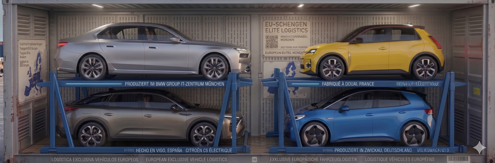

# Nubenetes Elite Portal (V2) | Awesome Kubernetes & Cloud 

!!! tip "Nubenetes V2 Elite Portal: AI-Curated & High-Density"
    You are browsing the AI-Curated V2 Elite Edition of Nubenetes. Looking for the complete historical archive? Explore the [**V1 Historical Archive**](/v1/).

  <a href="https://www.cncf.io/certification/software-conformance" class="hero-showcase-link">
    
    

      CNCF Conformance
      Standardized conformance guarantees seamless workload portability across the Cloud Native landscape.
    

  </a>

  <a href="https://en.wikipedia.org/wiki/Horatio_Nelson_Jackson" class="quote-card-link">
    

      
"I do not believe you can do today's job with yesterday's methods and be in business tomorrow"

      
Horatio Nelson Jackson

    

  </a>

## Explore the Ecosystem

  <a href="/kubernetes/" style="text-decoration: none; color: inherit; display: block;">
    

      
      
Ecosystem Core

      
Explore Kubernetes

    

  </a>
  <a href="/enterprise-ai-platforms/" style="text-decoration: none; color: inherit; display: block;">
    

      
☁️

      
Enterprise AI

      
Foundry · Bedrock · Vertex

    

  </a>
  <a href="/ai-agents-mcp/" style="text-decoration: none; color: inherit; display: block;">
    

      
      
AI & MCP Agents

      
Agentic Ecosystem

    

  </a>
  <a href="/tech-digest/" style="text-decoration: none; color: inherit; display: block;">
    

      
📊

      
Intelligence Digest

      
Top picks · 3/6/12 months

    

  </a>
  <a href="/videos/" style="text-decoration: none; color: inherit; display: block;">
    

      
      
Agentic Video Hub

      
Architect Video Library

    

  </a>
  <a href="/topic-map/" style="text-decoration: none; color: inherit; display: block;">
    

      
🗺️

      
Topic Map

      
All Categories · Directory

    

  </a>
  <a href="/introduction/" style="text-decoration: none; color: inherit; display: block;">
    

      
      
Get Started

      
Introduction Guide

    

  </a>
  <a href="./other-awesome-lists/" style="text-decoration: none; color: inherit; display: block;">
    

      
      
Awesome Lists

      
Curated awesome-* directory

    

  </a>

!!! abstract "The High-Density Vision"
    The V2 Edition is a curated, high-density version of the Nubenetes archive. Using **Agentic AI Orchestration**, the system selects only the most relevant, stable, and impactful resources for the modern Cloud Native ecosystem (2026 and beyond).

??? info "Knowledge Architecture and AI Coverage Status"
    The Nubenetes Elite Portal operates on a dual-layer knowledge architecture:
    1. **Elite Layer (AI-Enriched)**: Resources individually analyzed by our Agentic AI with high-density summaries and hierarchical indexing.
    2. **Standard Layer (Mapped)**: Resources identified as candidates for Elite status but pending deep AI analysis.

    **Current Inventory Coverage:**
    - **V1 Base Inventory**: 20085 total resources analyzed.
    - **V2 Elite Selection**: 15978 candidates identified (79.55% density ratio).
    - **AI Enrichment Coverage**: 15978 / 15978 (100.0%)
    - **GitHub Metadata Coverage**: 1837 / 1837 (100.0%) - *Critical for Maturity Tagging*
    - **Status**: The system is incrementally processing pending resources to complete the knowledge graph.

## Trending Now

🔥 Trending Now — Cloud Native Intelligence Updated Nov 14, 2026

<input type="checkbox" id="trend-expand-now" class="trending-toggle">

  
🔴 CRITICAL

  
Networking & Service Mesh

  
<a href="https://github.com/kubernetes-sigs/gateway-api">Kubernetes Gateway API</a>

  
2026-11-05 · 3k★

  
The Gateway API is the modern, role-oriented standard replacing Kubernetes Ingress for expressive L4-L7 traffic routing.

  
🔴 CRITICAL

  
AI & Agents

  
<a href="https://www.redhat.com/en/technologies/cloud-computing/openshift/openshift-ai">Red Hat OpenShift AI (RHOAI)</a>

  
2026-11-05 · 🌟🌟🌟🌟🌟

  
Delivers a fully supported, Kubernetes-native enterprise platform integrating vLLM, KServe, and Kueue for hybrid AI operations.

  
🔴 CRITICAL

  
Python, Java & Developer Ecosystem

  
<a href="https://github.com/metalbear-co/mirrord">metalbear-co/mirrord</a>

  
2026-11-05 · 5.4k★

  
Revolutionizes the cloud-native inner dev loop by transparently bridging local processes directly into remote Kubernetes namespaces without container rebuilds.

  
🔴 CRITICAL

  
Azure

  
<a href="https://github.com/kaito-project/kaito">KAITO (Kubernetes AI Toolchain Operator)</a>

  
2026-11-05 · 1k★

  
CNCF Sandbox operator that bridges Kubernetes with GenAI by automating open-weight LLM/SLM inference, fine-tuning, and GPU orchestration.

  
🔴 CRITICAL

  
Kubernetes & Orchestration

  
<a href="https://github.com/kubernetes-sigs/kueue">kubernetes-sigs/kueue: Kubernetes-native Job Queueing</a>

  
2026-11-05 · 3.1k★

  
Kueue has become the de facto cloud-native batch scheduling and queueing engine powering large-scale AI and ML workloads on Kubernetes.

  
🔴 CRITICAL

  
AWS

  
<a href="https://github.com/awslabs/ai-on-eks">AI on EKS (AWS Labs)</a>

  
2026-11-05 · 228★

  
Provides official production blueprints combining Amazon EKS, Argo CD, and GPU orchestration for running high-scale GenAI workloads.

  
🔴 CRITICAL

  
OpenShift / Red Hat

  
<a href="https://www.redhat.com/en/products/ai/openshift-ai">Red Hat OpenShift AI (RHOAI)</a>

  
2026-11-05 · 🌟🌟🌟🌟🌟

  
Serves as Red Hat's flagship enterprise platform for deploying, managing, and scaling distributed AI and MLOps workloads on OpenShift.

  
🔴 CRITICAL

  
Observability, SRE & Testing

  
<a href="https://github.com/kubernetes/kube-state-metrics">kube-state-metrics</a>

  
2026-11-05 · 6.2k★

  
Kube-state-metrics is an indispensable cluster service that translates Kubernetes API objects into core operational metrics across all enterprise environments.

  
🔴 CRITICAL

  
MLOps & Data Science

  
<a href="https://www.databricks.com/product/artificial-intelligence">Databricks Mosaic AI</a>

  
2026-11-05 · 🌟🌟🌟🌟🌟

  
Databricks Mosaic AI represents an industry-standard shift toward unifying Lakehouse data infrastructure with enterprise AI agent evaluation, fine-tuning, and production governance.

  
🔴 CRITICAL

  
Infrastructure as Code

  
<a href="https://github.com/opentofu/opentofu">OpenTofu Official GitHub Repository</a>

  
2026-11-02 · 30.7k★

  
OpenTofu represents the premier Linux Foundation-governed open-source fork of Terraform, introducing essential innovations like state encryption and community-driven governance.

  
🔴 CRITICAL

  
CI/CD & GitOps

  
<a href="https://github.com/fluxcd/flux2">github: Flux Version 2</a>

  
2026-11-01 · 8.5k★

  
Flux v2 is a graduated CNCF standard providing the decoupled GitOps Toolkit architecture for enterprise Kubernetes deployments.

  
🔴 CRITICAL

  
GCP, OCI & Others

  
<a href="https://github.com/GoogleCloudPlatform/k8s-config-connector">k8s-config-connector: GCP Config Connector</a>

  
2026-11-01 · 1.1k★

  
Enables true GitOps by allowing platform teams to manage Google Cloud infrastructure natively through declarative Kubernetes CRDs.

  
🔴 CRITICAL

  
Security & Compliance

  
<a href="https://github.com/hashicorp/vault">hashicorp/vault</a>

  
2026-11-01 · 36.5k★

  
HashiCorp Vault remains the foundational enterprise engine for dynamic secrets, identity brokering, and zero-trust cloud infrastructure.

  
🔴 CRITICAL

  
Containers & Runtime

  
<a href="https://github.com/containerd/containerd">containerd - An open and reliable container runtime</a>

  
2026-10-31 · 21.4k★

  
As the industry-standard CNCF runtime embedded in Kubernetes, containerd forms the core foundation of modern container execution.

  
🔴 CRITICAL

  
Data, Messaging & Storage

  
<a href="https://github.com/velero-io/velero">velero</a>

  
2026-10-30 · 10.4k★

  
Velero is the de facto industry standard for Kubernetes cluster disaster recovery, state backup, and persistent volume migration.

  
🔴 CRITICAL

  
DevOps & Culture

  
<a href="https://github.com/devtron-labs/devtron">Devtron</a>

  
2026-10-30 · 5.6k★

  
Unifies Kubernetes AppOps, GitOps, and observability into a single interface, significantly streamlining enterprise cloud native delivery workflows.

<label for="trend-expand-now" class="trending-showmore">▼ Show 7 more▲ Show less</label>

📈 Rising this Quarter — Sustained Momentum

<input type="checkbox" id="trend-expand-rising" class="trending-toggle">

  
🔴 CRITICAL

  
AI & Agents

  
<a href="https://github.com/vllm-project/vllm">vLLM on Kubernetes</a>

  
2026-11-02 · 96.2k★

  
Serves as the foundational standard for high-performance, memory-efficient LLM inference and serving on production Kubernetes clusters.

  
🔴 CRITICAL

  
Networking & Service Mesh

  
<a href="https://github.com/istio/istio">Istio</a>

  
2026-11-01 · 38.5k★

  
Istio is the leading cloud native service mesh standard driving zero-trust security and the sidecarless ambient mesh architecture.

  
🔴 CRITICAL

  
Python, Java & Developer Ecosystem

  
<a href="https://github.com/spring-projects/spring-boot#L73">spring-projects: springboot enables these probes automatically when running in k8s</a>

  
2026-10-28 · 81.8k★

  
Provides automatic, native Kubernetes liveness and readiness probe alignment for Spring Boot workloads running inside container platforms.

  
🔴 CRITICAL

  
Observability, SRE & Testing

  
<a href="https://github.com/prometheus/prometheus">prometheus</a>

  
2026-10-25 · 66.8k★

  
Prometheus remains the foundational CNCF graduated metric engine and the ubiquitous industry standard for cloud-native telemetry.

  
🔴 CRITICAL

  
Kubernetes & Orchestration

  
<a href="https://github.com/kubernetes-sigs/kubebuilder">kubernetes-sigs/kubebuilder</a>

  
2026-11-05 · 9.4k★

  
Kubebuilder serves as the industry-standard developer framework for scaffolding production-grade Kubernetes Custom Resource Definitions and controllers.

  
🔴 CRITICAL

  
Azure

  
<a href="https://github.com/microsoft/azurelinux">CBL-Mariner</a>

  
2026-11-05 · 5.4k★

  
The purpose-built, secure, container-optimized host OS underpinning AKS and Microsoft's cloud native container infrastructure.

  
🔴 CRITICAL

  
Architecture & Microservices

  
<a href="https://github.com/etcd-io/etcd">Etcd</a>

  
2026-10-28 · 52.4k★

  
The foundational CNCF-graduated distributed key-value store underpinning Kubernetes and modern cloud native distributed state architecture.

  
🔴 CRITICAL

  
Virtualization & Private Cloud

  
<a href="https://github.com/kubernetes/kubeadm">Kubernetes Cluster with Kubeadm</a>

  
2026-10-29 · 4k★

  
Serves as the foundational, CNCF-standard bootstrapping engine powering modern bare-metal and private cloud Kubernetes deployments.

  
🟡 HIGH

  
GCP, OCI & Others

  
<a href="https://github.com/google/adk-python">Google Agent Development Kit (ADK)</a>

  
2026-11-05 · 22.1k★

  
Provides an open-source, code-first multi-agent development framework with native support for the Model Context Protocol (MCP).

  
🔴 CRITICAL

  
Data, Messaging & Storage

  
<a href="https://github.com/CrunchyData/postgres-operator">postgres-operator</a>

  
2026-10-21 · 4.5k★

  
The Crunchy Data operator provides enterprise-grade automation for running highly available, production-ready PostgreSQL on Kubernetes.

  
🟡 HIGH

  
Security & Compliance

  
<a href="https://github.com/kubescape/kubescape">kubescape</a>

  
2026-11-05 · 11.8k★

  
Kubescape provides continuous compliance posture management and risk auditing directly integrated into Kubernetes and CI/CD pipelines.

  
🟡 HIGH

  
OpenShift / Red Hat

  
<a href="https://github.com/llm-d/llm-d">llm-d (Kubernetes-Native Distributed LLM Inference)</a>

  
2026-11-05 · 5.2k★

  
Provides a collaborative, Kubernetes-native inference framework co-engineered by Red Hat to optimize distributed LLM serving using the Gateway API.

<label for="trend-expand-rising" class="trending-showmore">▼ Show 6 more▲ Show less</label>

  <a href="/tech-digest/" class="digest-link-card">📊 Full Tech & Cloud Digest →</a>
  <a href="/industry-digest/" class="digest-link-card">🌍 Industry & Geo Digest →</a>

## The Cloud Native Universe We Track

AI & Advanced Tech

[{: style="width:48px; height:48px; object-fit:contain; margin:6px;" loading="lazy" .channel-logo}](https://www.youtube.com/@GoogleGemini) [{: style="width:48px; height:48px; object-fit:contain; margin:6px;" loading="lazy" .channel-logo}](https://www.youtube.com/@googledeepmind) [{: style="width:48px; height:48px; object-fit:contain; margin:6px;" loading="lazy" .channel-logo}](https://www.youtube.com/@anthropic-ai) [{: style="width:48px; height:48px; object-fit:contain; margin:6px;" loading="lazy" .channel-logo}](https://www.youtube.com/OpenAI) [{: style="width:48px; height:48px; object-fit:contain; margin:6px;" loading="lazy" .channel-logo}](https://www.youtube.com/@aiatmeta) [{: style="width:48px; height:48px; object-fit:contain; margin:6px;" loading="lazy" .channel-logo}](https://www.youtube.com/@Microsoft.Copilot) [{: style="width:48px; height:48px; object-fit:contain; margin:6px;" loading="lazy" .channel-logo}](https://www.youtube.com/@MicrosoftReactor) [{: style="width:48px; height:48px; object-fit:contain; margin:6px;" loading="lazy" .channel-logo}](https://www.youtube.com/@DotCSV) [{: style="width:48px; height:48px; object-fit:contain; margin:6px;" loading="lazy" .channel-logo}](https://www.youtube.com/@gustavo-entrala)

Cloud Providers & Core Infrastructure

[{: style="width:48px; height:48px; object-fit:contain; margin:6px;" loading="lazy" .channel-logo}](https://www.youtube.com/c/amazonwebservices) [{: style="width:48px; height:48px; object-fit:contain; margin:6px;" loading="lazy" .channel-logo}](https://www.youtube.com/c/MicrosoftAzure) [{: style="width:48px; height:48px; object-fit:contain; margin:6px;" loading="lazy" .channel-logo}](https://www.youtube.com/user/googlecloudplatform) [{: style="width:48px; height:48px; object-fit:contain; margin:6px;" loading="lazy" .channel-logo}](https://www.youtube.com/@googlecloudtech) [{: style="width:48px; height:48px; object-fit:contain; margin:6px;" loading="lazy" .channel-logo}](https://www.youtube.com/c/IBMTechnology) [{: style="width:48px; height:48px; object-fit:contain; margin:6px;" loading="lazy" .channel-logo}](https://www.youtube.com/c/OracleCloudInfrastructure) [{: style="width:48px; height:48px; object-fit:contain; margin:6px;" loading="lazy" .channel-logo}](https://www.youtube.com/c/Digitalocean) [{: style="width:48px; height:48px; object-fit:contain; margin:6px;" loading="lazy" .channel-logo}](https://www.youtube.com/cloudflare) [{: style="width:48px; height:48px; object-fit:contain; margin:6px;" loading="lazy" .channel-logo}](https://www.youtube.com/c/Scaleway-Cloud) [{: style="width:48px; height:48px; object-fit:contain; margin:6px;" loading="lazy" .channel-logo}](https://www.youtube.com/c/OpenStackFoundation) [{: style="width:48px; height:48px; object-fit:contain; margin:6px;" loading="lazy" .channel-logo}](https://www.youtube.com/c/AlibabaCloud) [{: style="width:48px; height:48px; object-fit:contain; margin:6px;" loading="lazy" .channel-logo}](https://www.youtube.com/c/linode) [{: style="width:48px; height:48px; object-fit:contain; margin:6px;" loading="lazy" .channel-logo}](https://www.youtube.com/channel/UCB5WMc2FfrxKzfd7XIODoMw) [{: style="width:48px; height:48px; object-fit:contain; margin:6px;" loading="lazy" .channel-logo}](https://www.youtube.com/@kyndryl) [{: style="width:48px; height:48px; object-fit:contain; margin:6px;" loading="lazy" .channel-logo}](https://www.youtube.com/@arsys) [{: style="width:48px; height:48px; object-fit:contain; margin:6px;" loading="lazy" .channel-logo}](https://www.youtube.com/@IONOSUK) [{: style="width:48px; height:48px; object-fit:contain; margin:6px;" loading="lazy" .channel-logo}](https://www.youtube.com/nutanix)

Cloud Native Platforms & Kubernetes

[{: style="width:48px; height:48px; object-fit:contain; margin:6px;" loading="lazy" .channel-logo}](https://www.youtube.com/c/cloudnativefdn) [{: style="width:48px; height:48px; object-fit:contain; margin:6px;" loading="lazy" .channel-logo}](https://www.youtube.com/kubernetescommunity) [{: style="width:48px; height:48px; object-fit:contain; margin:6px;" loading="lazy" .channel-logo}](https://www.youtube.com/c/redhat) [{: style="width:48px; height:48px; object-fit:contain; margin:6px;" loading="lazy" .channel-logo}](https://www.youtube.com/c/OpenShift) [{: style="width:48px; height:48px; object-fit:contain; margin:6px;" loading="lazy" .channel-logo}](https://www.youtube.com/c/Rancher) [{: style="width:48px; height:48px; object-fit:contain; margin:6px;" loading="lazy" .channel-logo}](https://www.youtube.com/c/VMwareTanzu) [{: style="width:48px; height:48px; object-fit:contain; margin:6px;" loading="lazy" .channel-logo}](https://www.youtube.com/channel/UCOvYmppcbOPm1viN6ust3lA) [{: style="width:48px; height:48px; object-fit:contain; margin:6px;" loading="lazy" .channel-logo}](https://www.youtube.com/channel/UCoZxt-YMhGHb20ZkvcCc5KA) [{: style="width:48px; height:48px; object-fit:contain; margin:6px;" loading="lazy" .channel-logo}](https://www.youtube.com/c/keptn) [{: style="width:48px; height:48px; object-fit:contain; margin:6px;" loading="lazy" .channel-logo}](https://www.youtube.com/@NetBoxLabs) [{: style="width:48px; height:48px; object-fit:contain; margin:6px;" loading="lazy" .channel-logo}](https://www.youtube.com/@kubefm) [{: style="width:48px; height:48px; object-fit:contain; margin:6px;" loading="lazy" .channel-logo}](https://www.youtube.com/c/ContainerDays) [{: style="width:48px; height:48px; object-fit:contain; margin:6px;" loading="lazy" .channel-logo}](https://www.youtube.com/c/Tetrate) [{: style="width:48px; height:48px; object-fit:contain; margin:6px;" loading="lazy" .channel-logo}](https://www.youtube.com/vmware) [{: style="width:48px; height:48px; object-fit:contain; margin:6px;" loading="lazy" .channel-logo}](https://www.youtube.com/ProxmoxVE)

DevOps, CI/CD, IaC & GitOps

[{: style="width:48px; height:48px; object-fit:contain; margin:6px;" loading="lazy" .channel-logo}](https://www.youtube.com/c/DockerIo) [{: style="width:48px; height:48px; object-fit:contain; margin:6px;" loading="lazy" .channel-logo}](https://www.youtube.com/c/CloudBeesTV) [{: style="width:48px; height:48px; object-fit:contain; margin:6px;" loading="lazy" .channel-logo}](https://www.youtube.com/c/jenkinscicd) [{: style="width:48px; height:48px; object-fit:contain; margin:6px;" loading="lazy" .channel-logo}](https://www.youtube.com/@jayex-io) [{: style="width:48px; height:48px; object-fit:contain; margin:6px;" loading="lazy" .channel-logo}](https://www.youtube.com/@spinnaker7813) [{: style="width:48px; height:48px; object-fit:contain; margin:6px;" loading="lazy" .channel-logo}](https://www.youtube.com/c/HashiCorp) [{: style="width:48px; height:48px; object-fit:contain; margin:6px;" loading="lazy" .channel-logo}](https://www.youtube.com/c/PulumiTV) [{: style="width:48px; height:48px; object-fit:contain; margin:6px;" loading="lazy" .channel-logo}](https://www.youtube.com/@azure-terraformer) [{: style="width:48px; height:48px; object-fit:contain; margin:6px;" loading="lazy" .channel-logo}](https://www.youtube.com/@NedintheCloud) [{: style="width:48px; height:48px; object-fit:contain; margin:6px;" loading="lazy" .channel-logo}](https://www.youtube.com/c/GitHub) [{: style="width:48px; height:48px; object-fit:contain; margin:6px;" loading="lazy" .channel-logo}](https://www.youtube.com/c/Gitlab) [{: style="width:48px; height:48px; object-fit:contain; margin:6px;" loading="lazy" .channel-logo}](https://www.youtube.com/c/Gitkraken) [{: style="width:48px; height:48px; object-fit:contain; margin:6px;" loading="lazy" .channel-logo}](https://www.youtube.com/c/Atlassian) [{: style="width:48px; height:48px; object-fit:contain; margin:6px;" loading="lazy" .channel-logo}](https://www.youtube.com/c/postman) [{: style="width:48px; height:48px; object-fit:contain; margin:6px;" loading="lazy" .channel-logo}](https://www.youtube.com/c/Smartbear) [{: style="width:48px; height:48px; object-fit:contain; margin:6px;" loading="lazy" .channel-logo}](https://www.youtube.com/c/JFrogInc) [{: style="width:48px; height:48px; object-fit:contain; margin:6px;" loading="lazy" .channel-logo}](https://www.youtube.com/c/Sonatypeinc) [{: style="width:48px; height:48px; object-fit:contain; margin:6px;" loading="lazy" .channel-logo}](https://www.youtube.com/@SonarSource) [{: style="width:48px; height:48px; object-fit:contain; margin:6px;" loading="lazy" .channel-logo}](https://www.youtube.com/c/ContinuousDeliveryFoundation) [{: style="width:48px; height:48px; object-fit:contain; margin:6px;" loading="lazy" .channel-logo}](https://www.youtube.com/c/AzureDevOps) [{: style="width:48px; height:48px; object-fit:contain; margin:6px;" loading="lazy" .channel-logo}](https://www.youtube.com/@DevOpsDirective) [{: style="width:48px; height:48px; object-fit:contain; margin:6px;" loading="lazy" .channel-logo}](https://www.youtube.com/@DevOpsParadox)

Observability, Databases & Cloud Storage

[{: style="width:48px; height:48px; object-fit:contain; margin:6px;" loading="lazy" .channel-logo}](https://www.youtube.com/c/PrometheusIo) [{: style="width:48px; height:48px; object-fit:contain; margin:6px;" loading="lazy" .channel-logo}](https://www.youtube.com/c/Grafana) [{: style="width:48px; height:48px; object-fit:contain; margin:6px;" loading="lazy" .channel-logo}](https://www.youtube.com/c/Istio) [{: style="width:48px; height:48px; object-fit:contain; margin:6px;" loading="lazy" .channel-logo}](https://www.youtube.com/c/Elastic) [{: style="width:48px; height:48px; object-fit:contain; margin:6px;" loading="lazy" .channel-logo}](https://www.youtube.com/c/dynatrace) [{: style="width:48px; height:48px; object-fit:contain; margin:6px;" loading="lazy" .channel-logo}](https://www.youtube.com/c/appdynamics) [{: style="width:48px; height:48px; object-fit:contain; margin:6px;" loading="lazy" .channel-logo}](https://www.youtube.com/c/NewRelicInc) [{: style="width:48px; height:48px; object-fit:contain; margin:6px;" loading="lazy" .channel-logo}](https://www.youtube.com/channel/UC8uN3yhpeBeerGNwDiQbcgw) [{: style="width:48px; height:48px; object-fit:contain; margin:6px;" loading="lazy" .channel-logo}](https://www.youtube.com/c/WeaveWorksInc) [{: style="width:48px; height:48px; object-fit:contain; margin:6px;" loading="lazy" .channel-logo}](https://www.youtube.com/c/CrunchyDataPostgres) [{: style="width:48px; height:48px; object-fit:contain; margin:6px;" loading="lazy" .channel-logo}](https://www.youtube.com/channel/UC5qMsRjObu685rTBq0PJX8w) [{: style="width:48px; height:48px; object-fit:contain; margin:6px;" loading="lazy" .channel-logo}](https://www.youtube.com/c/cockroachdb) [{: style="width:48px; height:48px; object-fit:contain; margin:6px;" loading="lazy" .channel-logo}](https://www.youtube.com/c/MongoDBofficial) [{: style="width:48px; height:48px; object-fit:contain; margin:6px;" loading="lazy" .channel-logo}](https://www.youtube.com/c/Redisinc) [{: style="width:48px; height:48px; object-fit:contain; margin:6px;" loading="lazy" .channel-logo}](https://www.youtube.com/c/Confluent) [{: style="width:48px; height:48px; object-fit:contain; margin:6px;" loading="lazy" .channel-logo}](https://www.youtube.com/channel/UCud7fErZAyMC6lHT_cWZNfA) [{: style="width:48px; height:48px; object-fit:contain; margin:6px;" loading="lazy" .channel-logo}](https://www.youtube.com/channel/UC3ywadaAUQ1FI4YsHZ8wa0g) [{: style="width:48px; height:48px; object-fit:contain; margin:6px;" loading="lazy" .channel-logo}](https://www.youtube.com/channel/UCm63IQg81KP9vXRWSHQpu1w) [{: style="width:48px; height:48px; object-fit:contain; margin:6px;" loading="lazy" .channel-logo}](https://www.youtube.com/channel/UCt7N400Z8gB_3yKq1qrjP2w) [{: style="width:48px; height:48px; object-fit:contain; margin:6px;" loading="lazy" .channel-logo}](https://www.youtube.com/c/Portworx) [{: style="width:48px; height:48px; object-fit:contain; margin:6px;" loading="lazy" .channel-logo}](https://www.youtube.com/@ClickHouseDB) [{: style="width:48px; height:48px; object-fit:contain; margin:6px;" loading="lazy" .channel-logo}](https://www.youtube.com/@Firebase) [{: style="width:48px; height:48px; object-fit:contain; margin:6px;" loading="lazy" .channel-logo}](https://www.youtube.com/c/supabase)

Development, Testing & Collaboration

[{: style="width:48px; height:48px; object-fit:contain; margin:6px;" loading="lazy" .channel-logo}](https://www.youtube.com/c/Code) [{: style="width:48px; height:48px; object-fit:contain; margin:6px;" loading="lazy" .channel-logo}](https://www.youtube.com/@Playwrightdev) [{: style="width:48px; height:48px; object-fit:contain; margin:6px;" loading="lazy" .channel-logo}](https://www.youtube.com/c/GoogleChromeDevelopers) [{: style="width:48px; height:48px; object-fit:contain; margin:6px;" loading="lazy" .channel-logo}](https://www.youtube.com/c/MozillaDeveloper) [{: style="width:48px; height:48px; object-fit:contain; margin:6px;" loading="lazy" .channel-logo}](https://www.youtube.com/c/RedHatDevelopers) [{: style="width:48px; height:48px; object-fit:contain; margin:6px;" loading="lazy" .channel-logo}](https://www.youtube.com/user/SpringSourceDev) [{: style="width:48px; height:48px; object-fit:contain; margin:6px;" loading="lazy" .channel-logo}](https://www.youtube.com/c/Quarkusio) [{: style="width:48px; height:48px; object-fit:contain; margin:6px;" loading="lazy" .channel-logo}](https://www.youtube.com/c/Lightbend-TV) [{: style="width:48px; height:48px; object-fit:contain; margin:6px;" loading="lazy" .channel-logo}](https://www.youtube.com/c/LambdaTest) [{: style="width:48px; height:48px; object-fit:contain; margin:6px;" loading="lazy" .channel-logo}](https://www.youtube.com/c/RocketChatApp) [{: style="width:48px; height:48px; object-fit:contain; margin:6px;" loading="lazy" .channel-logo}](https://www.youtube.com/c/Slackhq) [{: style="width:48px; height:48px; object-fit:contain; margin:6px;" loading="lazy" .channel-logo}](https://www.youtube.com/c/MattermostHQ) [{: style="width:48px; height:48px; object-fit:contain; margin:6px;" loading="lazy" .channel-logo}](https://www.youtube.com/c/microsoft365) [{: style="width:48px; height:48px; object-fit:contain; margin:6px;" loading="lazy" .channel-logo}](https://www.youtube.com/c/OpenProjectCommunity) [{: style="width:48px; height:48px; object-fit:contain; margin:6px;" loading="lazy" .channel-logo}](https://www.youtube.com/Salesforce) [{: style="width:48px; height:48px; object-fit:contain; margin:6px;" loading="lazy" .channel-logo}](https://www.youtube.com/user/SAP)

Tech E-Learning, Influencers & Communities

[{: style="width:48px; height:48px; object-fit:contain; margin:6px;" loading="lazy" .channel-logo}](https://www.youtube.com/c/Cloudacademy) [{: style="width:48px; height:48px; object-fit:contain; margin:6px;" loading="lazy" .channel-logo}](https://www.youtube.com/c/AcloudGuru) [{: style="width:48px; height:48px; object-fit:contain; margin:6px;" loading="lazy" .channel-logo}](https://www.youtube.com/c/Devopsdotcom) [{: style="width:48px; height:48px; object-fit:contain; margin:6px;" loading="lazy" .channel-logo}](https://www.youtube.com/c/XebiaLabs) [{: style="width:48px; height:48px; object-fit:contain; margin:6px;" loading="lazy" .channel-logo}](https://www.youtube.com/c/Devopslibrary) [{: style="width:48px; height:48px; object-fit:contain; margin:6px;" loading="lazy" .channel-logo}](https://www.youtube.com/c/codecademy) [{: style="width:48px; height:48px; object-fit:contain; margin:6px;" loading="lazy" .channel-logo}](https://www.youtube.com/user/coursera) [{: style="width:48px; height:48px; object-fit:contain; margin:6px;" loading="lazy" .channel-logo}](https://www.youtube.com/c/Academind) [{: style="width:48px; height:48px; object-fit:contain; margin:6px;" loading="lazy" .channel-logo}](https://www.youtube.com/c/guru99comm) [{: style="width:48px; height:48px; object-fit:contain; margin:6px;" loading="lazy" .channel-logo}](https://www.youtube.com/c/Intellipaat) [{: style="width:48px; height:48px; object-fit:contain; margin:6px;" loading="lazy" .channel-logo}](https://www.youtube.com/channel/UCv9MUffHWyo2GgLIDLVu0KQ) [{: style="width:48px; height:48px; object-fit:contain; margin:6px;" loading="lazy" .channel-logo}](https://www.youtube.com/c/Thetips4you) [{: style="width:48px; height:48px; object-fit:contain; margin:6px;" loading="lazy" .channel-logo}](https://www.youtube.com/channel/UC57acx8sCmE7uFHfVMvIlNg) [{: style="width:48px; height:48px; object-fit:contain; margin:6px;" loading="lazy" .channel-logo}](https://www.youtube.com/c/NTFAQGuy) [{: style="width:48px; height:48px; object-fit:contain; margin:6px;" loading="lazy" .channel-logo}](https://www.youtube.com/channel/UCorFV-WGnajyfNu4zPI0AAA) [{: style="width:48px; height:48px; object-fit:contain; margin:6px;" loading="lazy" .channel-logo}](https://www.youtube.com/c/AppsCodeInc) [{: style="width:48px; height:48px; object-fit:contain; margin:6px;" loading="lazy" .channel-logo}](https://www.youtube.com/c/DevOpsToolkit) [{: style="width:48px; height:48px; object-fit:contain; margin:6px;" loading="lazy" .channel-logo}](https://www.youtube.com/c/AnsiblePilot) [{: style="width:48px; height:48px; object-fit:contain; margin:6px;" loading="lazy" .channel-logo}](https://www.youtube.com/CodelyTV) [{: style="width:48px; height:48px; object-fit:contain; margin:6px;" loading="lazy" .channel-logo}](https://www.youtube.com/c/PeladoNerd) [{: style="width:48px; height:48px; object-fit:contain; margin:6px;" loading="lazy" .channel-logo}](https://www.youtube.com/c/HolaMundoDev) [{: style="width:48px; height:48px; object-fit:contain; margin:6px;" loading="lazy" .channel-logo}](https://www.youtube.com/c/JavierGarz%C3%A1s) [{: style="width:48px; height:48px; object-fit:contain; margin:6px;" loading="lazy" .channel-logo}](https://www.youtube.com/c/LondonIAC) [{: style="width:48px; height:48px; object-fit:contain; margin:6px;" loading="lazy" .channel-logo}](https://www.youtube.com/c/TechWorldwithNana) [{: style="width:48px; height:48px; object-fit:contain; margin:6px;" loading="lazy" .channel-logo}](https://www.youtube.com/c/Honeypotio) [{: style="width:48px; height:48px; object-fit:contain; margin:6px;" loading="lazy" .channel-logo}](https://www.youtube.com/c/AliSpittelDev) [{: style="width:48px; height:48px; object-fit:contain; margin:6px;" loading="lazy" .channel-logo}](https://www.youtube.com/c/ThomasMaurerCloud) [{: style="width:48px; height:48px; object-fit:contain; margin:6px;" loading="lazy" .channel-logo}](https://www.youtube.com/c/Freecodecamp) [{: style="width:48px; height:48px; object-fit:contain; margin:6px;" loading="lazy" .channel-logo}](https://www.youtube.com/c/TheNewStack) [{: style="width:48px; height:48px; object-fit:contain; margin:6px;" loading="lazy" .channel-logo}](https://www.youtube.com/c/priyankavergadia) [{: style="width:48px; height:48px; object-fit:contain; margin:6px;" loading="lazy" .channel-logo}](https://www.youtube.com/c/TinaHuang1) [{: style="width:48px; height:48px; object-fit:contain; margin:6px;" loading="lazy" .channel-logo}](https://www.youtube.com/channel/UC2Pk9GcHhlVV0R9CQIU6gLw) [{: style="width:48px; height:48px; object-fit:contain; margin:6px;" loading="lazy" .channel-logo}](https://www.youtube.com/c/MadeByGPS) [{: style="width:48px; height:48px; object-fit:contain; margin:6px;" loading="lazy" .channel-logo}](https://www.youtube.com/c/AnaisUrlichs) [{: style="width:48px; height:48px; object-fit:contain; margin:6px;" loading="lazy" .channel-logo}](https://www.youtube.com/c/TheDigitalLifeTech) [{: style="width:48px; height:48px; object-fit:contain; margin:6px;" loading="lazy" .channel-logo}](https://www.youtube.com/@techwithhelen) [{: style="width:48px; height:48px; object-fit:contain; margin:6px;" loading="lazy" .channel-logo}](https://www.youtube.com/@ByteByteGo) [{: style="width:48px; height:48px; object-fit:contain; margin:6px;" loading="lazy" .channel-logo}](https://www.youtube.com/@midulive) [{: style="width:48px; height:48px; object-fit:contain; margin:6px;" loading="lazy" .channel-logo}](https://www.youtube.com/@returngis) [{: style="width:48px; height:48px; object-fit:contain; margin:6px;" loading="lazy" .channel-logo}](https://www.youtube.com/@OlenaKutsenko) [{: style="width:48px; height:48px; object-fit:contain; margin:6px;" loading="lazy" .channel-logo}](https://www.youtube.com/@mouredev) [{: style="width:48px; height:48px; object-fit:contain; margin:6px;" loading="lazy" .channel-logo}](https://www.youtube.com/@CloudNativeMadrid) [{: style="width:48px; height:48px; object-fit:contain; margin:6px;" loading="lazy" .channel-logo}](https://www.youtube.com/@ITOpsTalk) [{: style="width:48px; height:48px; object-fit:contain; margin:6px;" loading="lazy" .channel-logo}](https://www.youtube.com/c/dzone) [{: style="width:48px; height:48px; object-fit:contain; margin:6px;" loading="lazy" .channel-logo}](https://www.youtube.com/@JorgeMonzon%C3%ADsSAP) [{: style="width:48px; height:48px; object-fit:contain; margin:6px;" loading="lazy" .channel-logo}](https://www.youtube.com/@ITTelevisi%C3%B3n_ES)

## Label Heatmap

Every technical label across Nubenetes, sized by how many resources carry it. Click any label to open it on the [Technical Tags](/tags/) page.

<a class="v2-heat-tag v2-heat-3" href="/tags/#agnostic-content" title="58 resources">Agnostic58</a>
<a class="v2-heat-tag v2-heat-3" href="/tags/#ai" title="20 resources">AI20</a>
<a class="v2-heat-tag v2-heat-1" href="/tags/#aiops" title="1 resources">Aiops1</a>
<a class="v2-heat-tag v2-heat-1" href="/tags/#aks" title="1 resources">Aks1</a>
<a class="v2-heat-tag v2-heat-2" href="/tags/#ansible-content" title="3 resources">Ansible3</a>
<a class="v2-heat-tag v2-heat-1" href="/tags/#any-content" title="1 resources">Any1</a>
<a class="v2-heat-tag v2-heat-1" href="/tags/#apacheconf-content" title="1 resources">Apacheconf1</a>
<a class="v2-heat-tag v2-heat-1" href="/tags/#api-first" title="1 resources">Api-First1</a>
<a class="v2-heat-tag v2-heat-1" href="/tags/#architecture" title="1 resources">Architecture1</a>
<a class="v2-heat-tag v2-heat-1" href="/tags/#asciidoc-content" title="1 resources">Asciidoc1</a>
<a class="v2-heat-tag v2-heat-1" href="/tags/#automation" title="2 resources">Automation2</a>
<a class="v2-heat-tag v2-heat-2" href="/tags/#awk-content" title="3 resources">Awk3</a>
<a class="v2-heat-tag v2-heat-1" href="/tags/#aws" title="2 resources">Aws2</a>
<a class="v2-heat-tag v2-heat-3" href="/tags/#azure" title="22 resources">Azure22</a>
<a class="v2-heat-tag v2-heat-1" href="/tags/#ballerina-content" title="1 resources">Ballerina1</a>
<a class="v2-heat-tag v2-heat-4" href="/tags/#bash-content" title="110 resources">Bash110</a>
<a class="v2-heat-tag v2-heat-1" href="/tags/#bash-python-content" title="1 resources">Bash/Python1</a>
<a class="v2-heat-tag v2-heat-1" href="/tags/#bash-yaml-content" title="1 resources">Bash/Yaml1</a>
<a class="v2-heat-tag v2-heat-3" href="/tags/#bicep-content" title="18 resources">Bicep18</a>
<a class="v2-heat-tag v2-heat-3" href="/tags/#c-content" title="29 resources">C29</a>
<a class="v2-heat-tag v2-heat-3" href="/tags/#c-sharp-content" title="27 resources">C#27</a>
<a class="v2-heat-tag v2-heat-1" href="/tags/#c-plus-plus-go-python-content" title="1 resources">C++ / Go / Python1</a>
<a class="v2-heat-tag v2-heat-1" href="/tags/#c-plus-plus-go-content" title="1 resources">C++ / Go1</a>
<a class="v2-heat-tag v2-heat-3" href="/tags/#c-plus-plus-content" title="22 resources">C++22</a>
<a class="v2-heat-tag v2-heat-1" href="/tags/#c-bash-content" title="1 resources">C/Bash1</a>
<a class="v2-heat-tag v2-heat-1" href="/tags/#c-c-plus-plus-content" title="1 resources">C/C++1</a>
<a class="v2-heat-tag v2-heat-4" href="/tags/#case-study" title="110 resources">Case Study110</a>
<a class="v2-heat-tag v2-heat-1" href="/tags/#chinese-content" title="1 resources">Chinese1</a>
<a class="v2-heat-tag v2-heat-2" href="/tags/#ci-cd" title="3 resources">Ci-Cd3</a>
<a class="v2-heat-tag v2-heat-2" href="/tags/#cicd" title="4 resources">Cicd4</a>
<a class="v2-heat-tag v2-heat-1" href="/tags/#clojure-content" title="1 resources">Clojure1</a>
<a class="v2-heat-tag v2-heat-3" href="/tags/#cloud-ai" title="43 resources">CLOUD-AI43</a>
<a class="v2-heat-tag v2-heat-6" href="/tags/#community-tool" title="8386 resources">Community-Tool8386</a>
<a class="v2-heat-tag v2-heat-2" href="/tags/#conceptual-content" title="13 resources">Conceptual13</a>
<a class="v2-heat-tag v2-heat-1" href="/tags/#dart-content" title="1 resources">Dart1</a>
<a class="v2-heat-tag v2-heat-5" href="/tags/#de-facto-standard" title="1292 resources">De Facto Standard1292</a>
<a class="v2-heat-tag v2-heat-1" href="/tags/#dev-dx" title="1 resources">Dev-Dx1</a>
<a class="v2-heat-tag v2-heat-1" href="/tags/#developer-experience" title="1 resources">Developer-Experience1</a>
<a class="v2-heat-tag v2-heat-1" href="/tags/#docker-content" title="1 resources">Docker1</a>
<a class="v2-heat-tag v2-heat-1" href="/tags/#docker-shell-content" title="1 resources">Docker/Shell1</a>
<a class="v2-heat-tag v2-heat-3" href="/tags/#dockerfile-content" title="20 resources">Dockerfile20</a>
<a class="v2-heat-tag v2-heat-1" href="/tags/#dockerfile-shell-content" title="1 resources">Dockerfile/Shell1</a>
<a class="v2-heat-tag v2-heat-1" href="/tags/#documentation" title="2 resources">Documentation2</a>
<a class="v2-heat-tag v2-heat-3" href="/tags/#ebpf" title="71 resources">EBPF71</a>
<a class="v2-heat-tag v2-heat-1" href="/tags/#elixir-content" title="1 resources">Elixir1</a>
<a class="v2-heat-tag v2-heat-4" href="/tags/#emerging" title="503 resources">Emerging503</a>
<a class="v2-heat-tag v2-heat-5" href="/tags/#enterprise-stable" title="1157 resources">Enterprise-Stable1157</a>
<a class="v2-heat-tag v2-heat-1" href="/tags/#erlang-content" title="1 resources">Erlang1</a>
<a class="v2-heat-tag v2-heat-1" href="/tags/#flux-content" title="1 resources">Flux1</a>
<a class="v2-heat-tag v2-heat-2" href="/tags/#french-content" title="3 resources">French3</a>
<a class="v2-heat-tag v2-heat-1" href="/tags/#gcp" title="1 resources">Gcp1</a>
<a class="v2-heat-tag v2-heat-1" href="/tags/#german-content" title="1 resources">German1</a>
<a class="v2-heat-tag v2-heat-1" href="/tags/#git" title="2 resources">Git2</a>
<a class="v2-heat-tag v2-heat-1" href="/tags/#github-actions" title="1 resources">Github-Actions1</a>
<a class="v2-heat-tag v2-heat-2" href="/tags/#gitops" title="3 resources">GITOPS3</a>
<a class="v2-heat-tag v2-heat-1" href="/tags/#go-javascript-content" title="2 resources">Go / Javascript2</a>
<a class="v2-heat-tag v2-heat-1" href="/tags/#go-yaml-content" title="2 resources">Go / Yaml2</a>
<a class="v2-heat-tag v2-heat-5" href="/tags/#go-content" title="1038 resources">Go1038</a>
<a class="v2-heat-tag v2-heat-1" href="/tags/#go-bash-content" title="1 resources">Go/Bash1</a>
<a class="v2-heat-tag v2-heat-1" href="/tags/#go-markdown-content" title="1 resources">Go/Markdown1</a>
<a class="v2-heat-tag v2-heat-1" href="/tags/#go-rego-content" title="1 resources">Go/Rego1</a>
<a class="v2-heat-tag v2-heat-1" href="/tags/#go-typescript-content" title="1 resources">Go/Typescript1</a>
<a class="v2-heat-tag v2-heat-2" href="/tags/#go-yaml-content-2" title="3 resources">Go/Yaml3</a>
<a class="v2-heat-tag v2-heat-3" href="/tags/#gpu" title="61 resources">GPU61</a>
<a class="v2-heat-tag v2-heat-3" href="/tags/#groovy-content" title="59 resources">Groovy59</a>
<a class="v2-heat-tag v2-heat-1" href="/tags/#groovy-hcl-content" title="1 resources">Groovy/Hcl1</a>
<a class="v2-heat-tag v2-heat-1" href="/tags/#groovy-yaml-content" title="1 resources">Groovy/Yaml1</a>
<a class="v2-heat-tag v2-heat-5" href="/tags/#guide" title="1077 resources">Guide1077</a>
<a class="v2-heat-tag v2-heat-2" href="/tags/#haskell-content" title="4 resources">Haskell4</a>
<a class="v2-heat-tag v2-heat-4" href="/tags/#hcl-content" title="221 resources">Hcl221</a>
<a class="v2-heat-tag v2-heat-1" href="/tags/#hcl-packer-content" title="1 resources">Hcl/Packer1</a>
<a class="v2-heat-tag v2-heat-2" href="/tags/#hcl-yaml-content" title="4 resources">Hcl/Yaml4</a>
<a class="v2-heat-tag v2-heat-1" href="/tags/#helm-content" title="1 resources">Helm1</a>
<a class="v2-heat-tag v2-heat-3" href="/tags/#html-content" title="36 resources">Html36</a>
<a class="v2-heat-tag v2-heat-3" href="/tags/#iac" title="41 resources">IAC41</a>
<a class="v2-heat-tag v2-heat-1" href="/tags/#iam" title="1 resources">Iam1</a>
<a class="v2-heat-tag v2-heat-1" href="/tags/#image-pdf-content" title="1 resources">Image/Pdf1</a>
<a class="v2-heat-tag v2-heat-1" href="/tags/#ini-content" title="1 resources">Ini1</a>
<a class="v2-heat-tag v2-heat-1" href="/tags/#ini-yaml-content" title="1 resources">Ini/Yaml1</a>
<a class="v2-heat-tag v2-heat-1" href="/tags/#java-english-content" title="1 resources">Java / English1</a>
<a class="v2-heat-tag v2-heat-1" href="/tags/#java-go-node-js-content" title="1 resources">Java / Go / Node.Js1</a>
<a class="v2-heat-tag v2-heat-1" href="/tags/#java-yaml-content" title="2 resources">Java / Yaml2</a>
<a class="v2-heat-tag v2-heat-4" href="/tags/#java-content" title="446 resources">Java446</a>
<a class="v2-heat-tag v2-heat-1" href="/tags/#java-c-plus-plus-content" title="1 resources">Java/C++1</a>
<a class="v2-heat-tag v2-heat-4" href="/tags/#javascript-content" title="133 resources">Javascript133</a>
<a class="v2-heat-tag v2-heat-1" href="/tags/#javascript-shell-content" title="1 resources">Javascript/Shell1</a>
<a class="v2-heat-tag v2-heat-1" href="/tags/#javascript-typescript-content" title="2 resources">Javascript/Typescript2</a>
<a class="v2-heat-tag v2-heat-3" href="/tags/#json-content" title="22 resources">Json22</a>
<a class="v2-heat-tag v2-heat-2" href="/tags/#jsonnet-content" title="5 resources">Jsonnet5</a>
<a class="v2-heat-tag v2-heat-2" href="/tags/#kotlin-content" title="4 resources">Kotlin4</a>
<a class="v2-heat-tag v2-heat-2" href="/tags/#kql-content" title="5 resources">Kql5</a>
<a class="v2-heat-tag v2-heat-1" href="/tags/#kubernetes" title="2 resources">Kubernetes2</a>
<a class="v2-heat-tag v2-heat-5" href="/tags/#legacy" title="638 resources">Legacy638</a>
<a class="v2-heat-tag v2-heat-4" href="/tags/#llm" title="99 resources">LLM99</a>
<a class="v2-heat-tag v2-heat-1" href="/tags/#lua-content" title="2 resources">Lua2</a>
<a class="v2-heat-tag v2-heat-1" href="/tags/#machine-learning" title="1 resources">Machine-Learning1</a>
<a class="v2-heat-tag v2-heat-1" href="/tags/#makefile-content" title="1 resources">Makefile1</a>
<a class="v2-heat-tag v2-heat-4" href="/tags/#markdown-content" title="334 resources">Markdown334</a>
<a class="v2-heat-tag v2-heat-1" href="/tags/#markdown-images-content" title="1 resources">Markdown/Images1</a>
<a class="v2-heat-tag v2-heat-1" href="/tags/#markdown-shell-content" title="1 resources">Markdown/Shell1</a>
<a class="v2-heat-tag v2-heat-4" href="/tags/#mcp" title="247 resources">MCP247</a>
<a class="v2-heat-tag v2-heat-1" href="/tags/#merge-queue" title="1 resources">Merge-Queue1</a>
<a class="v2-heat-tag v2-heat-3" href="/tags/#mlops" title="63 resources">MLOPS63</a>
<a class="v2-heat-tag v2-heat-1" href="/tags/#multi-content" title="2 resources">Multi2</a>
<a class="v2-heat-tag v2-heat-1" href="/tags/#networking" title="2 resources">Networking2</a>
<a class="v2-heat-tag v2-heat-1" href="/tags/#nginx-conf-content" title="1 resources">Nginx Conf1</a>
<a class="v2-heat-tag v2-heat-1" href="/tags/#nix-content" title="2 resources">Nix2</a>
<a class="v2-heat-tag v2-heat-2" href="/tags/#node-js-content" title="3 resources">Node.Js3</a>
<a class="v2-heat-tag v2-heat-1" href="/tags/#norwegian-content" title="1 resources">Norwegian1</a>
<a class="v2-heat-tag v2-heat-1" href="/tags/#objective-c-content" title="1 resources">Objective-C1</a>
<a class="v2-heat-tag v2-heat-1" href="/tags/#observability" title="1 resources">Observability1</a>
<a class="v2-heat-tag v2-heat-1" href="/tags/#ocaml-content" title="1 resources">Ocaml1</a>
<a class="v2-heat-tag v2-heat-2" href="/tags/#pdf-content" title="10 resources">Pdf10</a>
<a class="v2-heat-tag v2-heat-1" href="/tags/#perl-content" title="2 resources">Perl2</a>
<a class="v2-heat-tag v2-heat-2" href="/tags/#php-content" title="4 resources">Php4</a>
<a class="v2-heat-tag v2-heat-1" href="/tags/#platform-engineering" title="1 resources">Platform-Engineering1</a>
<a class="v2-heat-tag v2-heat-1" href="/tags/#powershell-sql-content" title="1 resources">Powershell / Sql1</a>
<a class="v2-heat-tag v2-heat-3" href="/tags/#powershell-content" title="66 resources">Powershell66</a>
<a class="v2-heat-tag v2-heat-1" href="/tags/#powershell-bash-content" title="1 resources">Powershell/Bash1</a>
<a class="v2-heat-tag v2-heat-2" href="/tags/#powershell-cli-content" title="3 resources">Powershell/Cli3</a>
<a class="v2-heat-tag v2-heat-2" href="/tags/#promql-content" title="3 resources">Promql3</a>
<a class="v2-heat-tag v2-heat-1" href="/tags/#proprietary-content" title="1 resources">Proprietary1</a>
<a class="v2-heat-tag v2-heat-1" href="/tags/#protobuf-content" title="1 resources">Protobuf1</a>
<a class="v2-heat-tag v2-heat-1" href="/tags/#python-c-plus-plus-content" title="1 resources">Python / C++1</a>
<a class="v2-heat-tag v2-heat-1" href="/tags/#python-go-content" title="1 resources">Python / Go1</a>
<a class="v2-heat-tag v2-heat-4" href="/tags/#python-content" title="380 resources">Python380</a>
<a class="v2-heat-tag v2-heat-1" href="/tags/#python-ansible-content" title="1 resources">Python/Ansible1</a>
<a class="v2-heat-tag v2-heat-1" href="/tags/#python-go-content-2" title="1 resources">Python/Go1</a>
<a class="v2-heat-tag v2-heat-1" href="/tags/#python-shell-content" title="2 resources">Python/Shell2</a>
<a class="v2-heat-tag v2-heat-1" href="/tags/#python-terraform-content" title="1 resources">Python/Terraform1</a>
<a class="v2-heat-tag v2-heat-2" href="/tags/#python-yaml-content" title="3 resources">Python/Yaml3</a>
<a class="v2-heat-tag v2-heat-1" href="/tags/#r-content" title="1 resources">R1</a>
<a class="v2-heat-tag v2-heat-1" href="/tags/#regex-content" title="1 resources">Regex1</a>
<a class="v2-heat-tag v2-heat-2" href="/tags/#rego-content" title="8 resources">Rego8</a>
<a class="v2-heat-tag v2-heat-1" href="/tags/#release-engineering" title="1 resources">Release-Engineering1</a>
<a class="v2-heat-tag v2-heat-1" href="/tags/#robot-content" title="1 resources">Robot1</a>
<a class="v2-heat-tag v2-heat-3" href="/tags/#ruby-content" title="20 resources">Ruby20</a>
<a class="v2-heat-tag v2-heat-3" href="/tags/#rust-content" title="38 resources">Rust38</a>
<a class="v2-heat-tag v2-heat-2" href="/tags/#scala-content" title="4 resources">Scala4</a>
<a class="v2-heat-tag v2-heat-2" href="/tags/#security" title="5 resources">Security5</a>
<a class="v2-heat-tag v2-heat-1" href="/tags/#sed-content" title="1 resources">Sed1</a>
<a class="v2-heat-tag v2-heat-1" href="/tags/#sentinel-content" title="1 resources">Sentinel1</a>
<a class="v2-heat-tag v2-heat-1" href="/tags/#serverless" title="1 resources">Serverless1</a>
<a class="v2-heat-tag v2-heat-4" href="/tags/#shell-content" title="181 resources">Shell181</a>
<a class="v2-heat-tag v2-heat-1" href="/tags/#shell-ansible-content" title="1 resources">Shell/Ansible1</a>
<a class="v2-heat-tag v2-heat-1" href="/tags/#shell-dockerfile-content" title="2 resources">Shell/Dockerfile2</a>
<a class="v2-heat-tag v2-heat-1" href="/tags/#shell-yaml-content" title="1 resources">Shell/Yaml1</a>
<a class="v2-heat-tag v2-heat-1" href="/tags/#smarty-content" title="2 resources">Smarty2</a>
<a class="v2-heat-tag v2-heat-4" href="/tags/#spanish-content" title="214 resources">Spanish214</a>
<a class="v2-heat-tag v2-heat-3" href="/tags/#sql-content" title="42 resources">Sql42</a>
<a class="v2-heat-tag v2-heat-1" href="/tags/#sql-typescript-content" title="1 resources">Sql/Typescript1</a>
<a class="v2-heat-tag v2-heat-1" href="/tags/#sql-yaml-content" title="1 resources">Sql/Yaml1</a>
<a class="v2-heat-tag v2-heat-1" href="/tags/#sre" title="2 resources">SRE2</a>
<a class="v2-heat-tag v2-heat-3" href="/tags/#terraform" title="40 resources">Terraform40</a>
<a class="v2-heat-tag v2-heat-2" href="/tags/#terraform-content" title="8 resources">Terraform8</a>
<a class="v2-heat-tag v2-heat-1" href="/tags/#typescript-go-content" title="1 resources">Typescript / Go1</a>
<a class="v2-heat-tag v2-heat-1" href="/tags/#typescript-rust-content" title="1 resources">Typescript / Rust1</a>
<a class="v2-heat-tag v2-heat-4" href="/tags/#typescript-content" title="190 resources">Typescript190</a>
<a class="v2-heat-tag v2-heat-1" href="/tags/#typescript-elixir-content" title="1 resources">Typescript/Elixir1</a>
<a class="v2-heat-tag v2-heat-1" href="/tags/#typescript-rego-content" title="1 resources">Typescript/Rego1</a>
<a class="v2-heat-tag v2-heat-1" href="/tags/#vim-script-content" title="1 resources">Vim Script1</a>
<a class="v2-heat-tag v2-heat-1" href="/tags/#viml-content" title="1 resources">Viml1</a>
<a class="v2-heat-tag v2-heat-1" href="/tags/#webassembly-content" title="1 resources">Webassembly1</a>
<a class="v2-heat-tag v2-heat-2" href="/tags/#xml-content" title="5 resources">Xml5</a>
<a class="v2-heat-tag v2-heat-1" href="/tags/#yaml-c-sharp-content" title="1 resources">Yaml / C#1</a>
<a class="v2-heat-tag v2-heat-1" href="/tags/#yaml-go-content" title="1 resources">Yaml / Go1</a>
<a class="v2-heat-tag v2-heat-1" href="/tags/#yaml-rego-content" title="1 resources">Yaml / Rego1</a>
<a class="v2-heat-tag v2-heat-1" href="/tags/#yaml-shell-content" title="1 resources">Yaml / Shell1</a>
<a class="v2-heat-tag v2-heat-4" href="/tags/#yaml-content" title="409 resources">Yaml409</a>
<a class="v2-heat-tag v2-heat-1" href="/tags/#yaml-bash-content" title="2 resources">Yaml/Bash2</a>
<a class="v2-heat-tag v2-heat-1" href="/tags/#yaml-go-content-2" title="2 resources">Yaml/Go2</a>
<a class="v2-heat-tag v2-heat-1" href="/tags/#yaml-hcl-content" title="2 resources">Yaml/Hcl2</a>
<a class="v2-heat-tag v2-heat-1" href="/tags/#yaml-helm-content" title="2 resources">Yaml/Helm2</a>
<a class="v2-heat-tag v2-heat-1" href="/tags/#yaml-jinja2-content" title="1 resources">Yaml/Jinja21</a>
<a class="v2-heat-tag v2-heat-1" href="/tags/#yaml-markdown-content" title="1 resources">Yaml/Markdown1</a>
<a class="v2-heat-tag v2-heat-1" href="/tags/#yaml-python-content" title="1 resources">Yaml/Python1</a>
<a class="v2-heat-tag v2-heat-1" href="/tags/#yaml-shell-content-2" title="1 resources">Yaml/Shell1</a>
<a class="v2-heat-tag v2-heat-1" href="/tags/#yaml-terraform-content" title="1 resources">Yaml/Terraform1</a>
<a class="v2-heat-tag v2-heat-1" href="/tags/#yaml-vagrantfile-content" title="1 resources">Yaml/Vagrantfile1</a>
<a class="v2-heat-tag v2-heat-2" href="/tags/#yml-content" title="4 resources">Yml4</a>

---

**Reference:** [🗺️ Full Topic Map](./topic-map/) · [📐 Methodology &amp; Maturity Taxonomy](./methodology/) · [🎥 Agentic Video Hub](./videos/index.md)
