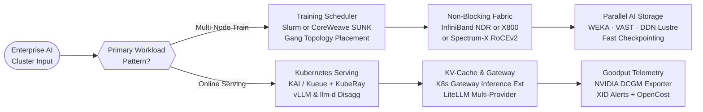

# GPU Fabrics, InfiniBand, Slurm vs Kubernetes and AI Storage

!!! tip "Nubenetes V2 Elite Portal"
    You are browsing the AI-Curated V2 Elite Edition. Looking for the exhaustive list of references? Check out the [**V1 Historical Archive**](/v1/neoclouds-architecture-stack/).

!!! info "Architectural Context"
    Detailed reference for GPU Fabrics, InfiniBand, Slurm vs Kubernetes and AI Storage in the context of Neoclouds & GPU AI Clouds.

!!! abstract "Deep-Dive Topic Pages"
    [Neoclouds Overview & Sovereign Overlap](neoclouds.md) · [Neocloud IaC Maturity, GPU FinOps & SLAs](neoclouds-iac-finops-sla.md) · [European Neoclouds & Country AI Factories](neoclouds-europe.md) · [North America Neoclouds (US & Canada)](neoclouds-north-america.md) · [MLOps & GPU Scheduling](mlops.md) · [Enterprise AI Platforms](enterprise-ai-platforms.md) · [AI Courses & E-Learning](elearning.md)

## Pre-Sales Engineering Blueprint: GPU Fabrics, InfiniBand, Slurm vs Kubernetes and AI Storage

1. [GPU Silicon and Memory Hierarchy (NVIDIA Blackwell vs AMD Instinct)](#gpu-silicon-and-memory-hierarchy-nvidia-blackwell-vs-amd-instinct)
2. [AI Networking Fabrics: NVLink vs InfiniBand vs Spectrum-X RoCEv2](#ai-networking-fabrics-nvlink-vs-infiniband-vs-spectrum-x-rocev2)
3. [Slurm vs Kubernetes GPU Schedulers and SUNK Convergence](#slurm-vs-kubernetes-gpu-schedulers-and-sunk-convergence)
4. [Reference Neocloud AI Factory Stack (Mermaid Diagram)](#reference-neocloud-ai-factory-stack-mermaid-diagram)
5. [Parallel Storage and High-Speed Checkpointing (WEKA, VAST, DDN Lustre)](#parallel-storage-and-high-speed-checkpointing-weka-vast-ddn-lustre)

### GPU Silicon and Memory Hierarchy (NVIDIA Blackwell vs AMD Instinct)

Selecting the wrong GPU SKU is the fastest way to burn budget in a Neocloud deal. Match **workload memory &amp; precision profile** to **HBM capacity and NVLink domain size**:

| Accelerator SKU (Clickable) | HBM Capacity &amp; Memory Bandwidth | Native Low-Precision Compute | Intra-Node / Intra-Rack Link | Optimal Workload Profile (Pre-Sales Selection Rule) |
| :--- | :--- | :--- | :--- | :--- |
| [**NVIDIA H100 SXM5**](https://www.nvidia.com/en-us/data-center/h100) (`8x Node`) | **640 GB HBM3** *(80 GB/GPU; 3.35 TB/s)* | **FP8 / BF16** (Transformer Engine) | **900 GB/s NVLink Gen4** (8 GPUs) | Proven sweet spot for **fine-tuning, 8B–70B inference, LoRA**, and widest [PyTorch](https://pytorch.org)/CUDA compatibility at lowest spot rates |
| [**NVIDIA H200 SXM**](https://www.nvidia.com/en-us/data-center/h200) (`8x Node`) | **1.13 TB HBM3e** *(141 GB/GPU; 4.8 TB/s)* | **FP8 / BF16** | **900 GB/s NVLink Gen4** (8 GPUs) | **1.8x memory bandwidth boost** speeds up memory-bound **70B–405B LLM decoding &amp; long-context KV cache** dramatically |
| [**NVIDIA B200 &amp; GB200 NVL72**](https://www.nvidia.com/en-us/data-center/gb200-nvl72) | **192 GB HBM3e/GPU** *(13.8 TB unified across NVL72 rack @ 8 TB/s)* | **FP4 / FP8** (2nd Gen Transformer Engine) | **1.8 TB/s NVLink Gen5/GPU** (**130 TB/s Rack Coherence**) | **Trillion-parameter MoE training &amp; disaggregated reasoning (`DeepSeek/Llama-4`)**: keeps massive MoE experts in a single coherent NVLink fabric |
| [**AMD Instinct MI300X / MI325X**](https://www.amd.com/en/products/accelerators/instinct/mi300/mi300x.html) (`8x Node`) | **1.54 TB – 2.05 TB HBM3e** *(192–256 GB/GPU; 5.3–6.0 TB/s)* | **FP8 / BF16** ([**ROCm 6+**](https://rocm.docs.amd.com) / [vLLM](https://github.com/vllm-project/vllm)) | **896 GB/s Infinity Fabric** (8 GPUs) | **Inference TCO Killer:** Hosts huge open-weight models (`Qwen-72B`, `Llama-405B`) on **fewer GPUs without multi-node TP latency** ([TensorWave](https://tensorwave.com), [Vultr](https://docs.vultr.com/products/compute/instances/cloud-gpu)) |
| [**NVIDIA L40S**](https://www.nvidia.com/en-us/data-center/l40s) (`PCIe`) | **48 GB GDDR6/GPU** *(864 GB/s)* | **FP8 / BF16** | PCIe Gen4 (No NVLink) | Cost-effective **8B–32B inference, embeddings, image/video gen, VDI/CAD** where cross-GPU [NCCL](https://github.com/NVIDIA/nccl) AllReduce is unnecessary |

### AI Networking Fabrics: NVLink vs InfiniBand vs Spectrum-X RoCEv2

!!! danger "Why Standard Cloud Ethernet Kills Multi-Node Training Scaling"
    In distributed LLM training (`Tensor / Pipeline / FSDP`), GPUs synchronize gradients on every step via [**NCCL**](https://github.com/NVIDIA/nccl) `AllReduce / AlltoAll`. Standard TCP/IP VPC Ethernet suffers packet drops and ECMP hash collisions — collapsing cluster **Model FLOPs Utilization (MFU)** from **50%+ down to &lt;15%** across 32+ GPUs. Always audit the **Rail-Optimized Non-Blocking Backend Fabric** and [**BlueField-3 DPU**](https://www.nvidia.com/en-us/networking/products/data-processing-unit) north-south isolation:

| Network Fabric Tier (Clickable) | Per-GPU NIC Bandwidth | Protocol &amp; Congestion Architecture | Neocloud Footprint Examples | When Mandatory |
| :--- | :--- | :--- | :--- | :--- |
| **1. Scale-Up Domain (`NVLink / NVSwitch`)** | **900 GB/s – 1.8 TB/s** *(~7.2–14.4 Tbps!)* | Memory-coherent GPU-to-GPU switch fabric inside single node (`8 GPUs`) or [**GB200 NVL72 Rack**](https://www.nvidia.com/en-us/data-center/gb200-nvl72) (`72 GPUs`) | All SXM / HGX / DGX / NVL72 Neoclouds | **Required** for Tensor Parallelism (`TP=4/8/72`) &amp; Mixture-of-Experts routing |
| **2. Lossless InfiniBand ([`Quantum-2 NDR`](https://www.nvidia.com/en-us/networking/quantum2) / `X800`)** | **400 Gbps – 800 Gbps per GPU** *(3.2–6.4 Tbps/8-GPU node)* | Lossless credit-based link flow control, [**GPUDirect RDMA**](https://developer.nvidia.com/gpudirect), **SHARP** in-network reduction | [**CoreWeave**](https://coreweave.com), [**Nebius**](https://nebius.com), [**Crusoe**](https://crusoe.ai), [**Lambda**](https://lambda.ai), [**Nscale**](https://nscale.com), [**Verda**](https://verda.com), [**Taiga**](https://www.taigacloud.com), [**Yotta**](https://shakticloud.ai) | **Mandatory** for **64–4,096+ GPU multi-node pre-training** &amp; dense RLHF |
| **3. AI-Tuned Ethernet ([`NVIDIA Spectrum-X`](https://www.nvidia.com/en-us/networking/spectrumx) / `RoCEv2`)** | **400 Gbps per GPU** | Adaptive packet spraying + [**BlueField-3 SuperNIC/DPU**](https://www.nvidia.com/en-us/networking/products/data-processing-unit) congestion control (~95% effective link utilization) | Modern multi-tenant K8s inference clouds ([**Scaleway**](https://www.scaleway.com/en/gpu-instances), [**TensorWave**](https://tensorwave.com)) | Great for **disaggregated [`llm-d`](https://github.com/llm-d/llm-d) prefill/decode inference**, [KubeRay](https://github.com/ray-project/kuberay), &amp; **16–128 GPU fine-tuning** |
| **4. Standard Frontend Cloud VPC Ethernet** | **10G – 100G Shared** | Standard Linux TCP/IP &amp; overlay VXLAN ([Cilium](https://cilium.io)) | General VPS / budget PCIe clouds ([RunPod](https://www.runpod.io), [Civo](https://www.civo.com/ai), [Hetzner](https://www.hetzner.com/cloud)) | Acceptable **ONLY for single-node inference (`&lt;=8 GPUs`), embeddings, or RAG APIs** |

### Slurm vs Kubernetes GPU Schedulers and SUNK Convergence

| Orchestrator Pattern (Clickable) | Operational Model | Strengths for AI Teams | Weaknesses / Operational Traps | Where Used Best |
| :--- | :--- | :--- | :--- | :--- |
| [**Bare-Metal Slurm**](https://slurm.schedmd.com) | Traditional HPC batch daemon (`sbatch` / `srun` / PMIx) | Zero container scheduling latency; native InfiniBand topology awareness; loved by ML research PhDs | Awkward for 24x7 microservices, rolling upgrades, API gateways, and multi-tenant isolation | **Pure pre-training research labs** dedicating static blocks (`256–2,048 GPUs`) to 1–2 training jobs |
| **Kubernetes + [KAI Scheduler](https://github.com/NVIDIA/KAI-Scheduler) / [Kueue](https://github.com/kubernetes-sigs/kueue) / [Volcano](https://volcano.sh) + [GPU Operator](https://github.com/NVIDIA/gpu-operator)** | Declarative CNCF control plane + gang queuing + [**LeaderWorkerSet (`LWS`)**](https://github.com/kubernetes-sigs/lws) + **Dynamic Resource Allocation (DRA)** | Unified platform for **batch training ([KubeRay](https://github.com/ray-project/kuberay)) + autoscaled serving ([vLLM](https://github.com/vllm-project/vllm) / [SGLang](https://github.com/sgl-project/sglang) / [TensorRT-LLM](https://github.com/NVIDIA/TensorRT-LLM) / [`llm-d`](https://github.com/llm-d/llm-d))** | Plain default `kube-scheduler` lacks gang co-scheduling (`all-or-nothing`) without **Kueue / KAI / Volcano** | **Enterprise Platform Teams &amp; Inference Fleets** running mixed RAG, serving, and LoRA training |
| [**SUNK (`CoreWeave Slurm on K8s`)**](https://github.com/coreweave/sunk-anywhere) | Runs [Slurm](https://slurm.schedmd.com) **workers as Kubernetes Pods** inside one unified cluster | **Best of Both Worlds:** ML researchers submit `sbatch` jobs while Platform SREs manage drivers, autoscaling, [DCGM](https://github.com/NVIDIA/dcgm-exporter), and idle-capacity inference reclaim via K8s | Slightly steeper initial cluster engineering outside [CoreWeave](https://docs.coreweave.com)/managed templates | **Medium-to-large Neocloud tenants** needing zero idle GPU gap between day-time research and night-time batch evals |

### Reference Neocloud AI Factory Stack (Mermaid Diagram)

### Parallel Storage and High-Speed Checkpointing (WEKA, VAST, DDN Lustre)

Training a 70B–405B+ model emits **terabyte-scale optimizer checkpoints every 30–60 minutes**. If checkpoints stall because standard S3/NFS saturates at 2 GB/s, **thousands of EUR/hr of idle GPUs burn waiting on disk I/O**.

1. **Tier 0 — Local Node NVMe Scratch (`PCIe Gen5 RAID0`):** **50–100+ GB/s/node** for dataset prefetch shuffles and ephemeral scratch. Volatile if node fails!
2. **Tier 1 — Parallel AI Filesystem ([`WEKA`](https://docs.weka.io) / [`VAST Data`](https://www.vastdata.com) / [`DDN`](https://www.ddn.com) [`Lustre`](https://www.lustre.org)):** **Sub-millisecond POSIX + [GPUDirect Storage](https://developer.nvidia.com/gpudirect) RDMA** scaling to hundreds of GB/s–TB/s aggregate, finishing full cluster checkpoints in **&lt; 60 seconds**. Mandatory on every serious pre-training Neocloud engagement ([CoreWeave](https://coreweave.com), [Nebius](https://nebius.com), [Nscale](https://nscale.com), [EuroHPC](https://eurohpc-ju.europa.eu/ai-factories_en)).
3. **Tier 2 — Sovereign Object Storage (`S3` / [Ceph](https://ceph.io/en)):** Durable model weight artifact registry, raw curated corpus buckets, and [**CoreWeave Tensorizer**](https://github.com/coreweave/tensorizer) / [**Model Streamer**](https://github.com/dsx-ai-factory/model-streamer) fast cold-boot streaming into inference containers.

## AI Agents And MCP

### Cloud AI Platforms

#### Red Hat Openshift AI

  - **(2026)** [==llm-d (Kubernetes-Native Distributed LLM Inference)==](https://github.com/llm-d/llm-d) ⭐ 5151 <svg class="v2-sparkline" width="50" height="15" viewBox="0 0 50 15" style="vertical-align: middle; display: inline-block; margin-left: 6px;" title="Activity Trend"><defs><linearGradient id="spark-grad-98a8d706" x1="0" y1="0" x2="1" y2="0"><stop offset="0%" stop-color="rgba(34, 211, 238, 0.2)" /><stop offset="100%" stop-color="var(--md-accent-fg-color)" /></linearGradient></defs><path class="v2-sparkline-path" d="M 0 7 L 10 6 L 20 9 L 30 6 L 40 3 L 50 5" fill="none" stroke="url(#spark-grad-98a8d706)" stroke-width="1.5" stroke-linecap="round" stroke-linejoin="round" /><circle cx="50" cy="5" r="2" fill="var(--md-accent-fg-color)" /></svg> [CNCF SANDBOX] ⚖️ Apache-2.0 🌟🌟🌟🌟🌟 [CLOUD-AI] [DE FACTO STANDARD] [EMERGING] [ENTERPRISE-STABLE] [GPU] [LLM] — Curator Insight: Co-engineered by Red Hat, Google, IBM, and NVIDIA, llm-d is a Kubernetes-native distributed LLM inference framework built on vLLM and the Kubernetes Gateway API Inference Extension. Live Grounding: Delivers disaggregated prefill/decode serving, KV-cache-aware intelligent routing, and elastic multi-host GPU scaling on OpenShift AI and standard Kubernetes clusters.
## AI Infrastructure

### Distributed Computing

#### Kube-ray

  - **(2025)** [Kube-Ray](https://github.com/ray-project/kuberay) ⭐ 2541 <svg class="v2-sparkline" width="50" height="15" viewBox="0 0 50 15" style="vertical-align: middle; display: inline-block; margin-left: 6px;" title="Activity Trend"><defs><linearGradient id="spark-grad-2471d9c8" x1="0" y1="0" x2="1" y2="0"><stop offset="0%" stop-color="rgba(34, 211, 238, 0.2)" /><stop offset="100%" stop-color="var(--md-accent-fg-color)" /></linearGradient></defs><path class="v2-sparkline-path" d="M 0 12 L 10 11 L 20 3 L 30 12 L 40 5 L 50 4" fill="none" stroke="url(#spark-grad-2471d9c8)" stroke-width="1.5" stroke-linecap="round" stroke-linejoin="round" /><circle cx="50" cy="4" r="2" fill="var(--md-accent-fg-color)" /></svg> [CNCF SANDBOX] ⚖️ Apache-2.0 [GO CONTENT] 🌟🌟 [COMMUNITY-TOOL] [EMERGING] [MLOPS] — Curator Insight: An open-source Kubernetes Operator enabling the deployment and management of Ray clusters. Live Grounding: Serves as the backbone for distributed machine learning workloads on Kubernetes, abstracting compute node scaling, memory configuration, and actor scheduling.
### Hardware Orchestration

#### NVIDIA Operators

  - **(2025)** [NVIDIA GPU Operator](https://github.com/NVIDIA/gpu-operator) ⭐ 2739 <svg class="v2-sparkline" width="50" height="15" viewBox="0 0 50 15" style="vertical-align: middle; display: inline-block; margin-left: 6px;" title="Activity Trend"><defs><linearGradient id="spark-grad-6c3bb734" x1="0" y1="0" x2="1" y2="0"><stop offset="0%" stop-color="rgba(34, 211, 238, 0.2)" /><stop offset="100%" stop-color="var(--md-accent-fg-color)" /></linearGradient></defs><path class="v2-sparkline-path" d="M 0 12 L 10 6 L 20 4 L 30 8 L 40 4 L 50 5" fill="none" stroke="url(#spark-grad-6c3bb734)" stroke-width="1.5" stroke-linecap="round" stroke-linejoin="round" /><circle cx="50" cy="5" r="2" fill="var(--md-accent-fg-color)" /></svg> ⚖️ Apache-2.0 [GO CONTENT] 🌟🌟 [COMMUNITY-TOOL] [EMERGING] [GPU] — Curator Insight: Kubernetes operator designed to automate the management of NVIDIA software components on nodes. Live Grounding: Provisions GPU drivers, container runtimes, device plug-ins, and monitoring tools automatically, ensuring consistent access to hardware acceleration.
### LLM Serving

#### vLLM

  - **(2025)** [==vLLM on Kubernetes==](https://github.com/vllm-project/vllm) ⭐ 96155 <svg class="v2-sparkline" width="50" height="15" viewBox="0 0 50 15" style="vertical-align: middle; display: inline-block; margin-left: 6px;" title="Activity Trend"><defs><linearGradient id="spark-grad-6caed060" x1="0" y1="0" x2="1" y2="0"><stop offset="0%" stop-color="rgba(34, 211, 238, 0.2)" /><stop offset="100%" stop-color="var(--md-accent-fg-color)" /></linearGradient></defs><path class="v2-sparkline-path" d="M 0 9 L 10 5 L 20 4 L 30 13 L 40 12 L 50 5" fill="none" stroke="url(#spark-grad-6caed060)" stroke-width="1.5" stroke-linecap="round" stroke-linejoin="round" /><circle cx="50" cy="5" r="2" fill="var(--md-accent-fg-color)" /></svg> ⚖️ Apache-2.0 [PYTHON CONTENT] 🌟🌟🌟🌟🌟 [DE FACTO STANDARD] [LLM] — Curator Insight: Integration guides and deployment schemas for hosting vLLM on Kubernetes clusters. Live Grounding: Standardizes memory-efficient LLM serving using PagedAttention. Features rapid integration with Kubernetes HPA (Horizontal Pod Autoscaler) and native Prometheus performance scraping.
## Career and Industry

### Elearning

#### NVIDIA Free And Open-source AI Courses

  - **(2026)** [==AI Factory Reference Architectures (NVIDIA Academy)==](https://www.nvidia.com/en-us/training/academy/course-detail/?id=course:16237010) ⏱️ 00:22 🌟🌟🌟🌟🌟 [DE FACTO STANDARD] [GPU] [GUIDE] [NEOCLOUD] — Free ($0 / €0.00), 22-minute NVIDIA Academy mini-course detailing Enterprise AI Factory Reference Architectures across rack-scale GB300 NVL72 clusters and modular RTX PRO AI Factory deployments.
  - **(2026)** [**ClusterMinder Fundamentals (NVIDIA Academy)**](https://www.nvidia.com/en-us/training/academy/course-detail/?id=course:16449049) ⏱️ 03:03 🌟🌟🌟🌟 [EMERGING] [ENTERPRISE-STABLE] [GPU] [GUIDE] — Free ($0 / €0.00), 3h 03m infrastructure operations course teaching NVIDIA ClusterMinder deployment, Redfish hardware fault detection, cluster health visibility, and automated alerting.
  - **(2026)** [**Getting Started with NVIDIA DOCA (NVIDIA Academy)**](https://www.nvidia.com/en-us/training/academy/course-detail/?id=course:18501412) ⏱️ 00:50 🌟🌟🌟🌟 [EMERGING] [ENTERPRISE-STABLE] [GPU] [GUIDE] — Free ($0 / €0.00), 50-minute foundational curriculum introducing NVIDIA DOCA software frameworks for hardware-accelerated networking on BlueField DPUs and ConnectX SuperNICs.
  - **(2026)** [**Getting Started with NVIDIA DSX Air (NVIDIA Academy)**](https://www.nvidia.com/en-us/training/academy/course-detail/?id=course:16115386) ⏱️ 01:27 🌟🌟🌟🌟 [EMERGING] [ENTERPRISE-STABLE] [GPU] [GUIDE] — Free ($0 / €0.00), 1h 27m SaaS digital-twin course enabling engineers to build and simulate multi-node GPU, BlueField DPU, and switch network topologies risk-free prior to physical rack deployment.
## GPU Silicon And Non-blocking AI Networking Fabrics

  - **(2026)** [AMD Instinct MI300X HBM3 Accelerators](https://www.amd.com/en/products/accelerators/instinct/mi300/mi300x.html) 🌟🌟🌟 [EMERGING] [GPU] [NEOCLOUD] — 192 GB HBM3 per-GPU accelerator powering TensorWave and Oracle/Crusoe clusters to host whole 70B–405B models with minimal tensor-parallelism splitting overhead.
  - **(2026)** [AMD ROCm Open Software Stack Documentation](https://rocm.docs.amd.com) 🌟🌟🌟 [EMERGING] [GPU] [LLM] [NEOCLOUD] — Official open-source GPU compute documentation covering HIP, RCCL collective communications, PyTorch integration, and vLLM acceleration on AMD Neocloud hardware.
  - **(2026)** [NVIDIA BlueField Networking Platform (DPUs and SuperNICs)](https://www.nvidia.com/en-us/networking/products/data-processing-unit) 🌟🌟🌟 [EMERGING] [GPU] [NEOCLOUD] — Hardware-accelerated Data Processing Units isolating multi-tenant Neocloud control planes, storage encryption, and adaptive RoCEv2 congestion telemetry from host CPUs.
  - **(2026)** [NVIDIA GB200 NVL72 Rack-Scale Exascale Architecture](https://www.nvidia.com/en-us/data-center/gb200-nvl72) 🌟🌟🌟 [EMERGING] [GPU] [NEOCLOUD] — Liquid-cooled 72-Blackwell-GPU NVLink coherence domain delivering 130 TB/s intra-rack bandwidth, turning an entire Neocloud rack into a single giant accelerator for trillion-parameter training and MoE inference.
  - **(2026)** [NVIDIA NCCL Collective Communications Library](https://github.com/NVIDIA/nccl) 🌟🌟🌟 [EMERGING] [GPU] [NEOCLOUD] — Multi-GPU and multi-node collective communication primitives (`AllReduce`, `AllGather`, `ReduceScatter`, `AllToAll`) optimized for NVLink, Quantum InfiniBand, and Spectrum-X RoCEv2.
  - **(2026)** [NVIDIA Quantum-2 InfiniBand AI Platform](https://www.nvidia.com/en-us/networking/quantum2) 🌟🌟🌟 [EMERGING] [GPU] [NEOCLOUD] — 400 Gbps (NDR) lossless RDMA switched fabric with in-network SHARP aggregation delivering microsecond tail latency critical for multi-thousand-GPU AllReduce training convergence.
  - **(2026)** [NVIDIA Spectrum-X Ethernet for AI Fabrics](https://www.nvidia.com/en-us/networking/spectrumx) 🌟🌟🌟 [EMERGING] [GPU] [NEOCLOUD] — Adaptive-routing, congestion-controlled RoCEv2 Ethernet fabric achieving up to 95% effective network utilization across multi-tenant Neoclouds and enterprise K8s clusters without proprietary InfiniBand switches.
## Parallel Nvme Filesystems And Checkpoint Storage

  - **(2026)** [CoreWeave Tensorizer: Ultra-Fast Kubernetes Model Deserialization](https://github.com/coreweave/tensorizer) 🌟🌟🌟 [EMERGING] [GPU] [NEOCLOUD] — Open-source PyTorch tensor streaming serializer loading multi-gigabyte model weights directly from S3/HTTP into GPU VRAM in seconds to slash cold-start autoscaling latency.
  - **(2026)** [DDN EXAScaler Lustre High-Performance Storage](https://www.ddn.com) 🌟🌟🌟 [DRP-RESILIENCE] [EMERGING] [GPU] — Enterprise Lustre parallel filesystem powering JUPITER, Leonardo, and NVIDIA DGX SuperPOD reference architectures at extreme sequential checkpoint bandwidth.
  - **(2026)** [Run:ai / DSX Model Streamer](https://github.com/dsx-ai-factory/model-streamer) 🌟🌟🌟 [EMERGING] [LLM] — High-concurrency safetensors weight streamer accelerating container startup across Kubernetes vLLM inference fleets from object and file storage.
  - **(2026)** [VAST Data AI Operating System](https://www.vastdata.com) 🌟🌟🌟 [EMERGING] [GPU] [NEOCLOUD] — Disaggregated shared-everything (DASE) exabyte storage architecture combining GPUDirect Storage throughput with vector database and S3 object tiering inside sovereign Neoclouds.
  - **(2026)** [WEKA AI-Native Parallel Data Platform Documentation](https://docs.weka.io) 🌟🌟🌟 [EMERGING] [NEOCLOUD] — Sub-millisecond POSIX and S3 NVMe-over-Fabrics parallel filesystem widely deployed inside CoreWeave, Nscale, and European AI Factories to eliminate training checkpoint stalls.
## Slurm Vs Kubernetes GPU Schedulers And Distributed Inference

  - **(2026)** [CoreWeave SUNK: Slurm on Kubernetes Anywhere](https://github.com/coreweave/sunk-anywhere) 🌟🌟🌟 [EMERGING] [GPU] [NEOCLOUD] — Production pattern co-running Slurm HPC job scheduling and Kubernetes control planes natively inside one cluster so research and serving share the same GPU pool dynamically.
  - **(2026)** [NVIDIA KAI Scheduler (Open-Source Run:ai Engine)](https://github.com/NVIDIA/KAI-Scheduler) 🌟🌟🌟 [EMERGING] [GPU] [NEOCLOUD] — Kubernetes-native GPU scheduler enabling gang scheduling, fractional GPU sharing, fair-share team queues, and preemption across Neocloud and on-prem clusters.
  - **(2026)** [NVIDIA TensorRT-LLM High-Performance Inference SDK](https://github.com/NVIDIA/TensorRT-LLM) 🌟🌟🌟 [EMERGING] [GPU] [LLM] — Open-source CUDA/TensorRT inference compiler optimizing FP8/FP4 quantization, in-flight batching, and multi-node NVLink execution on Hopper and Blackwell GPUs.
  - **(2026)** [Slurm Workload Manager Documentation](https://slurm.schedmd.com) 🌟🌟🌟 [EMERGING] [NEOCLOUD] — De facto bare-metal HPC batch scheduler still preferred by frontier training teams needing rigid topology-aware InfiniBand gang scheduling and zero-overhead PMIx launches.
  - **(2026)** [Volcano CNCF Batch and AI Gang Scheduler](https://volcano.sh) 🌟🌟🌟 [EMERGING] [GPU] [MLOPS] — CNCF Kubernetes batch scheduling system providing gang scheduling, topology-aware GPU bin-packing, and fair-share queues for distributed PyTorch and MPI jobs.
## Workloads

### Batch Jobs

#### Queueing

  - **(2026)** [==kubernetes-sigs/kueue: Kubernetes-native Job Queueing==](https://github.com/kubernetes-sigs/kueue) ⭐ 3132 <svg class="v2-sparkline" width="50" height="15" viewBox="0 0 50 15" style="vertical-align: middle; display: inline-block; margin-left: 6px;" title="Activity Trend"><defs><linearGradient id="spark-grad-48e21aa7" x1="0" y1="0" x2="1" y2="0"><stop offset="0%" stop-color="rgba(34, 211, 238, 0.2)" /><stop offset="100%" stop-color="var(--md-accent-fg-color)" /></linearGradient></defs><path class="v2-sparkline-path" d="M 0 12 L 10 2 L 20 10 L 30 3 L 40 4 L 50 3" fill="none" stroke="url(#spark-grad-48e21aa7)" stroke-width="1.5" stroke-linecap="round" stroke-linejoin="round" /><circle cx="50" cy="3" r="2" fill="var(--md-accent-fg-color)" /></svg> ⚖️ Apache-2.0 [ADVANCED LEVEL] 🌟🌟🌟🌟🌟 [CLOUD-AI] [DE FACTO STANDARD] [MLOPS] — Kueue manages resource quotas across tenant namespaces, supporting complex machine learning and AI orchestration flows. It acts as a cloud-native batch scheduling engine, optimizing utilization within strict resource envelopes.

---
💡 **Explore Related:** [Neoclouds Overview, Sovereign Overlap & TCO](./neoclouds.md) | [European Neoclouds & Country AI Factories](./neoclouds-europe.md) | [North America Neoclouds (US & Canada)](./neoclouds-north-america.md)

🔗 **See Also:** [AI Agents & MCP](./ai-agents-mcp.md) | [MLOps](./mlops.md)

