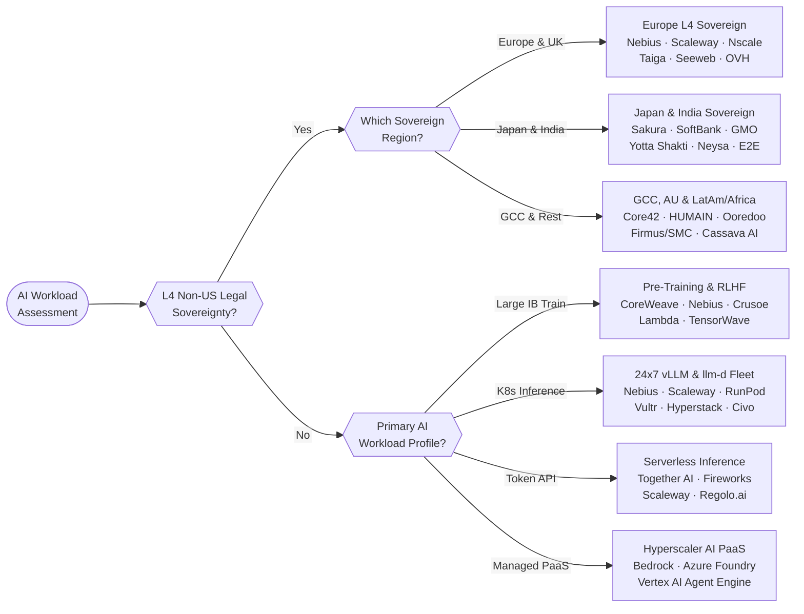

# Neoclouds Overview, Sovereign Overlap and Global GPU AI Clouds

!!! tip "Nubenetes V2 Elite Portal"
    You are browsing the AI-Curated V2 Elite Edition. Looking for the exhaustive list of references? Check out the [**V1 Historical Archive**](/v1/neoclouds/).

!!! info "Architectural Context"
    Detailed reference for Neoclouds Overview, Sovereign Overlap and Global GPU AI Clouds in the context of Neoclouds & GPU AI Clouds.

!!! abstract "Deep-Dive Topic Pages"
    [European Neoclouds & Country AI Factories](neoclouds-europe.md) · [North America Neoclouds (US & Canada)](neoclouds-north-america.md) · [Asia-Pacific Neoclouds & AI Clouds](neoclouds-apac.md) · [Middle East & GCC Sovereign AI Factories](neoclouds-mena.md) · [Latin America & Africa AI Cloud Hubs](neoclouds-latam-africa.md) · [GPU Fabrics, InfiniBand, Slurm vs K8s & Storage](neoclouds-architecture-stack.md) · [Neocloud IaC Maturity, GPU FinOps & SLAs](neoclouds-iac-finops-sla.md) · [EU Sovereign Cloud Overview & TCO](eu-sovereign-cloud.md)

## Executive Architecture: Global Neoclouds vs Hyperscalers and Sovereign Cloud (2026)

1. [Global Regional Hubs and Technical Pillars](#global-regional-hubs-and-technical-pillars)
2. [What Are Neoclouds and How They Differ From Hyperscalers](#what-are-neoclouds-and-how-they-differ-from-hyperscalers)
3. [Neoclouds vs Sovereign Cloud: Overlap, Convergence and Legal Distinction](#neoclouds-vs-sovereign-cloud-overlap-convergence-and-legal-distinction)
4. [Global Pre-Sales Architecture Decision Flow](#global-pre-sales-architecture-decision-flow)
5. [Global GPU Cost and TCO Benchmarks (EUR and USD vs Hyperscalers)](#global-gpu-cost-and-tco-benchmarks-eur-and-usd-vs-hyperscalers)
6. [When Does a Neocloud Win (Pre-Sales Playbook)](#when-does-a-neocloud-win-pre-sales-playbook)

### Global Regional Hubs and Technical Pillars

Nubenetes V2 maps the specialized global GPU cloud landscape across five continental markets and two cross-cutting engineering pillars, with deep country parity across Europe and direct links to every provider:

  <a class="eu-hub-link" href="/neoclouds-europe/">
    <article class="eu-hub-card">
      <header>
        🇪🇺
        Europe &amp; UK
        8 EU Hubs + EuroHPC
      </header>
      
Nebius · Scaleway · Nscale · Taiga · Seeweb · OVH · Civo · JUPITER &amp; MareNostrum 5

      <footer>Explore Europe →</footer>
    </article>
  </a>
  <a class="eu-hub-link" href="/neoclouds-north-america/">
    <article class="eu-hub-card">
      <header>
        🇺🇸
        North America
        US &amp; Canada
      </header>
      
CoreWeave · Lambda · Crusoe · TensorWave · Together · Fireworks · IREN · QScale

      <footer>Explore Americas →</footer>
    </article>
  </a>
  <a class="eu-hub-link" href="/neoclouds-apac/">
    <article class="eu-hub-card">
      <header>
        🌏
        Asia-Pacific
        JP · IN · SG · AU · KR
      </header>
      
Sakura Internet · SoftBank · Yotta Shakti · Neysa · E2E · Firmus SMC · Singtel RE:AI

      <footer>Explore APAC →</footer>
    </article>
  </a>
  <a class="eu-hub-link" href="/neoclouds-mena/">
    <article class="eu-hub-card">
      <header>
        🏜️
        Middle East &amp; GCC
        UAE · Saudi · Qatar
      </header>
      
Core42 / G42 · Khazna · HUMAIN · center3 · Aramco Digital · Ooredoo NCP · MEEZA

      <footer>Explore MENA →</footer>
    </article>
  </a>
  <a class="eu-hub-link" href="/neoclouds-latam-africa/">
    <article class="eu-hub-card">
      <header>
        🌎
        LatAm &amp; Africa
        BR · CL · MX · ZA · KE
      </header>
      
ODATA · Scala · Elea AI City · Ascenty · KIO · Cassava AI Factories · Raxio

      <footer>Explore hubs →</footer>
    </article>
  </a>

  <a class="eu-hub-link" href="/neoclouds-architecture-stack/">
    <article class="eu-hub-card">
      <header>
        🔌
        GPU Fabrics, Slurm &amp; K8s
        IB NDR · NVL72 · llm-d
      </header>
      
NVLink vs Quantum InfiniBand vs Spectrum-X RoCEv2, SUNK/Kueue/DRA, WEKA/VAST storage

      <footer>Open architecture →</footer>
    </article>
  </a>
  <a class="eu-hub-link" href="/neoclouds-iac-finops-sla/">
    <article class="eu-hub-card">
      <header>
        🏗️
        IaC, FinOps &amp; Goodput SLAs
        SkyPilot · OpenTofu
      </header>
      
Terraform coverage vs hyperscalers, MTBF/checkpoint math, DCGM health &amp; GPU FinOps

      <footer>Open scorecard →</footer>
    </article>
  </a>
  <a class="eu-hub-link" href="/eu-sovereign-cloud/">
    <article class="eu-hub-card">
      <header>
        🇪🇺
        EU Sovereign Cloud Bridge
        DORA · ENS · BSI C5
      </header>
      
Compare generalist L4 European sovereign clouds, private DCs, VMs &amp; Proxmox/K8s TCO

      <footer>Open EU Sovereign →</footer>
    </article>
  </a>

| Region / Pillar | Core Neocloud Ecosystem (Clickable Links) | Dominant Jurisdiction &amp; Energy Edge | Pre-Sales Deep-Dive |
| :--- | :--- | :--- | :--- |
| **Europe &amp; UK (8 Country Hubs)** | [**Nebius**](https://nebius.com), [**Scaleway**](https://www.scaleway.com/en/gpu-instances), [**Nscale**](https://nscale.com), [**Taiga/Northern Data**](https://www.taigacloud.com), [**Seeweb**](https://www.seeweb.it/en), [**OVHcloud AI**](https://www.ovhcloud.com/en/public-cloud/ai-training), [**IONOS AI**](https://www.ionos.com/servers/gpu-server), [**Civo**](https://www.civo.com/ai), [**Exoscale**](https://www.exoscale.com/gpu), plus [**EuroHPC AI Factories**](https://eurohpc-ju.europa.eu/ai-factories_en) | **L4 EU/UK Sovereign** (`GDPR, EU AI Act, DORA, ENS Alto, SecNumCloud, BSI C5`) + Nordic/Iberian renewables | [European Neoclouds](/neoclouds-europe/) |
| **North America (US &amp; Canada)** | [**CoreWeave**](https://coreweave.com), [**Lambda**](https://lambda.ai), [**Crusoe**](https://crusoe.ai), [**TensorWave**](https://tensorwave.com) (AMD), [**Together AI**](https://www.together.ai), [**Fireworks**](https://fireworks.ai), [**Voltage Park**](https://voltagepark.com), [**Fluidstack**](https://fluidstack.io), [**IREN**](https://iren.com), [**Applied Digital**](https://www.applieddigital.com), [**RunPod**](https://www.runpod.io), [**Vultr**](https://docs.vultr.com/products/compute/instances/cloud-gpu), [**QScale**](https://qscale.com) | Largest H200/GB200 NVL72 cluster scale + Texas/Dakota/Quebec cheap hydro &amp; stranded power; **US CLOUD Act applies** | [North America Neoclouds](/neoclouds-north-america/) |
| **Asia-Pacific (APAC)** | [**Sakura Internet**](https://www.sakura.ad.jp), [**SoftBank**](https://www.softbank.jp/en), [**GMO**](https://www.gmo.jp/en) (JP); [**Yotta Shakti**](https://shakticloud.ai), [**Neysa**](https://neysa.ai), [**E2E**](https://www.e2enetworks.com) (IN); [**Firmus**](https://firmus.co)/[**SMC**](https://smc.co), [**NEXTDC**](https://www.nextdc.com), [**Singtel RE:AI**](https://re-ai.ai) (SG/AU); [**NAVER**](https://www.navercorp.com/en)/[**NHN**](https://www.nhncloud.com) (KR) | Strong state subsidies (METI Japan, [**IndiaAI Mission**](https://indiaai.gov.in)) + tropical **liquid immersion cooling** (Firmus PUE ~1.05) | [APAC Neoclouds](/neoclouds-apac/) |
| **Middle East &amp; GCC (MENA)** | [**Core42**](https://www.core42.ai)/[**G42**](https://www.g42.ai), [**Khazna**](https://khaznadatacenters.com) (UAE); [**HUMAIN**](https://www.humain.com), [**center3**](https://www.center3.com), [**Aramco Digital**](https://www.aramcodigital.com) (SA); [**Ooredoo NCP**](https://www.ooredoo.com), [**MEEZA**](https://www.meeza.net) (QA) | Sovereign wealth gigawatt campuses + domestic NCA/PDPL residency connecting EMEA and South Asia | [Middle East &amp; GCC](/neoclouds-mena/) |
| **Latin America &amp; Africa** | [**ODATA**](https://odatadc.com), [**Scala**](https://scaladatacenters.com), [**Elea AI City**](https://eleadatacenters.com), [**Ascenty**](https://ascenty.com), [**KIO**](https://www.kio.tech/en), [**Cirion**](https://www.ciriontechnologies.com) (LatAm); [**Cassava AI**](https://www.cassava.ai), [**Africa Data Centres**](https://www.africadatacentres.com), [**Teraco**](https://www.teraco.co.za), [**Raxio**](https://raxiogroup.com) (Africa) | Hydro renewable power (Brazil 85%+), subsea cables (EllaLink/2Africa), continental LGPD &amp; POPIA sovereignty | [LatAm &amp; Africa Hubs](/neoclouds-latam-africa/) |
| **Systems &amp; Execution Engineering** | [**GB200 NVL72**](https://www.nvidia.com/en-us/data-center/gb200-nvl72), [**Quantum-2 IB**](https://www.nvidia.com/en-us/networking/quantum2), [**Spectrum-X**](https://www.nvidia.com/en-us/networking/spectrumx), [**MI300X**](https://www.amd.com/en/products/accelerators/instinct/mi300/mi300x.html), [**Slurm**](https://slurm.schedmd.com)/[**SUNK**](https://github.com/coreweave/sunk-anywhere), [**Kueue**](https://github.com/kubernetes-sigs/kueue)/[**vLLM**](https://github.com/vllm-project/vllm)/[**`llm-d`**](https://github.com/llm-d/llm-d), [**SkyPilot**](https://skypilot.readthedocs.io), [**WEKA**](https://docs.weka.io)/[**VAST**](https://www.vastdata.com) | Raw goodput efficiency, checkpoint I/O throughput, multi-provider OpenTofu/SkyPilot exit portability | [Fabrics &amp; Stack](/neoclouds-architecture-stack/) · [IaC &amp; SLAs](/neoclouds-iac-finops-sla/) |

### What Are Neoclouds and How They Differ From Hyperscalers

**Neoclouds** (short for *New Cloud* or *GPU-Native AI Cloud* providers) are specialized cloud infrastructure operators engineered **from the bare metal up specifically for parallel AI training, fine-tuning, and high-throughput inference**, rather than general-purpose enterprise web, ERP, and SaaS hosting.

Unlike AWS, Azure, and GCP — which layer expensive multi-tenant SDN hypervisors, noisy VPC gateways, general-purpose control planes, and hefty internet egress markups over shared data center footprints — Neoclouds strip away general-purpose overhead to maximize **FLOPs, memory bandwidth, and Tokens-per-Second per EUR spent**:

1. **Archetype 1 — Bare-Metal &amp; Kubernetes GPU Clouds ([CoreWeave](https://coreweave.com), [Nebius](https://nebius.com), [Crusoe](https://crusoe.ai), [Lambda](https://lambda.ai), [Nscale](https://nscale.com), [Seeweb](https://www.seeweb.it/en)):** Direct bare-metal or ultra-thin virtualized access to multi-node **NVIDIA H100/H200/B200/GB200** or **AMD MI300X/MI325X** pods wired with non-blocking **3.2 Tbps Quantum-2 InfiniBand** or **Spectrum-X RoCEv2**, native **Slurm / SUNK / Managed Kubernetes**, and **WEKA / VAST / Lustre** shared NVMe filesystems.
2. **Archetype 2 — Serverless &amp; Compound Inference Clouds ([Together AI](https://www.together.ai), [Fireworks AI](https://fireworks.ai), [RunPod Serverless](https://www.runpod.io), [Scaleway](https://www.scaleway.com/en/gpu-instances), [Regolo.ai](https://regolo.ai)):** Custom CUDA/ROCm inference engines (`vLLM`, TensorRT-LLM, SGLang, speculative decoding) delivering open-weight LLM tokens via OpenAI-compatible APIs at **50–80% lower $/token** than frontier proprietary APIs.
3. **Archetype 3 — Energy-First &amp; AI Factory Operators ([IREN](https://iren.com), [Applied Digital](https://www.applieddigital.com), [Merlin-Edged](https://edged.es), [atNorth](https://atnorth.com), [Green Mountain](https://greenmountain.no), [Firmus/SMC](https://smc.co), [QScale](https://qscale.com), [Khazna](https://khaznadatacenters.com)):** Power-and-cooling-led operators securing 50–500 MW substations, direct liquid/immersion cooling, and long-term hydro/geothermal/flare-gas PPAs to host wholesale Neocloud and enterprise single-tenant GPU halls.

| Engineering &amp; Commercial Dimension | US Hyperscalers (`AWS / Azure / GCP`) | Bare-Metal Neoclouds (`CoreWeave / Nebius / Nscale / Crusoe`) | European Generalist Sovereign Clouds (`STACKIT / IONOS / Arsys / Outscale`) |
| :--- | :--- | :--- | :--- |
| **Core Design Optimization** | 250+ general PaaS services (IAM, Serverless, BigQuery, Managed DBs) | **Raw GPU density, RDMA AllReduce latency, high-speed checkpointing** | **Legal sovereignty, VMware/KVM enterprise hosting, DORA/NIS2 compliance** |
| **Multi-Node GPU Interconnect** | Mixed; top-tier EFA/IB (`p5`/`NDv5`) gated behind rigid quotas &amp; premium SKUs | **Standard lossless 400G/800G InfiniBand or Spectrum-X RoCEv2** across pods | Mostly standard 10G–100G Ethernet (except dedicated AI partner partitions) |
| **Liquid Cooling &amp; GB200 Readiness** | Selective new retrofits; many legacy air-cooled racks | **Direct-to-chip liquid cooling (DLC) &amp; immersion built greenfield (80–130 kW/rack)** | Improving rapidly via partner campuses ([Merlin-Edged](https://edged.es), [DATA4](https://www.data4group.com/en), [Northern Data](https://northerndata.de)) |
| **Orchestration Interface** | AWS EKS / SageMaker / Batch / GCP GKE | **Kubernetes + Slurm / SUNK + KubeRay + bare-metal SSH/Terraform** | VMware vCD / OpenStack / Proxmox VE / Managed Kubernetes |
| **Network Egress Pricing** | Punitive (`~EUR 0.08/GB`), punishing hybrid dataset &amp; RAG syncing | **Zero or minimal included egress** for datasets, weights, and checkpoints | **Zero or ultra-low EUR egress**, ideal for steady data repatriation |
| **IaC &amp; Ecosystem Parity** | **~98–100%** (every service in Terraform/OpenTofu Day 1) | **~55–80%** (focused cleanly on GPU clusters, K8s, VPC, S3, Shared FS) | **~45–85%** (via OpenStack, `vcd`, `bpg/proxmox`, Scaleway/IONOS APIs) |

### Neoclouds vs Sovereign Cloud: Overlap, Convergence and Legal Distinction

!!! warning "Critical Pre-Sales Rule: 'European Location' on a US Neocloud Does NOT Equal L4 Legal Sovereignty!"
    A frequent pre-sales mistake is conflating **Neoclouds** with **Sovereign Clouds**. [**CoreWeave**](https://coreweave.com) UK/EU, [**Crusoe**](https://crusoe.ai) Iceland, [**Lambda**](https://lambda.ai) London, and [**Vultr**](https://docs.vultr.com/products/compute/instances/cloud-gpu) Frankfurt operate modern GPU facilities inside Europe, yet remain **US-headquartered corporations** legally subject to the **US CLOUD Act / FISA 702** (**Level 1 Data Residency**, NOT Level 4 Legal Sovereignty). Conversely, **Generalist EU Sovereign Clouds** satisfy strict national clearance (**SecNumCloud 3.2, ENS Alto, BSI C5**) for ERPs and databases, yet often lack thousands of InfiniBand-linked H200/GB200 GPUs for frontier training.

Understanding where **Neoclouds** and **Sovereign Cloud** converge — and where they diverge — allows architects to classify every deal into the exact right quadrant:

| Quadrant | Legal Governance &amp; Ownership | Workloads Where It Wins | Representative Global &amp; European Examples |
| :--- | :--- | :--- | :--- |
| **1. L4 Sovereign Neoclouds (Overlap Sweet Spot)** | **100% non-US domestic corporate control** + sovereign AI compliance (**EU AI Act, DORA, APPI, India DPDP, GCC NCA**) | Regulated healthcare/banking/government **open-weight LLM training &amp; private inference** inside domestic borders | **EU/UK:** [**Nebius**](https://nebius.com) (NL), [**Scaleway AI**](https://www.scaleway.com/en/gpu-instances), [**OVHcloud AI**](https://www.ovhcloud.com/en/public-cloud/ai-training) (FR), [**Northern Data / Taiga**](https://www.taigacloud.com), [**IONOS AI**](https://www.ionos.com/servers/gpu-server) (DE), [**Seeweb**](https://www.seeweb.it/en) / [**Regolo.ai**](https://regolo.ai), [**Aruba AI3**](https://www.arubacloud.com) (IT), [**Merlin-Edged**](https://edged.es) + [**MareNostrum 5**](https://www.bsc.es/research-and-development/ai-factory) (ES), [**Nscale**](https://nscale.com), [**Civo**](https://www.civo.com/ai) (UK) · **Global:** [**Sakura**](https://www.sakura.ad.jp) / [**SoftBank**](https://www.softbank.jp/en) (JP), [**Yotta**](https://shakticloud.ai) / [**Neysa**](https://neysa.ai) / [**E2E**](https://www.e2enetworks.com) (IN), [**Core42**](https://www.core42.ai) / [**HUMAIN**](https://www.humain.com) / [**Ooredoo**](https://www.ooredoo.com) (GCC), [**Cassava AI**](https://www.cassava.ai) (AF) |
| **2. US / Global Bare-Metal Neoclouds (L1 in EU)** | **US-headquartered** (CLOUD Act applies even when DCs sit in UK/Iceland/DE); maximum Blackwell rack scale | Unregulated SaaS, commercial AI startups, frontier R&amp;D, and massive non-PII open-weight training chasing lowest **EUR/FLOP** | [**CoreWeave**](https://coreweave.com), [**Lambda**](https://lambda.ai), [**Crusoe**](https://crusoe.ai), [**TensorWave**](https://tensorwave.com) (AMD), [**Voltage Park**](https://voltagepark.com), [**Fluidstack**](https://fluidstack.io), [**Applied Digital**](https://www.applieddigital.com), [**IREN**](https://iren.com), [**Together AI**](https://www.together.ai), [**Fireworks**](https://fireworks.ai), [**RunPod**](https://www.runpod.io) |
| **3. EU Generalist Sovereign Clouds &amp; Private DCs** | **L4 National Security Clearances** (**ENS Alto, SecNumCloud 3.2, BSI C5, ACN QC3, FINMA**) | Core banking/ERP VMs, Post-Broadcom **Proxmox/OpenStack** exits, WORM ransomware vaults, regulated PostgreSQL/Kafka | [**Arsys**](https://www.arsys.es/cloud), [**Gigas**](https://gigas.com/en), [**Alhambra IT**](https://alhambrait.com/en), [**Stackscale**](https://www.stackscale.com) (ES); [**STACKIT**](https://stackit.com/en), [**IONOS**](https://cloud.ionos.com), [**Open Telekom**](https://www.open-telekom-cloud.com/en) (DE); [**3DS Outscale**](https://en.outscale.com), [**Cloud Temple**](https://www.cloud-temple.com/en) (FR); [**WIIT**](https://www.wiit.cloud/en) (IT); [**Exoscale**](https://www.exoscale.com), [**cloudscale.ch**](https://www.cloudscale.ch/en) (CH); [**Elastx**](https://elastx.se/en), [**Cleura**](https://cleura.com) (Nordics) |
| **4. US Hyperscalers (Standard &amp; L2/L3 Sovereign Wrappers)** | **US-owned**, localized EU control-plane ops ([AWS ESC Brandenburg](https://aws.amazon.com/compliance/europe-digital-sovereignty), [S3NS](https://www.s3ns.io/en), [Bleu](https://www.bleucloud.fr/en)) | Heavy serverless/SaaS stacks (**BigQuery, DynamoDB, Bedrock, Azure Foundry**) needing 200+ managed services under one contract | [**AWS**](https://aws.amazon.com), [**Microsoft Azure**](https://azure.microsoft.com), [**Google Cloud Platform**](https://cloud.google.com) (and **Oracle Cloud OCI** GPU superclusters) |

!!! tip "2026 Winning Hybrid Reference Pattern: Sovereign Generalist Core + L4 Sovereign Neocloud"
    For regulated European enterprises under **DORA** and the **EU AI Act**, **never rebuild your entire corporate ERP inside a GPU startup.** Keep sensitive transactional systems, KMS/HSM vaults, IAM, and PostgreSQL on your **L4 National Sovereign Cloud** ([/eu-sovereign-cloud/](/eu-sovereign-cloud/)), peer over local private optical fiber (`DE-CIX, AMS-IX, France-IX, ESpanix, MIX, LINX`), and burst RAG indexing, fine-tuning, and stateless `vLLM`/`llm-d` inference into a nearby **L4 European Neocloud** ([Nebius](https://nebius.com), [Scaleway](https://www.scaleway.com/en/gpu-instances), [IONOS](https://www.ionos.com/servers/gpu-server), [Seeweb](https://www.seeweb.it/en), [Nscale](https://nscale.com)).

### Global Pre-Sales Architecture Decision Flow

### Global GPU Cost and TCO Benchmarks (EUR and USD vs Hyperscalers)

*Indicative 2026 production run-rate benchmarks (`1 USD ≈ 0.92 EUR`) comparing standard hyperscaler SKUs against Neocloud on-demand and 12-month reserved commitments (excluding multi-year custom mega-commitments and variable hyperscaler egress surcharges):*

| Accelerated Node Spec | Network Fabric &amp; Typical VRAM | US Hyperscalers (`AWS / Azure / GCP` On-Demand / 1-Yr) | US / Global Neoclouds (`CoreWeave / Lambda / Crusoe / TensorWave`) | EU Sovereign Neoclouds (`Nebius / Scaleway / Taiga / Nscale / Seeweb`) | Pre-Sales Savings &amp; TCO Drivers |
| :--- | :--- | :--- | :--- | :--- | :--- |
| [**8x NVIDIA H100 SXM5**](https://www.nvidia.com/en-us/data-center/h100) | [**3.2 Tbps InfiniBand NDR**](https://www.nvidia.com/en-us/networking/quantum2) · 640 GB HBM3 | **EUR 5.90 – 9.05 / GPU-hr** *($6.40 – $9.83/GPU-hr; ~EUR 34k–52k/node/mo)* | **EUR 1.75 – 2.75 / GPU-hr** *($1.90 – $2.99/GPU-hr; ~EUR 10k–16k/node/mo)* | **EUR 1.85 – 2.85 / GPU-hr** *($2.00 – $3.10/GPU-hr; EU VAT/SEPA billing)* | **55–72% cheaper** on Neoclouds; savings multiply when moving multi-TB training checkpoints (zero egress). |
| [**8x NVIDIA H200 SXM**](https://www.nvidia.com/en-us/data-center/h200) | [**3.2 Tbps IB NDR / X800**](https://www.nvidia.com/en-us/networking/quantum2) · **1.13 TB HBM3e** | **EUR 6.45 – 9.75 / GPU-hr** *($7.00 – $10.60/GPU-hr)* | **EUR 2.30 – 3.40 / GPU-hr** *($2.50 – $3.70/GPU-hr)* | **EUR 2.50 – 3.60 / GPU-hr** *($2.70 – $3.90/GPU-hr)* | **50–65% cheaper**; 141 GB HBM3e/GPU fits **Llama-3/DeepSeek 70B+ FP8 inside fewer nodes**, cutting TP comm overhead. |
| [**NVIDIA B200 / GB200 NVL72**](https://www.nvidia.com/en-us/data-center/gb200-nvl72) (Liquid-Cooled) | **NVLink 5 (130 TB/s/rack) + X800 IB** · 192 GB HBM3e/GPU | **Limited Gated Quotas** *(EUR 7.80–11.50+/GPU-hr eq.)* | **EUR 3.50 – 5.20 / GPU-hr** *($3.80 – $5.65/GPU-hr committed clusters)* | **EUR 3.70 – 5.45 / GPU-hr** *($4.00 – $5.90/GPU-hr via [Nebius](https://nebius.com)/[Nscale](https://nscale.com)/[Scaleway](https://www.scaleway.com/en/gpu-instances))* | Unlocked **Blackwell-ready 120 kW+ DLC racks** months ahead of general hyperscaler regional availability. |
| [**8x AMD Instinct MI300X / MI325X**](https://www.amd.com/en/products/accelerators/instinct/mi300/mi300x.html) | **400G RoCEv2 / IB** · **1.54 TB – 2.0 TB HBM3e** | **EUR 4.40 – 6.20 / GPU-hr** *(Azure ND MI300X v5)* | **EUR 1.45 – 2.30 / GPU-hr** *($1.58 – $2.50/GPU-hr via [TensorWave](https://tensorwave.com)/[Crusoe](https://crusoe.ai)/[Vultr](https://docs.vultr.com/products/compute/instances/cloud-gpu))* | **EUR 1.60 – 2.50 / GPU-hr** *([Nscale](https://nscale.com) / [Seeweb](https://www.seeweb.it/en) / [DigitalOcean](https://www.digitalocean.com/products/gpu-droplets) AMD pools)* | **2.4x VRAM/GPU vs H100** makes 8x MI300X ideal for **high-batch 405B inference without multi-node splitting**. |

### When Does a Neocloud Win (Pre-Sales Playbook)

| Customer Scenario | Winning Architectural Recommendation | Why Neoclouds Win Here | Pre-Sales Red Flag to Surface Early |
| :--- | :--- | :--- | :--- |
| **Multi-Node Pre-Training or Continuous Fine-Tuning (`64–2,048+ GPUs`)** | [**Nebius**](https://nebius.com) (EU/US), [**CoreWeave**](https://coreweave.com), [**Crusoe**](https://crusoe.ai), [**Lambda**](https://lambda.ai), [**Nscale**](https://nscale.com), or [**Taiga**](https://www.taigacloud.com) with Slurm / SUNK + WEKA/Lustre | Lossless InfiniBand + proactive XID hardware replacement keeps cluster **Model FLOPs Utilization (MFU)** consistently **2x higher** than virtualized cloud VMs. | Never compare raw $/GPU-hr without factoring **goodput**: an unstable Ethernet cluster losing 15% of runtime to checkpoint/AllReduce retries costs *more*. |
| **Sustained 24x7 Open-Weight Inference (`vLLM / SGLang / llm-d`)** | [**Scaleway**](https://www.scaleway.com/en/gpu-instances), [**Nebius**](https://nebius.com), [**RunPod**](https://www.runpod.io), [**TensorWave**](https://tensorwave.com) (MI300X), [**Seeweb**](https://www.seeweb.it/en) ([Regolo.ai](https://regolo.ai)), or [**Vultr**](https://docs.vultr.com/products/compute/instances/cloud-gpu) | Zero egress tax + dedicated GPU cost cuts per-million-token cost by **45–75%** once daily volume saturates a 4x–8x GPU pod. | Plan **multi-provider failover** ([LiteLLM](https://github.com/BerriAI/litellm) / [Gateway API Inference Extension](https://github.com/kubernetes-sigs/gateway-api-inference-extension)) because single-region Neoclouds occasionally face power maintenance windows. |
| **Regulated EU/National Banking, Public Sector &amp; Healthcare AI** | **L4 Sovereign Neocloud** ([Nebius](https://nebius.com), [Scaleway](https://www.scaleway.com/en/gpu-instances), [IONOS](https://www.ionos.com/servers/gpu-server), [Seeweb](https://www.seeweb.it/en), [Nscale](https://nscale.com), [Sakura](https://www.sakura.ad.jp), [Yotta](https://shakticloud.ai), [Core42](https://www.core42.ai)) **paired with Sovereign Core** | Meets **EU AI Act, GDPR, DORA, ENS/BSI/SecNumCloud/APPI/DPDP** residency while keeping data inside local national IXPs. | Verify **corporate ownership tree + US subsidiary links** cleanly before promising "zero CLOUD Act" to a government CISO. |
| **Bursty Agents, Batch Embeddings, or Frontier API Prototyping** | **Keep AWS Bedrock / Azure AI Foundry / Vertex AI** or serverless APIs ([Together AI](https://www.together.ai) / [Fireworks](https://fireworks.ai) / [Scaleway Endpoints](https://www.scaleway.com/en/gpu-instances)) | Zero operational SRE burden for idle periods; pay strictly per active million tokens rather than idle 24x7 bare-metal GPU leases. | Never lock a startup with irregular traffic into a **12-month bare-metal reservation** before validating steady utilization above 55%. |

## European Neoclouds and Country AI Factories

### Netherlands Benelux And France Neoclouds

  - **(2026)** [Scaleway GPU Cloud (Paris / Iliad Group)](https://www.scaleway.com/en/gpu-instances) 🌟🌟🌟 [EMERGING] [GPU] [NEOCLOUD] [SOVEREIGN-EU] — Leading French Neocloud offering H100 SXM5, L40S, and Blackwell GPU nodes integrated natively with Kapsule Kubernetes and Terraform (`scaleway/scaleway`).
### Nordics Alpine And UK Neoclouds Plus Eurohpc AI Factories

  - **(2026)** [Nscale Sovereign AI Cloud (UK and Europe)](https://nscale.com) 🌟🌟🌟 [EMERGING] [GPU] [NEOCLOUD] [SOVEREIGN-EU] — UK-headquartered vertically integrated Neocloud operating renewable liquid-cooled NVIDIA H100/B200 AI factories across Europe, the UK, and North America.
## European Sovereign Cloud and Private Dcs

### Netherlands and Benelux Cloud and Dcs

#### Nordics Switzerland And Benelux Cloud And AI Providers

  - **(2026)** [Nebius Sovereign AI Cloud (Amsterdam HQ)](https://nebius.com) 🌟🌟🌟 [EMERGING] [GPU] [NEOCLOUD] [SOVEREIGN-EU] — European-headquartered AI hyperscaler operating massive InfiniBand-interconnected NVIDIA H100, H200, and Blackwell B200 superclusters in Finland and France with Kubernetes (MK8s), Slurm, and Sovereign S3 storage.
## Global Neocloud Reference Leaders And Benchmarks

  - **(2026)** [ClusterMAX: GPU Cloud Rating and Cluster Benchmarks](https://www.clustermax.ai) 🌟🌟🌟 [EMERGING] [GPU] [NEOCLOUD] — Independent engineering scorecard evaluating global Neoclouds and hyperscalers on NCCL multi-node fabric efficiency, Slurm and Kubernetes readiness, lifecycle automation, and effective goodput SLA.
  - **(2026)** [CoreWeave: Specialized GPU Hyperscaler](https://coreweave.com) 🌟🌟🌟 [EMERGING] [GPU] [NEOCLOUD] — Flagship North American NVIDIA Exemplar Cloud Partner operating bare-metal Kubernetes, SUNK (Slurm on Kubernetes), and InfiniBand NDR/X800 GPU fabrics across the US, UK, and Europe.
  - **(2026)** [Epoch AI: Compute Trends and AI Factory Economics](https://epoch.ai) 🌟🌟🌟 [EMERGING] — Research institute tracking frontier training cluster scaling, power envelopes, accelerator FLOP/watt ratios, and capital efficiency across global AI data centers.
  - **(2026)** [MLCommons: MLPerf Training and Inference Benchmarks](https://mlcommons.org) 🌟🌟🌟 [EMERGING] [LLM] — Open engineering consortium publishing audited distributed training and LLM inference benchmarks across specialized AI clouds and hyperscalers.
  - **(2026)** [NVIDIA Cloud Partners (NCP) Ecosystem](https://www.nvidia.com/en-us/data-center/gpu-cloud-computing/partners) 🌟🌟🌟 [EMERGING] [GPU] [NEOCLOUD] — Official NVIDIA directory and reference program for specialized GPU cloud providers building validated HGX/DGX H100, H200, Blackwell B200, and GB200 NVL72 AI clusters worldwide.
## Multi-cloud GPU Orchestration And Portability Reference

  - **(2026)** [Nebius AI Cloud Documentation and CLI](https://docs.nebius.com) 🌟🌟🌟 [EMERGING] [GPU] [NEOCLOUD] [SOVEREIGN-EU] — Reference documentation for Nebius Managed Kubernetes (MK8s), Slurm GPU clusters, InfiniBand fabrics, Shared Filesystem, and Terraform automation.
  - **(2026)** [SkyPilot: Multi-Cloud and Neocloud AI Job Broker](https://skypilot.readthedocs.io) 🌟🌟🌟 [EMERGING] [NEOCLOUD] [SOVEREIGN-EU] — Open-source UC Berkeley orchestration layer automating cluster provisioning, spot failover, and job queueing transparently across Neoclouds (Nebius, RunPod, Lambda, Fluidstack) and hyperscalers.
## North America Neoclouds US and Canada

### Large-scale Bare-metal Training Neoclouds

  - **(2026)** [CoreWeave Cloud Platform and Documentation](https://docs.coreweave.com) 🌟🌟🌟 [EMERGING] [GPU] [NEOCLOUD] — Pioneer US Neocloud engineered around non-blocking InfiniBand fabrics, Kubernetes-native GPU scheduling (CKS), Slurm on Kubernetes (SUNK), and multi-thousand-GPU NVIDIA Blackwell pods.
  - **(2026)** [Lambda Cloud and 1-Click Clusters](https://lambda.ai) 🌟🌟🌟 [EMERGING] [GPU] [NEOCLOUD] — San Jose AI compute specialist offering reserved NVIDIA HGX/Blackwell InfiniBand clusters, deep-learning stack images, and clean per-hour pricing vs AWS/Azure.
## Sovereign Neoclouds Vs Global Bare-metal GPU Clouds

  - **(2026)** [Crusoe Cloud: Clean-Energy AI Infrastructure](https://crusoe.ai) 🌟🌟🌟 [EMERGING] [GPU] [NEOCLOUD] — Energy-first AI cloud co-locating gigawatt-scale NVIDIA and AMD GPU clusters at curtailed renewable and stranded energy sites across North America and Iceland.

---
💡 **Explore Related:** [European Neoclouds & Country AI Factories](./neoclouds-europe.md) | [North America Neoclouds (US & Canada)](./neoclouds-north-america.md) | [Asia-Pacific Neoclouds & AI Clouds](./neoclouds-apac.md)

🔗 **See Also:** [Hypervisors, IaaS, K8s & Sovereign AI](./eu-cloud-workloads-stack.md) | [MLOps](./mlops.md)

